# Experiment 15: Django To-Do application

**Course:** Backend Development Lab  
**Student:** Krish Pawar · B.Tech CSE · SAP ID 590017543 · UPES Dehradun  
**Date:** 21 November 2026

**Source:** [`LAB/EXP-15` on GitHub](https://github.com/Krish252616/backend-development/tree/main/LAB/EXP-15) · [`django_todo_app/`](https://github.com/Krish252616/backend-development/tree/main/LAB/EXP-15/django_todo_app) · [`sheet-code/`](https://github.com/Krish252616/backend-development/tree/main/LAB/EXP-15/sheet-code) (the sheet's original views and templates, kept for comparison)

---

## 1. Aim

To install Django, create a project and an app, and build a To-Do application with an SQLite database that can create, list, update (mark done) and delete tasks. Then, as the Lab Assignment, to extend it so that it serves its own static files (CSS, JavaScript, an image) and uses <code>&#123;% extends %&#125;</code> and <code>&#123;% include %&#125;</code> to make the templates modular and reusable.

## 2. Objectives

1. Create a virtual environment and install Django.
2. Create the project with `django-admin startproject` and the app with `python manage.py startapp`.
3. Understand each generated file and the main `manage.py` subcommands.
4. Define the `Task` model, then create and apply migrations.
5. Write the views, URLs and templates for create, read, update and delete.
6. Register the model in the admin site and create a superuser.
7. **Lab Assignment:** serve static files from the app's `static/` folder, and split the templates into a base layout (`extends`) and small reusable parts (`include`).
8. Test every operation, including wrong input and missing tasks.

## 3. Tools and versions used

| Tool | Version | What it is |
|---|---|---|
| Python | 3.13.18 | Runs Django |
| Django | 6.1.3 (also tested with 5.2.19) | The web framework |
| SQLite | built into Python | The database, stored in `db.sqlite3` |
| Chromium (Playwright) | headless | Used to click through the app and take the screenshots |

Django 6.x needs Python 3.12 or newer. I checked what `pip` picks for `Django>=5.2,<7` on each Python version: on Python 3.10 and 3.11 it installs Django 5.2.19, on Python 3.12 it installs 6.1.3. All 12 tests pass on both Django versions (section 7.8).

## 4. Theory

### 4.1 MVT: Model, View, Template

| Part | File | What it does in this app |
|---|---|---|
| Model | `todo/models.py` | The `Task` class. Django turns it into the table `todo_task` |
| View | `todo/views.py` | A function per page or action. It reads the request, talks to the model and returns a response |
| Template | `todo/templates/todo/*.html` | The HTML, with placeholders that the view fills in |
| URLs | `todo/urls.py`, `todo_project/urls.py` | Which URL runs which view |

One request goes like this: the browser asks for `/`, `todo_project/urls.py` passes it to `todo/urls.py`, which calls `task_list`. The view gets the tasks from the model and renders `task_list.html` with them, and Django sends the HTML back.

### 4.2 Project and app

A **project** (`todo_project/`) holds the settings and the main URL list. An **app** (`todo/`) is one feature: its models, views, templates and static files. One project can have many apps, and an app only works after it is added to `INSTALLED_APPS`.

### 4.3 Migrations

`makemigrations` compares `models.py` with the migration files and writes a new migration describing the change. `migrate` runs the migrations on the database. `sqlmigrate todo 0001` shows the SQL a migration will run.

### 4.4 Static files

Static files are files sent to the browser unchanged: CSS, JavaScript, images. With `django.contrib.staticfiles` installed, Django looks for them in each app's `static/` folder. The template loads the tag library with <code>&#123;% load static %&#125;</code> and writes <code>&#123;% static 'todo/css/style.css' %&#125;</code>, which becomes `/static/todo/css/style.css` (from `STATIC_URL`).

The extra `todo/` folder inside `static/` (and inside `templates/`) is a namespace: if two apps both had `css/style.css`, Django would use the first one it found. With `todo/css/style.css` there is no clash.

`runserver` serves static files only while `DEBUG` is on. For a real deployment, `collectstatic` copies all of them into `STATIC_ROOT` and the web server sends them.

### 4.5 Template inheritance: extends and include

* <code>&#123;% extends "todo/base.html" %&#125;</code> says: this page is the base layout, with some parts replaced. The base marks those parts with <code>&#123;% block content %&#125;&#123;% endblock %&#125;</code>, and the child page fills them with its own <code>&#123;% block content %&#125; ... &#123;% endblock %&#125;</code>. It must be the first tag in the file.
* <code>&#123;% include "todo/partials/_header.html" %&#125;</code> pastes another template in at that point. The included template sees the same variables, for example `task` inside the loop.

So the head, header, messages, footer and script tag are written once in `base.html` and its partials, and each page only contains what is different about it.

<pre><code>base.html
 ├─ include  partials/_header.html
 ├─ include  partials/_messages.html
 ├─ block content   &lt;-- filled by task_list.html, add_task.html or 404.html
 │                       task_list.html includes partials/_task_item.html once per task
 └─ include  partials/_footer.html</code></pre>

### 4.6 GET and POST

GET is for reading. Browsers, link previews and `` tags send GET requests on their own, so a GET must never change data. Anything that changes data (add, toggle, delete) should be a POST from a form with <code>&#123;% csrf_token %&#125;</code>, and Django then checks that the form really came from this site.

## 5. Files

<pre><code>LAB/EXP-15/
├── report.md
├── screenshots/                     12 screenshots used below
├── sheet-code/                      the sheet's views.py and two templates, unchanged
└── django_todo_app/
    ├── manage.py
    ├── requirements.txt             Django&gt;=5.2,&lt;7
    ├── .gitignore                   venv/, db.sqlite3, __pycache__/, staticfiles/
    ├── todo_project/
    │   ├── settings.py              'todo' added, STATIC_ROOT, key and DEBUG from env
    │   └── urls.py                  admin/ and include('todo.urls')
    └── todo/
        ├── apps.py                  default_auto_field (section 9, problem 7)
        ├── models.py                Task: title, completed, created_at
        ├── forms.py                 TaskForm (checks the title)
        ├── views.py                 task_list, add_task, toggle_task, delete_task
        ├── urls.py
        ├── admin.py                 list columns, filter and search
        ├── tests.py                 12 tests
        ├── migrations/0001_initial.py
        ├── static/todo/
        │   ├── css/style.css
        │   ├── js/app.js            asks before deleting
        │   └── img/logo.svg         logo and favicon
        └── templates/
            ├── 404.html             extends base.html
            └── todo/
                ├── base.html
                ├── task_list.html
                ├── add_task.html
                └── partials/
                    ├── _header.html
                    ├── _messages.html
                    ├── _task_item.html
                    └── _footer.html</code></pre>

`venv/` and `db.sqlite3` are not in the repository. Each computer makes its own (section 6).

## 6. Procedure

**1. Virtual environment and Django**

| | macOS / Linux | Windows |
|---|---|---|
| Create | `python3 -m venv venv` | `python -m venv venv` (or `py -m venv venv`) |
| Activate | `source venv/bin/activate` | `venv\Scripts\activate` (Command Prompt) or `venv\Scripts\Activate.ps1` (PowerShell) |
| Install | `pip install -r requirements.txt` | same |
| Check | `python -m django --version` | same |

After activating, the prompt starts with `(venv)` and `python` means the venv's Python on both systems.

**2. Project and app (already done in this folder, these are the commands used)**

```bash
django-admin startproject todo_project .
python manage.py startapp todo
```

**3. Database and admin user**

```bash
python manage.py makemigrations todo
python manage.py migrate
python manage.py createsuperuser
```

**4. Run**

```bash
python manage.py runserver
```

Open <http://127.0.0.1:8000/> for the app and <http://127.0.0.1:8000/admin/> for the admin site. `Ctrl + C` stops the server.

**5. Tests**

```bash
python manage.py test
```

### 6.1 What I changed from the sheet, and why

The sheet's code is followed step by step: same project and app names, same model, same URL names and paths, same page texts ("My To-Do List", "Add New Task", "Add a New Task", "Back to List", "No tasks yet."). The changes:

| Sheet | Now | Why |
|---|---|---|
| `Task.objects.get(id=task_id)` | `get_object_or_404(Task, id=task_id)` | An unknown id gave a **500 server error**, now it gives **404 Not Found** (problem 2) |
| Toggle and Delete are `<a href>` links (GET) | Small forms with `method="post"` and <code>&#123;% csrf_token %&#125;</code>, views marked `@require_POST` | Another website could delete tasks with one `` tag (problem 3) |
| `if title:` then `Task.objects.create(title=title)` | `TaskForm` (a `ModelForm`) | A title of only spaces, or longer than 200 characters, was saved (problems 4 and 5) |
| No feedback after adding or deleting | Django messages: `Added "..."`, `Deleted "..."` | The user sees that it worked |
| Two full HTML pages | `base.html` + partials, pages use `extends` and `include` | **Lab Assignment** |
| No CSS, JS or images | `todo/static/todo/` with CSS, JS and the logo | **Lab Assignment** |
| `admin.site.register(Task)` | `@admin.register(Task)` with `list_display`, `list_filter`, `search_fields` | The admin list shows done/not done and can be filtered |

### 6.2 views.py

<pre><code>from django.contrib import messages
from django.shortcuts import get_object_or_404, redirect, render
from django.views.decorators.http import require_POST

from .forms import TaskForm
from .models import Task


def task_list(request):
    tasks = Task.objects.all().order_by('-created_at')
    done = tasks.filter(completed=True).count()
    return render(request, 'todo/task_list.html', &#123;'tasks': tasks, 'done': done&#125;)


def add_task(request):
    if request.method == 'POST':
        form = TaskForm(request.POST)
        if form.is_valid():                 # required, at most 200 characters, spaces stripped
            task = form.save()
            messages.success(request, f'Added "&#123;task.title&#125;".')
            return redirect('task_list')
    else:
        form = TaskForm()
    # A GET, or a POST that failed: show the form again, with its errors
    return render(request, 'todo/add_task.html', &#123;'form': form&#125;)


@require_POST                               # changing data only with POST, never with a plain link
def toggle_task(request, task_id):
    task = get_object_or_404(Task, id=task_id)   # 404 instead of a 500 error for an unknown id
    task.completed = not task.completed
    task.save()
    return redirect('task_list')


@require_POST
def delete_task(request, task_id):
    task = get_object_or_404(Task, id=task_id)
    task.delete()
    messages.info(request, f'Deleted "&#123;task.title&#125;".')
    return redirect('task_list')</code></pre>

### 6.3 forms.py

<pre><code>from django import forms
from .models import Task


class TaskForm(forms.ModelForm):
    """Checks the title before it is saved.

    A ModelForm uses the model's rules: the title is required and at most 200 characters.
    forms.CharField also strips spaces, so a title of only spaces counts as empty.
    """

    class Meta:
        model = Task
        fields = ["title"]
        widgets = &#123;
            "title": forms.TextInput(attrs=&#123;"placeholder": "Task title", "autofocus": True&#125;),
        &#125;</code></pre>

`forms.CharField` (which the `ModelForm` makes for `title`) strips spaces at both ends by default, so `"   "` becomes `""` and fails "required". It also adds the 200 character limit from `max_length=200`.

### 6.4 Templates (Lab Assignment)

**`todo/templates/todo/base.html`**, the layout every page extends. It loads the static tag library and links the CSS, the favicon and the script:

<pre><code>&#123;% load static %&#125;&lt;!DOCTYPE html&gt;
&lt;html lang="en"&gt;
&lt;head&gt;
    &lt;meta charset="UTF-8"&gt;
    &lt;meta name="viewport" content="width=device-width, initial-scale=1.0"&gt;
    &lt;title&gt;&#123;% block title %&#125;To-Do&#123;% endblock %&#125; | Django To-Do&lt;/title&gt;
    &lt;link rel="icon" href="&#123;% static 'todo/img/logo.svg' %&#125;" type="image/svg+xml"&gt;
    &lt;link rel="stylesheet" href="&#123;% static 'todo/css/style.css' %&#125;"&gt;
&lt;/head&gt;
&lt;body&gt;
    &#123;% include "todo/partials/_header.html" %&#125;

    &lt;main class="wrap"&gt;
        &#123;% include "todo/partials/_messages.html" %&#125;
        &#123;% block content %&#125;&#123;% endblock %&#125;
    &lt;/main&gt;

    &#123;% include "todo/partials/_footer.html" %&#125;

    &lt;script src="&#123;% static 'todo/js/app.js' %&#125;"&gt;&lt;/script&gt;
&lt;/body&gt;
&lt;/html&gt;</code></pre>

**`task_list.html`** only fills the blocks. The row of each task is a separate partial:

<pre><code>&#123;% extends "todo/base.html" %&#125;

&#123;% block title %&#125;My To-Do List&#123;% endblock %&#125;

&#123;% block content %&#125;
&lt;div class="page-head"&gt;
    &lt;h1&gt;My To-Do List&lt;/h1&gt;
    &lt;a class="btn btn-primary" href="&#123;% url 'add_task' %&#125;"&gt;Add New Task&lt;/a&gt;
&lt;/div&gt;
&lt;p class="summary"&gt;&#123;&#123; tasks|length &#125;&#125; task&#123;&#123; tasks|length|pluralize &#125;&#125;, &#123;&#123; done &#125;&#125; done&lt;/p&gt;
&lt;ul class="tasks"&gt;
    &#123;% for task in tasks %&#125;
        &#123;% include "todo/partials/_task_item.html" %&#125;
    &#123;% empty %&#125;
        &lt;li class="empty"&gt;No tasks yet.&lt;/li&gt;
    &#123;% endfor %&#125;
&lt;/ul&gt;
&#123;% endblock %&#125;</code></pre>

**`partials/_task_item.html`**, included once per task. It can use `task` because an included template sees the variables of the place it is included from:

<pre><code>&lt;li class="task&#123;% if task.completed %&#125; done&#123;% endif %&#125;"&gt;
    &lt;span class="task-title"&gt;&#123;% if task.completed %&#125;&lt;s&gt;&#123;&#123; task.title &#125;&#125;&lt;/s&gt;&#123;% else %&#125;&#123;&#123; task.title &#125;&#125;&#123;% endif %&#125;&lt;/span&gt;
    &lt;span class="task-actions"&gt;
        &lt;form method="post" action="&#123;% url 'toggle_task' task.id %&#125;"&gt;
            &#123;% csrf_token %&#125;
            &lt;button type="submit" class="btn"&gt;&#123;% if task.completed %&#125;Undo&#123;% else %&#125;Done&#123;% endif %&#125;&lt;/button&gt;
        &lt;/form&gt;
        &lt;form method="post" action="&#123;% url 'delete_task' task.id %&#125;" class="delete-form" data-title="&#123;&#123; task.title &#125;&#125;"&gt;
            &#123;% csrf_token %&#125;
            &lt;button type="submit" class="btn btn-danger"&gt;Delete&lt;/button&gt;
        &lt;/form&gt;
    &lt;/span&gt;
&lt;/li&gt;</code></pre>

**`add_task.html`**:

<pre><code>&#123;% extends "todo/base.html" %&#125;

&#123;% block title %&#125;Add Task&#123;% endblock %&#125;

&#123;% block content %&#125;
&lt;h1&gt;Add a New Task&lt;/h1&gt;
&lt;form method="post" class="add-form" novalidate&gt;
    &#123;% csrf_token %&#125;
    &lt;label for="&#123;&#123; form.title.id_for_label &#125;&#125;"&gt;Title&lt;/label&gt;
    &#123;&#123; form.title &#125;&#125;
    &#123;% for error in form.title.errors %&#125;
        &lt;p class="field-error"&gt;&#123;&#123; error &#125;&#125;&lt;/p&gt;
    &#123;% endfor %&#125;
    &lt;div class="form-actions"&gt;
        &lt;button type="submit" class="btn btn-primary"&gt;Add&lt;/button&gt;
        &lt;a href="&#123;% url 'task_list' %&#125;"&gt;Back to List&lt;/a&gt;
    &lt;/div&gt;
&lt;/form&gt;
&#123;% endblock %&#125;</code></pre>

`novalidate` turns off the browser's own check, so the server's check and its message are what the user sees (screenshot 3). The header, messages and footer partials, and `404.html`, are in the [templates folder](https://github.com/Krish252616/backend-development/tree/main/LAB/EXP-15/django_todo_app/todo/templates).

### 6.5 Static files (Lab Assignment)

`todo/static/todo/js/app.js`:

<pre><code>// Django To-Do: served from todo/static/todo/js/app.js with &#123;% static %&#125;
// Ask before deleting, because a delete cannot be undone.
document.querySelectorAll(".delete-form").forEach(function (form) &#123;
    form.addEventListener("submit", function (event) &#123;
        if (!window.confirm('Delete "' + form.dataset.title + '"?')) &#123;
            event.preventDefault();
        &#125;
    &#125;);
&#125;);</code></pre>

The task title is put into `data-title` by the template, and Django escapes it, so a title like `<b>x</b>` cannot break the HTML.

Added to `settings.py` for `collectstatic`:

```python
STATIC_ROOT = BASE_DIR / "staticfiles"
```

`findstatic` shows where Django finds each file:

```
$ python manage.py findstatic todo/css/style.css todo/js/app.js todo/img/logo.svg
Found 'todo/css/style.css' here:
  .../django_todo_app/todo/static/todo/css/style.css
Found 'todo/js/app.js' here:
  .../django_todo_app/todo/static/todo/js/app.js
Found 'todo/img/logo.svg' here:
  .../django_todo_app/todo/static/todo/img/logo.svg
```

## 7. Output

### 7.1 Migrations

```
$ python manage.py makemigrations todo
Migrations for 'todo':
  todo/migrations/0001_initial.py
    + Create model Task

$ python manage.py migrate
  ...
  Applying sessions.0001_initial... OK
  Applying todo.0001_initial... OK

$ python manage.py sqlmigrate todo 0001
BEGIN;
--
-- Create model Task
--
CREATE TABLE "todo_task" ("id" integer NOT NULL PRIMARY KEY AUTOINCREMENT, "title" varchar(200) NOT NULL, "completed" bool NOT NULL, "created_at" datetime NOT NULL);
COMMIT;

$ python manage.py check
System check identified no issues (0 silenced).
```

### 7.2 Read: the empty list

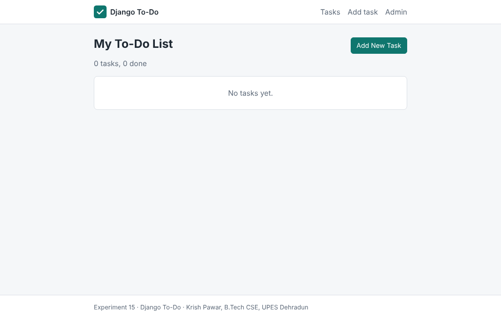

The CSS, the logo and the favicon all come from `todo/static/`. In the browser the favicon URL was `http://127.0.0.1:8000/static/todo/img/logo.svg`.

### 7.3 Create: adding a task

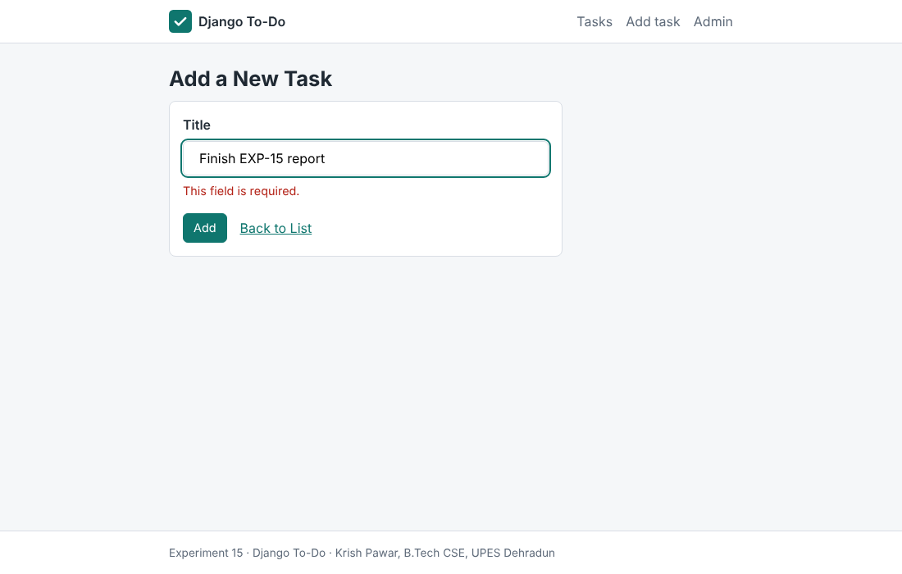

Submitting a title of only spaces shows the form again with the error, and nothing is saved:

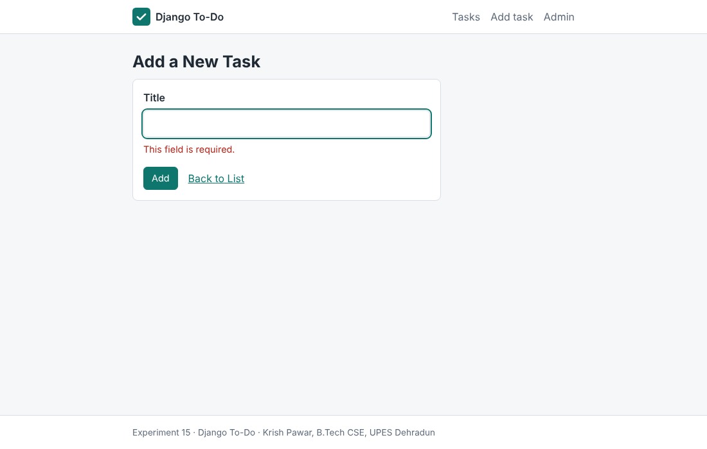

After adding four tasks (the title `"  Finish EXP-15 report  "` was saved as `Finish EXP-15 report`, without the spaces). The title `<b>not bold</b> title` is shown as text, not as bold HTML, because Django escapes variables:

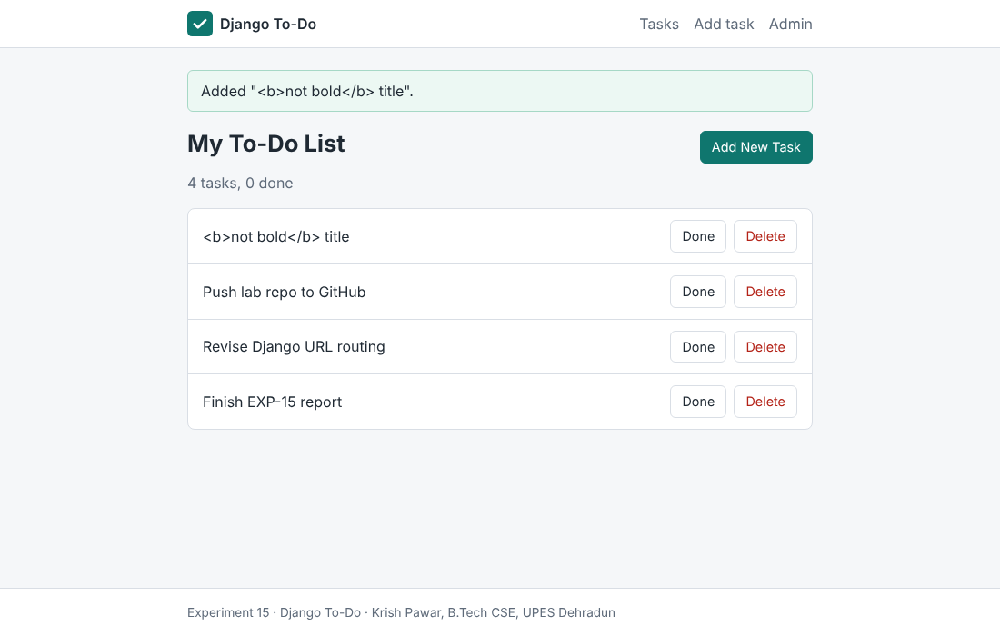

### 7.4 Update: Done and Undo

Two tasks marked done. The summary line counts them:

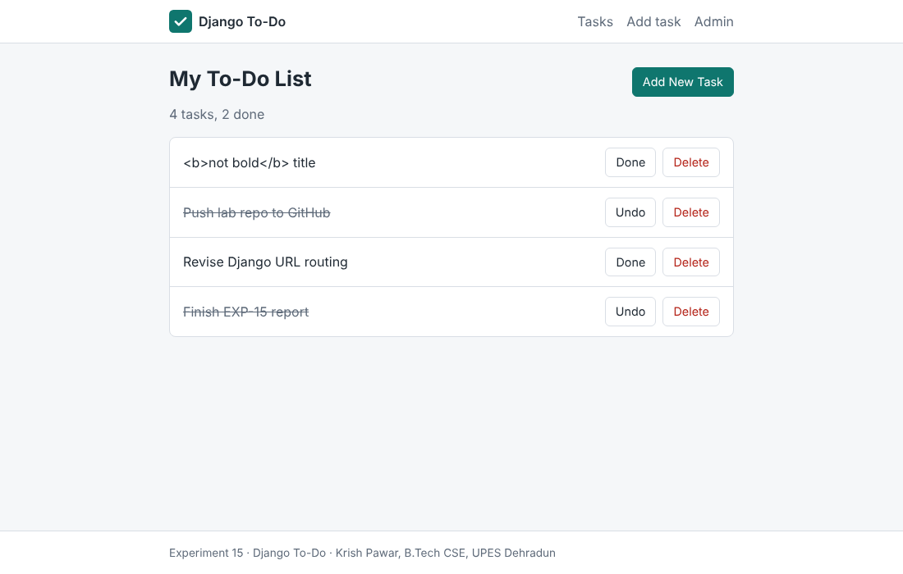

### 7.5 Delete

Clicking Delete opens the browser's "Delete "...?" box from `app.js`. In the test, Cancel left the task in the list, OK deleted it and showed the message:

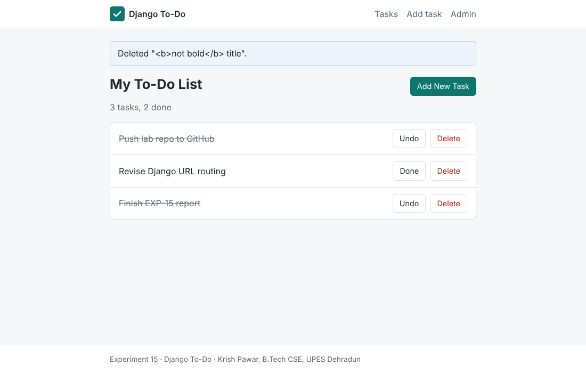

### 7.6 Phone width

At 375px the buttons move under the title. I checked `/` and `/add/` at 320, 375, 414, 768, 1024 and 1440px: no page was wider than the screen.

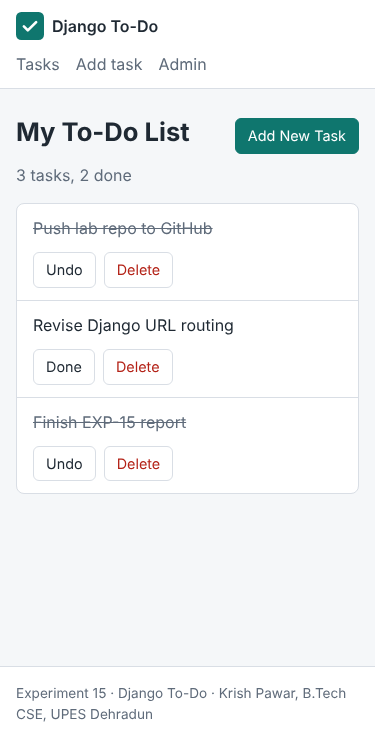

### 7.7 Admin site

Logged in as the superuser. The list shows the three columns, a filter by "completed" and a search box:

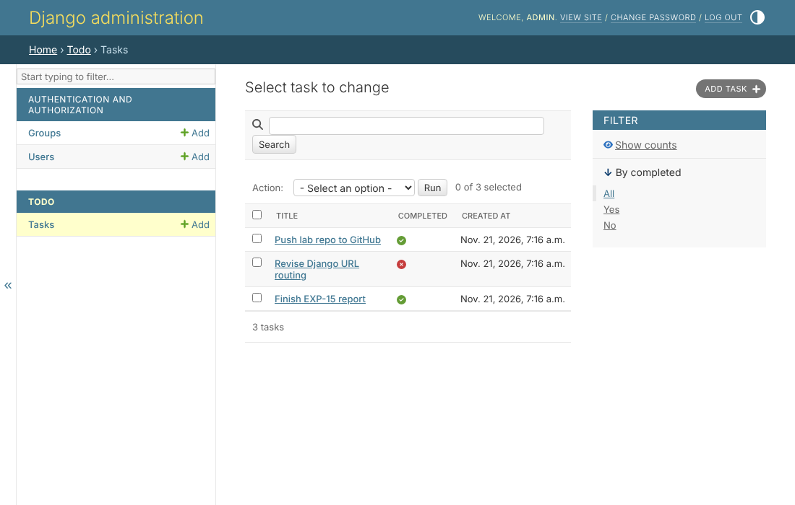

### 7.8 Tests

```
$ python manage.py test -v 2
...
test_add_task (todo.tests.AddTaskTests.test_add_task) ... ok
test_blank_and_spaces_only_titles_are_rejected (todo.tests.AddTaskTests.test_blank_and_spaces_only_titles_are_rejected) ... ok
test_post_without_csrf_token_is_refused (todo.tests.AddTaskTests.test_post_without_csrf_token_is_refused) ... ok
test_title_longer_than_200_is_rejected (todo.tests.AddTaskTests.test_title_longer_than_200_is_rejected) ... ok
test_empty_list (todo.tests.TaskListTests.test_empty_list) ... ok
test_list_uses_base_template_and_partials (todo.tests.TaskListTests.test_list_uses_base_template_and_partials) ... ok
test_static_files_are_linked (todo.tests.TaskListTests.test_static_files_are_linked) ... ok
test_title_is_escaped (todo.tests.TaskListTests.test_title_is_escaped) ... ok
test_delete (todo.tests.ToggleAndDeleteTests.test_delete) ... ok
test_get_does_not_change_anything (todo.tests.ToggleAndDeleteTests.test_get_does_not_change_anything) ... ok
test_toggle_twice (todo.tests.ToggleAndDeleteTests.test_toggle_twice) ... ok
test_unknown_id_gives_404_not_500 (todo.tests.ToggleAndDeleteTests.test_unknown_id_gives_404_not_500) ... ok

----------------------------------------------------------------------
Ran 12 tests in 0.049s

OK
```

The same 12 tests also pass with Django 5.2.19. As a check that the tests really test something, I ran them against the sheet's original `views.py` and templates: **6 failed and 1 gave an error** (the 500 for a missing task).

`test_list_uses_base_template_and_partials` checks the Lab Assignment: the list page is built from `task_list.html`, `base.html` and all four partials. `test_static_files_are_linked` checks that the page links `/static/todo/css/style.css`, `/static/todo/js/app.js` and `/static/todo/img/logo.svg`.

### 7.9 Data stays after a restart

I stopped the server and started it again. The list still said `3 tasks, 2 done`, because the tasks are in `db.sqlite3`, not in memory.

## 8. Testing the sheet's original code

I ran the sheet's code unchanged (it is in `sheet-code/`) on port 8001 and sent it requests with Django's test client and with Chromium.

```
GET /                                                   -> 200
POST /add/ title='Buy milk'                             -> 302 /
POST /add/ title='   ' (spaces only)                    -> 302 /
POST /add/ title='' (empty)                             -> 302 /
POST /add/ title=300 x 'a'                              -> 302 /
POST /add/ title='<b>bold</b>'                          -> 302 /
tasks in database: [(1, "'Buy milk'", 8), (2, "'   '", 3), (3, "'aaaaaaaaaaaa'...", 300), (4, "'<b>bold</b>'", 11)]
'<b>bold</b>' in page as raw HTML? False | escaped? True
GET /toggle/1/  (a plain link click)                    -> 302 /
task 1 completed now: True
GET /toggle/999/  (no such task)                        -> 500
GET /delete/999/  (no such task)                        -> 500
GET /delete/2/  (a plain link click)                    -> 302 /
task 2 still exists: False
POST /add/ without a CSRF token (real browser rules)    -> 403
```

What this shows: the basic operations work and Django's escaping and CSRF check work, but a spaces-only title and a 300 character title are saved, a missing id crashes, and a plain GET deletes a task. In the browser the sheet's list shows the spaces-only task as a row with only the links in it (the middle row):

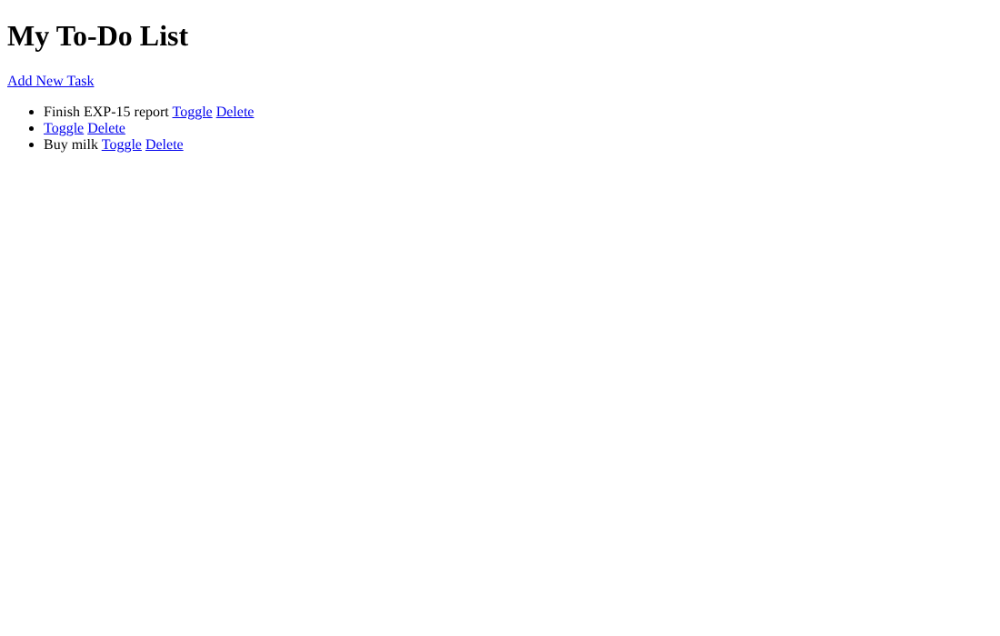

## 9. Problems faced and Windows vs macOS differences

| # | Problem | Cause | Fix |
|---|---|---|---|
| 1 | `makemigrations` failed with `RuntimeError: Model class todo.models.Task doesn't declare an explicit app_label and isn't in an application in INSTALLED_APPS.` | My edit to add `'todo'` did not apply. The `settings.py` made by Django 6.1 uses double quotes (`"django.contrib.staticfiles",`) while the sheet shows single quotes, so my search for the single-quoted line found nothing | Added `"todo",` to `INSTALLED_APPS`. Both quote styles work in Python; the line just has to be there |
| 2 | `/toggle/999/` and `/delete/999/` gave a **500** error, a yellow "DoesNotExist" page (below) | `Task.objects.get()` raises `DoesNotExist` when nothing matches, and nothing catches it. This happens for real when a task is deleted in one tab and Toggle is clicked in another | `get_object_or_404()`, which answers 404. With `DEBUG` off, Django shows my `404.html`, which extends `base.html` (below) |
| 3 | A page on another site deleted a task just by being opened (below) | Toggle and Delete were GET links. The other page contained ``; the browser requested that "image", and the server log shows `"GET /delete/1/ HTTP/1.1" 302`: the task was gone | `@require_POST` on both views, and the buttons are forms with <code>&#123;% csrf_token %&#125;</code>. Now the same `` gets `405 Method Not Allowed`, and a POST without the token gets `403 Forbidden`. The fixed app still had all 3 tasks after visiting that page |
| 4 | A title of only spaces was saved and shown as an empty row | The `required` attribute only blocks a completely empty box ("Please fill out this field."), and on the server `if "   ":` is true | `TaskForm` strips the spaces, then "required" fails: "This field is required." |
| 5 | A 300 character title was saved, although the model says `max_length=200` | SQLite does not enforce the length of `varchar(200)`. `max_length` is checked by forms, not by `Model.objects.create()` | `TaskForm` checks it: "Ensure this value has at most 200 characters (it has 201)." |
| 6 | Wrong input gave no message: the sheet's view silently redirects to the list | No form errors are passed back | `add_task.html` shows the form's errors, and Django messages confirm add and delete |
| 7 | On Django 5.2, `check` printed warning `models.W042: Auto-created primary key used when not defining a primary key type` | Django 6 uses `BigAutoField` for ids by default and the migration was made with it; Django 5.2 defaults to `AutoField` | `default_auto_field = "django.db.models.BigAutoField"` in `todo/apps.py`. Now `check` is clean and `makemigrations --check` finds no changes on both versions |
| 8 | `collectstatic` failed: `ImproperlyConfigured: You're using the staticfiles app without having set the STATIC_ROOT setting to a filesystem path.` | The generated settings have `STATIC_URL` but no `STATIC_ROOT` | Added `STATIC_ROOT = BASE_DIR / "staticfiles"`. Then: `133 static files copied` (my 3 plus the admin's). `staticfiles/` is in `.gitignore` |
| 9 | With `DEBUG` off the page had no styling | `runserver` serves static files only when `DEBUG` is on. I checked `style.css`: 200 with `DEBUG` on, **404** with `DEBUG` off, 200 again with `runserver --insecure` | For trying `DEBUG` off on your own computer use `--insecure`. On a real server, run `collectstatic` and let the web server send `staticfiles/` |
| 10 | The custom `404.html` did not appear while testing | With `DEBUG` on, Django shows its own technical "Page not found (404)" page instead | Expected. Screenshot 12 was taken with `DEBUG` off (`DJANGO_DEBUG=0`) |
| 11 | `pip install django` installs different versions on different computers | Django 6.x needs Python 3.12+. On Python 3.10 and 3.11, pip installs 5.2 | `requirements.txt` says `Django>=5.2,<7`, and the app is tested on 5.2.19 and 6.1.3 |
| 12 | The secret key is written in `settings.py`, and the repository is public | `startproject` puts a random key there for local development | Kept it for running the lab, but `settings.py` now reads `DJANGO_SECRET_KEY` and `DJANGO_DEBUG` from the environment when they are set, so a real deployment does not use the public key |

Problem 2, the sheet's code. A missing task crashes the view:

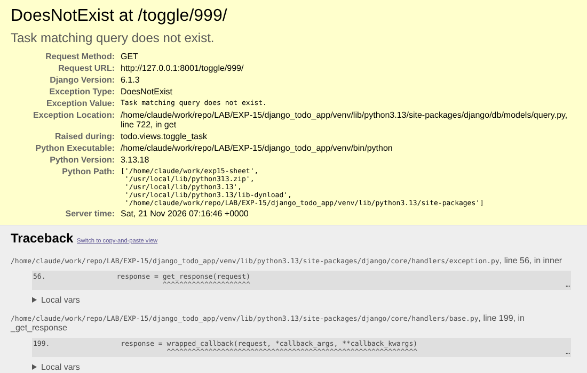

Problem 2, the fix, with `DEBUG` off. The same layout as every other page, because `404.html` extends `base.html`:

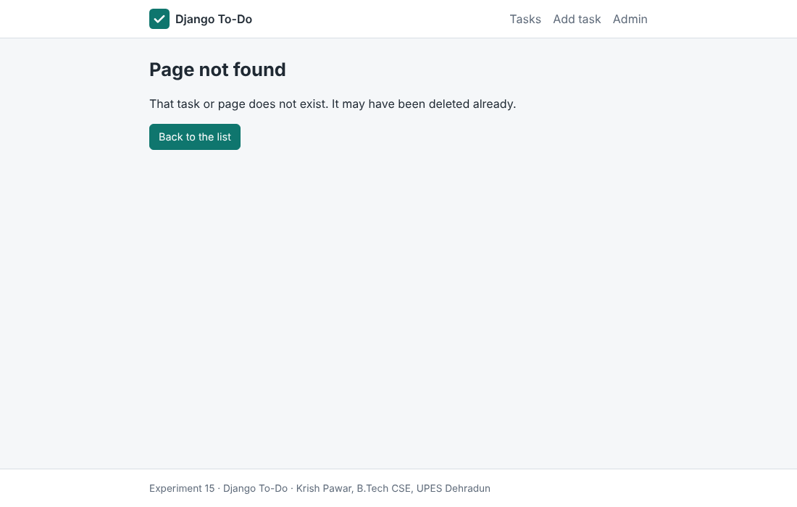

Problem 3. Only opening this page (on port 8002) deleted task 1 of the sheet version on port 8001. The fixed version on port 8000 answered 405 and kept its tasks:

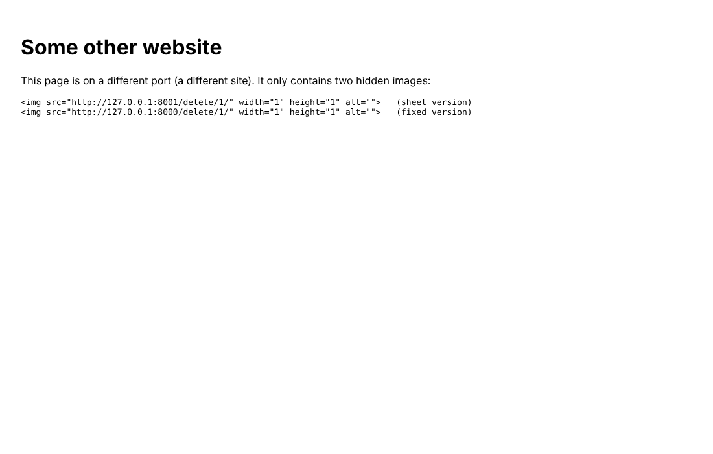

### 9.1 Windows vs macOS

I ran everything on Linux, which behaves like macOS here. The Windows commands are the ones from the Python and Django documentation; I did not run them on a Windows computer.

| Task | macOS / Linux | Windows |
|---|---|---|
| Python command | `python3` (on macOS `python` may not exist outside a venv) | `python` or `py` |
| Activate venv | `source venv/bin/activate` | Command Prompt: `venv\Scripts\activate`. PowerShell: `venv\Scripts\Activate.ps1` |
| PowerShell says "running scripts is disabled on this system" | does not happen | Run once: `Set-ExecutionPolicy -Scope CurrentUser RemoteSigned`, or use Command Prompt |
| Leave venv | `deactivate` | `deactivate` |
| Run with `DEBUG` off | `DJANGO_DEBUG=0 python manage.py runserver --insecure` | PowerShell: `$env:DJANGO_DEBUG="0"; python manage.py runserver --insecure`. Command Prompt: `set DJANGO_DEBUG=0` then the command |
| Port 8000 already in use | `lsof -i :8000` to find the process | `netstat -ano \| findstr :8000` to find the PID |
| Paths | `todo/static/todo/css/style.css` | `todo\static\todo\css\style.css` on disk, but always forward slashes inside <code>&#123;% static %&#125;</code> and in URLs |
| Stop the server | `Ctrl + C` | `Ctrl + C` (or `Ctrl + Break`) |

## 10. Observations (what I learned)

1. Django's layers are clearly split: the model only knows data, the view only knows the request, the template only knows how to show it. Changing the add form to a `ModelForm` did not need any change to the model or the URLs.
2. `Model.objects.get()` is for when the object must exist. In a view, where the id comes from the URL, `get_object_or_404()` is the right call.
3. A database column type is not a check. SQLite saved 300 characters into `varchar(200)`. The check lives in the form.
4. HTTP methods matter. A link (GET) that changes data can be triggered by any page, an `` tag or a link preview. POST plus the CSRF token stops that, and `@require_POST` makes the view refuse anything else.
5. Django escapes every <code>&#123;&#123; variable &#125;&#125;</code> by default, so a task titled `<script>` is shown as text. This was already true in the sheet's version.
6. `extends` and `include` removed all repeated HTML. The header, footer, favicon and CSS link exist once, and the 404 page got the same look by adding one line.
7. Static files go in `app/static/app/`, and templates in `app/templates/app/`. The repeated app name looks strange at first, but it prevents clashes between apps.
8. `DEBUG` changes a lot: error pages, the 404 page and whether static files are served. Testing with `DEBUG` off showed things that were invisible before.
9. Django's test client made it easy to test every view, including the error cases, without starting a server.

## 11. Viva questions

1. **What is MVT?** Model (data and database table), View (Python function that handles a request), Template (HTML with placeholders).
2. **Project vs app?** A project is the whole site with its settings. An app is one part with its own models, views and templates. A project can have many apps.
3. **What does the `.` in `django-admin startproject todo_project .` do?** It creates the project in the current folder instead of an extra folder with the same name.
4. **`makemigrations` vs `migrate`?** `makemigrations` writes migration files from the model changes. `migrate` applies them to the database.
5. **Where is the data stored?** In `db.sqlite3`, an SQLite database file in the project folder.
6. **What is <code>&#123;% csrf_token %&#125;</code> for?** It adds a hidden secret value to the form. Django checks it on every POST, so a form on another site cannot post to this one: it gets 403 Forbidden.
7. **Why use POST for toggle and delete?** GET must not change data. Pages, images and link previews can send GET requests without the user clicking anything.
8. **`get()` vs `get_object_or_404()`?** `get()` raises `DoesNotExist` (a 500 error in a view). `get_object_or_404()` turns that into a 404 response.
9. **How does Django find static files?** `django.contrib.staticfiles` looks in each app's `static/` folder. <code>&#123;% static 'path' %&#125;</code> builds the URL from `STATIC_URL`.
10. **What does `collectstatic` do?** Copies the static files of all apps into `STATIC_ROOT`, so one web server can serve them.
11. **`extends` vs `include`?** `extends` makes a page a child of a layout and fills its blocks. `include` inserts a smaller template at one place.
12. **What happens to the `title` field if a user types `"  hi  "`?** The form strips it to `"hi"` before saving.
13. **How do you open the admin?** `createsuperuser`, run the server, go to `/admin/` and log in. The model shows up because it is registered in `admin.py`.

## 12. Result

The To-Do app was built with Django 6.1.3 and SQLite and runs at `http://127.0.0.1:8000/`. Tasks can be added, listed, marked done or not done, and deleted, and they stay after a restart. The Lab Assignment is done: the CSS, JavaScript and logo are served from `todo/static/todo/` with <code>&#123;% static %&#125;</code>, and all pages extend one `base.html` and include four partials. The four problems found in the sheet's code (500 on a missing task, delete by GET, spaces-only title, over-long title) are fixed, and 12 tests pass on Django 6.1.3 and 5.2.19.

## 13. Conclusion

Django gives a working CRUD app with very little code: a model, four views, a URL list and two templates. Testing it with wrong input showed what the short version leaves out: checking input, handling missing objects, and using POST for changes. The Lab Assignment showed how a real Django project avoids repeating itself: static files in a namespaced `static/` folder, and templates built from one layout and small parts.

## 14. References

1. Django documentation: *Writing your first Django app*. <https://docs.djangoproject.com/en/stable/intro/tutorial01/>
2. Django documentation: *How to manage static files*. <https://docs.djangoproject.com/en/stable/howto/static-files/>
3. Django documentation: *The Django template language* (template inheritance). <https://docs.djangoproject.com/en/stable/ref/templates/language/#template-inheritance>
4. Django documentation: *Built-in template tags* (`extends`, `include`, `static`). <https://docs.djangoproject.com/en/stable/ref/templates/builtins/>
5. Django documentation: *Django shortcut functions* (`get_object_or_404`). <https://docs.djangoproject.com/en/stable/topics/http/shortcuts/>
6. Django documentation: *View decorators* (`require_POST`). <https://docs.djangoproject.com/en/stable/topics/http/decorators/>
7. Django documentation: *Cross Site Request Forgery protection*. <https://docs.djangoproject.com/en/stable/ref/csrf/>
8. Django documentation: *Creating forms from models*. <https://docs.djangoproject.com/en/stable/topics/forms/modelforms/>
9. Python documentation: *venv*. <https://docs.python.org/3/library/venv.html>
