# Experiment 4: Create Responsive Web Pages with Bootstrap and Tailwind CSS

**Course:** Backend Development Lab  
**Student:** Krish Pawar · B.Tech CSE · SAP ID 590017543 · UPES Dehradun  
**Date:** 21 November 2026

**Live pages:** [Experiment 4 hub](./index.html) · [Bootstrap page](./exp04-bootstrap.html) · [Tailwind page](./exp04-tailwind.html)  
**Source:** [`LAB/EXP-4` on GitHub](https://github.com/Krish252616/backend-development/tree/main/LAB/EXP-4)

---

## 1. Aim

To build the same responsive page twice, once with **Bootstrap 5** (component-based) and once with **Tailwind CSS** (utility-first), and to compare the two approaches by their classes, responsive behaviour and file size.

## 2. Objectives

1. Load Bootstrap and Tailwind from a CDN.
2. Use Bootstrap's navbar, 12-column grid, cards, buttons and spacing classes.
3. Build the same parts with Tailwind's flex, grid, spacing, color and responsive prefix utilities.
4. Add a contact form in both (Exercises 1 and 2).
5. Count and compare the classes in both pages (Exercise 3).

## 3. Tools and environment

| Item | Detail |
|---|---|
| Bootstrap | 5.3.3, CSS and JS bundle from `cdn.jsdelivr.net` |
| Tailwind CSS | Play CDN script from `cdn.tailwindcss.com` (Tailwind 3). Version 3.4.17 from npm was used to measure sizes |
| Editor and browser | VS Code with Live Server, Google Chrome DevTools device toolbar |
| Hosting | GitHub Pages |

## 4. Theory

### 4.1 Two approaches

| | Bootstrap | Tailwind CSS |
|---|---|---|
| Approach | **Component-based:** ready classes like `.navbar`, `.card`, `.btn-primary` | **Utility-first:** one small class per CSS property, like `bg-white`, `p-6`, `rounded-xl` |
| Look out of the box | Bootstrap's own design | No design until you build it |
| JavaScript | Bundle for the navbar toggle, modals, dropdowns | None. Interactive parts need your own JS |
| Customising | Sass variables, or overriding its CSS | `tailwind.config.js` (theme colors, fonts, spacing) |

### 4.2 Bootstrap grid and breakpoints

The grid has 12 columns: `col-6` takes 6 of 12 (50%). A breakpoint prefix makes the width apply **from that size upward**:

| Prefix | From | Used here |
|---|---|---|
| (none) `col-` | 0px | |
| `sm` | 576px | |
| `md` | 768px | Service cards 2 per row, form name and email side by side |
| `lg` | 992px | Navbar expands, hero becomes 2 columns, cards 3 per row |
| `xl` | 1200px | |
| `xxl` | 1400px | |

Spacing pattern `{m|p}{t|b|s|e|x|y}-{0..5|auto}`: `p-3` = 1rem padding, `mt-2` = 0.5rem top margin, `mx-auto` centers.

### 4.3 Tailwind utilities and breakpoints

Spacing scale: 1 unit = 0.25rem = 4px, so `p-4` = 16px and `gap-6` = 24px. Responsive prefixes are also mobile-first, but the sizes are **different from Bootstrap's**:

| Prefix | From | Used here |
|---|---|---|
| `sm:` | 640px | |
| `md:` | 768px | Menu button hidden, links in a row, cards 2 per row, form 2 columns |
| `lg:` | 1024px | Hero becomes a row, cards 3 per row |
| `xl:` | 1280px | |
| `2xl:` | 1536px | |

So between **992px and 1023px** the Bootstrap hero is already 2 columns while the Tailwind hero is still stacked.

### 4.4 Size in production

Measured on this page:

| | File | Size (minified) | Gzipped |
|---|---|---|---|
| Bootstrap 5.3.3 CSS | `bootstrap.min.css`, every component included | 232,803 bytes (227 KB) | 31,079 bytes (30 KB) |
| Bootstrap 5.3.3 JS | `bootstrap.bundle.min.js` | 80,721 bytes (79 KB) | |
| Tailwind 3.4.17 CSS | Built for `exp04-tailwind.html`, only the classes it uses | 10,531 bytes (10.3 KB) | 2,776 bytes (2.7 KB) |
| Tailwind with no classes | Only Tailwind's base reset ("preflight") | 4,754 bytes | |

> **Note on the lab sheet.** The sheet says Tailwind needs **PurgeCSS** and is about 3 MB without it. That was true for Tailwind 2. Tailwind 3 has a just-in-time engine that scans your files and only ever generates the classes you use, so there is nothing to purge. The 10.3 KB above came straight out of the Tailwind CLI. The sheet's "about 3 KB" matches the gzipped size.

The Play CDN script (`cdn.tailwindcss.com`) builds the CSS in the browser on every visit. Tailwind's documentation describes it as meant for development, not production. For a real site you run the Tailwind CLI and link the generated CSS file.

## 5. Files

| File | What it is |
|---|---|
| `index.html` | Hub page with links and the Exercise 3 table |
| `exp04-bootstrap.html` | Final Bootstrap page: Task 4 + fixes + Exercise 1 contact form |
| `exp04-tailwind.html` | Final Tailwind page: Task 8 + fixes + Exercise 2 contact form |
| `steps/task1-bootstrap.html` to `steps/task8-tailwind.html` | The eight steps of the sheet, each as its own page |
| `images/hero.svg` | Hero image, drawn by me as an SVG (500 x 300): a page as columns on a desktop and stacked on a phone |
| `count-classes.js` | Exercise 3: counts the classes in both pages. Run `node count-classes.js` |

## 6. Procedure

1. Wrote the four Bootstrap steps and the four Tailwind steps as given in the sheet.
2. Opened every step and both final pages in Chrome at 1440, 1024, 992, 800, 768, 600, 375 and 320px wide and checked for sideways scrolling, broken images and wrapped buttons.
3. Fixed the problems found (section 8) in the final pages, and replaced the placeholder image in every page.
4. Added the contact form to both pages, tested empty, invalid and valid submits.
5. Counted the classes with `count-classes.js`.

**How to run**

| Step | macOS | Windows |
|---|---|---|
| Open the hub | `open index.html` | `start index.html` |
| Internet | Needed: Bootstrap and Tailwind come from a CDN | Same |
| Phone sizes | DevTools (`Cmd + Option + I`), `Cmd + Shift + M` | DevTools (`F12`), `Ctrl + Shift + M` |
| Exercise 3 | `node count-classes.js` in `LAB/EXP-4` | Same, in Command Prompt or PowerShell |

## 7. Output

### 7.1 Bootstrap steps

Task 2, navbar:

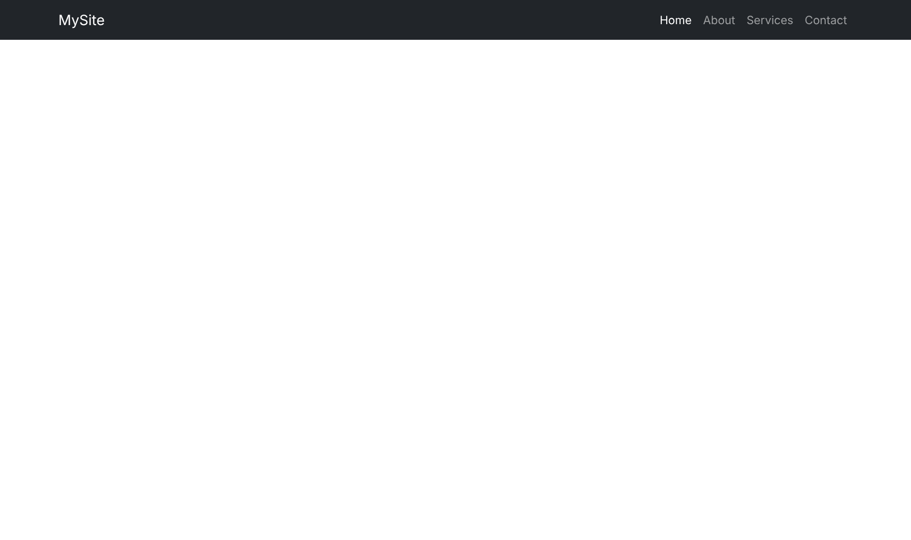

Task 3, hero with `col-lg-6`:

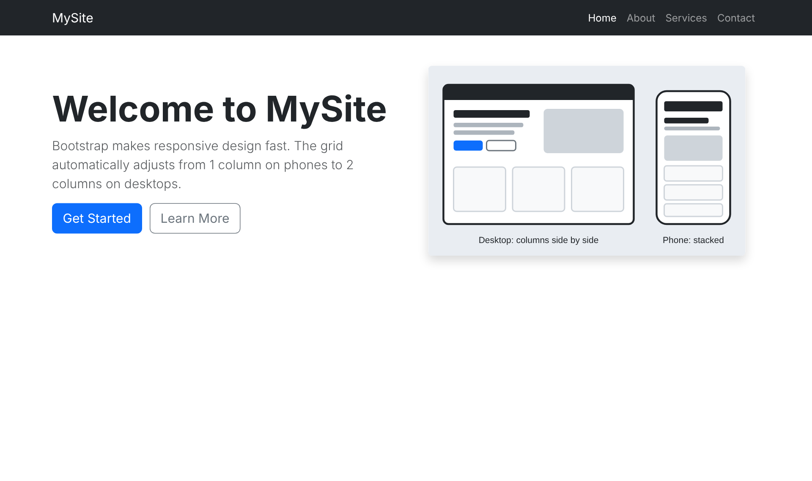

Task 4, cards and footer:

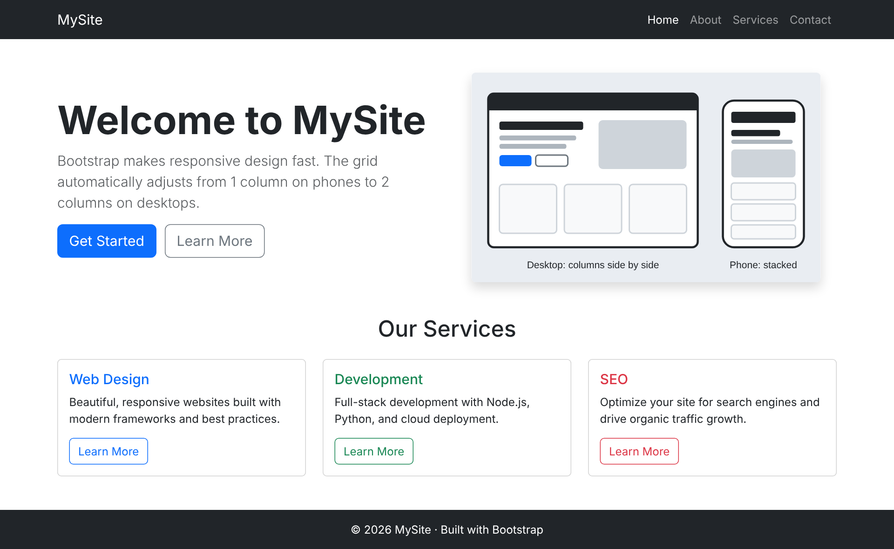

### 7.2 Tailwind steps

Task 6, navbar from utilities:

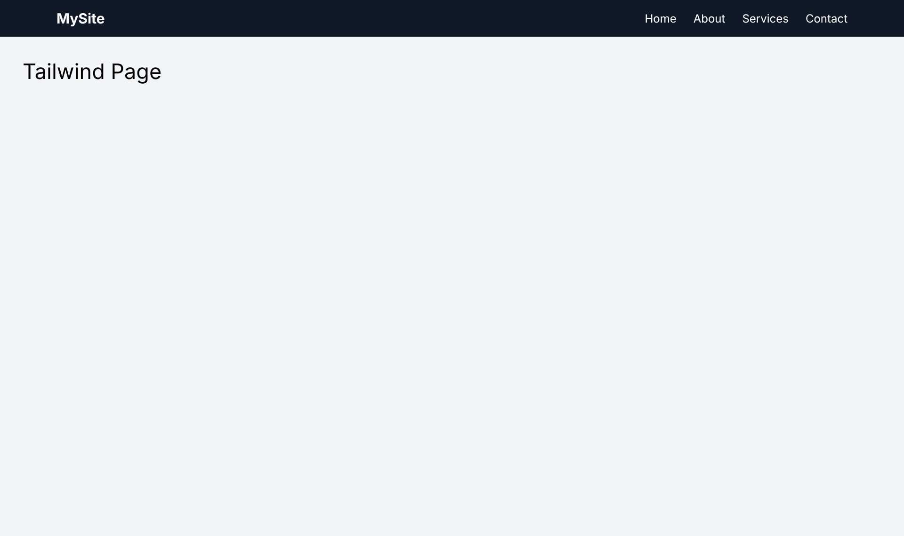

Task 7, hero with `flex-col lg:flex-row`:

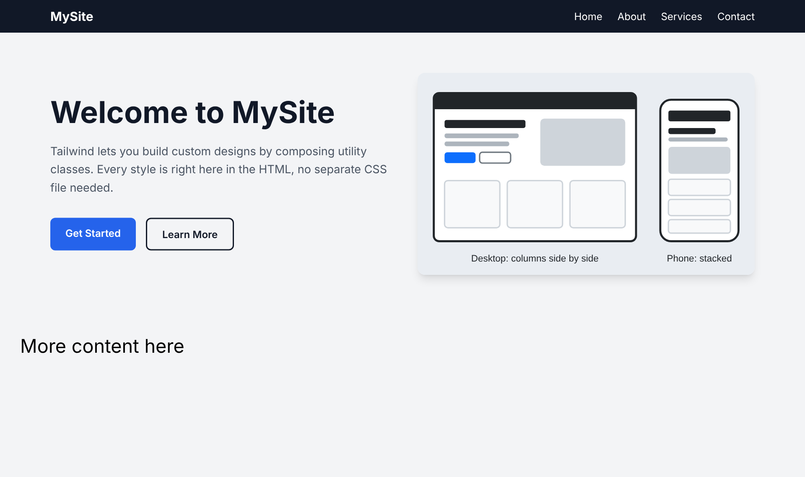

Task 8, card grid and footer:

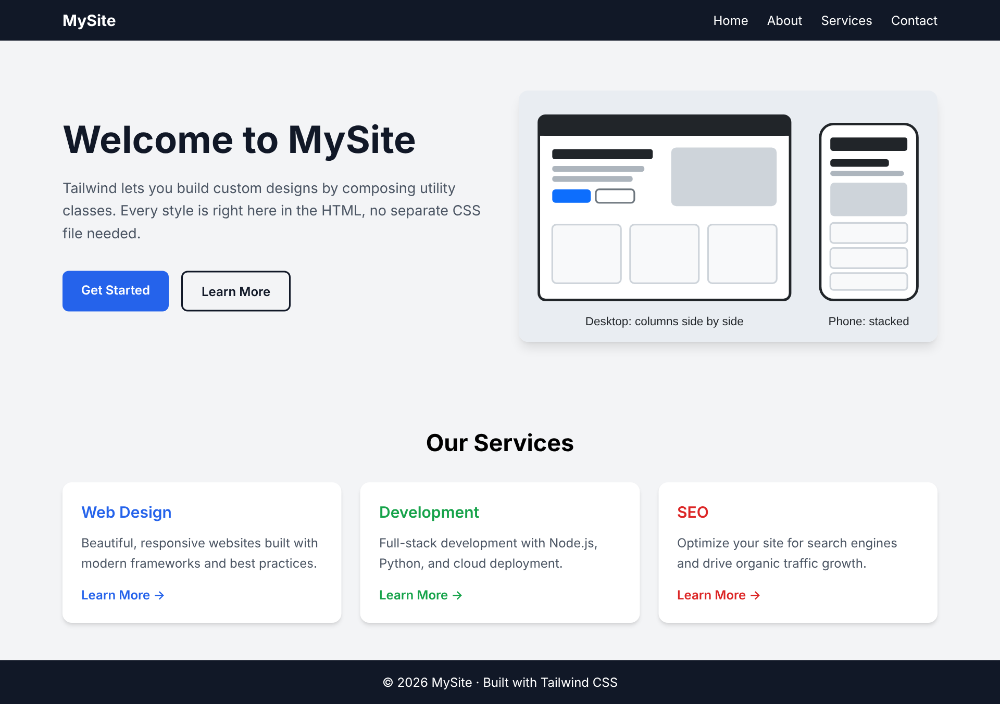

### 7.3 Final Bootstrap page

Desktop (1280px): hero in 2 columns, cards 3 per row, form with name and email side by side:


Tablet (800px): below 992px the navbar collapses and the hero stacks, cards 2 per row:


Phone (375px): everything in one column:

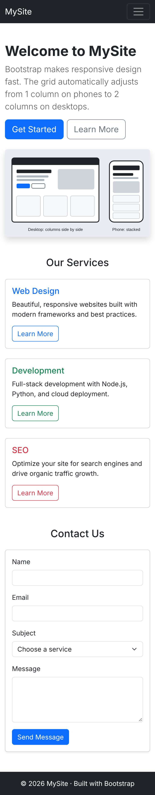

The menu button opens the links (Bootstrap's JS sets `aria-expanded="true"`):

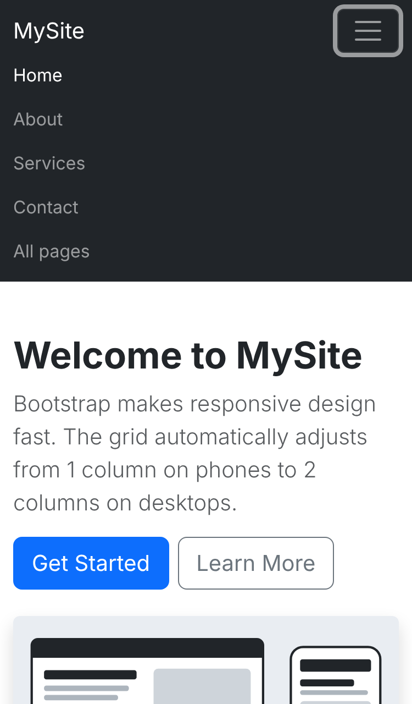

### 7.4 Final Tailwind page

Desktop (1280px):


Tablet (800px): above 768px the links are in a row; the hero stays stacked until 1024px:


Phone (375px):

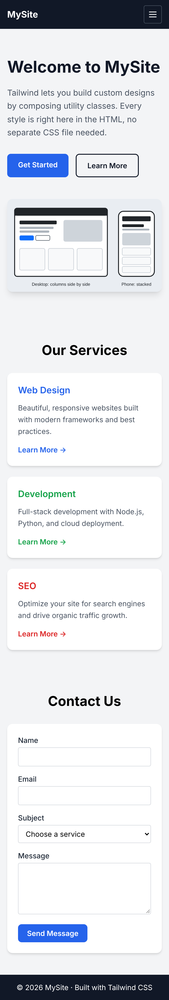

The menu button added for phones (section 8.2):


### 7.5 Exercises 1 and 2: contact forms

Both forms have the same fields and rules: name, email, subject and a message of at least 10 characters. Empty submit, Bootstrap (`was-validated`, `invalid-feedback`):

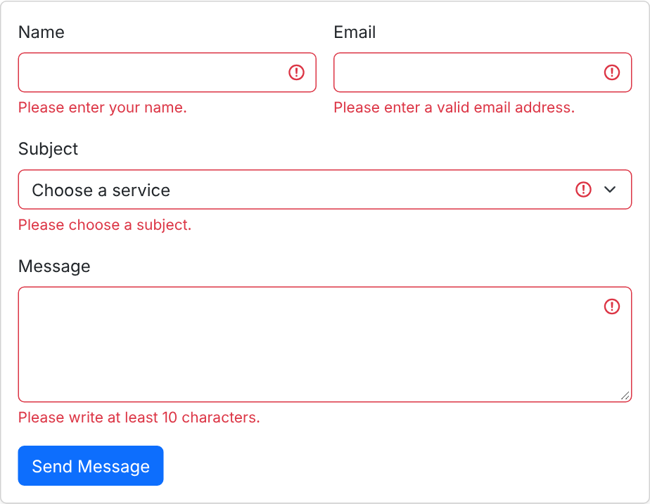

Empty submit, Tailwind (`group-[.submitted]:invalid:border-red-600` and `peer-invalid:block`):

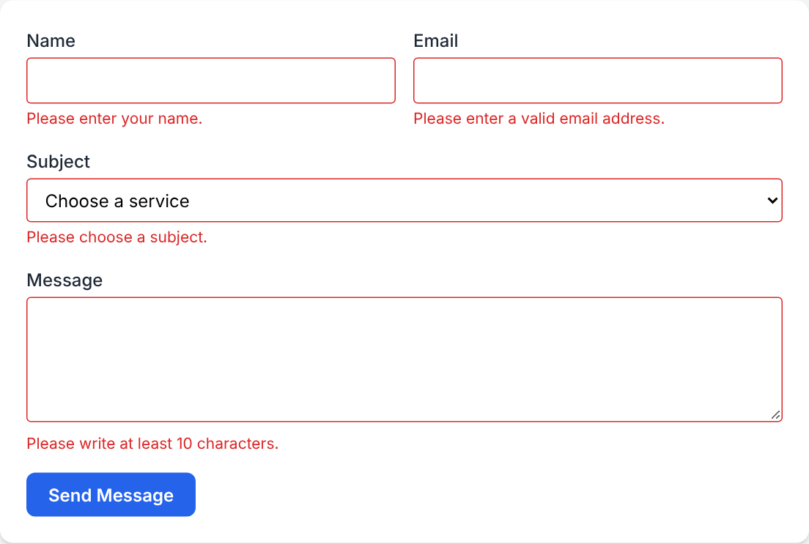

Valid submit. There is no server in this lab, so the page only confirms the data is valid:


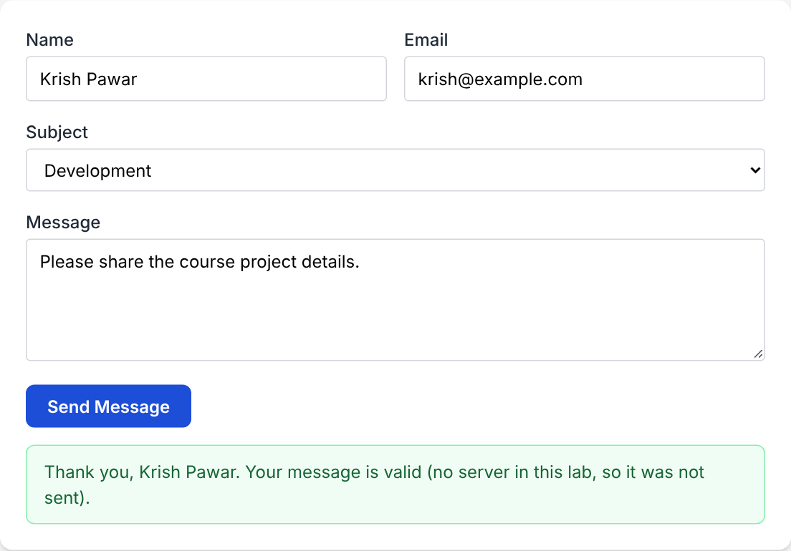

Tested: an empty form showed all 4 messages in both pages, a valid form showed the confirmation, and an email of `krish@` hid the confirmation again.

### 7.6 Exercise 3: class count

```text
$ node count-classes.js
┌────────────────────────────────┬──────────┬───────┬────────┬────────────┬─────────┐
│ (index)                        │ elements │ total │ unique │ perElement │ longest │
├────────────────────────────────┼──────────┼───────┼────────┼────────────┼─────────┤
│ Bootstrap, whole page          │ 75       │ 126   │ 67     │ '1.7'      │ 5       │
│ Tailwind, whole page           │ 57       │ 266   │ 97     │ '4.7'      │ 12      │
│ Bootstrap, steps/task4 (sheet) │ 47       │ 85    │ 51     │ '1.8'      │ 4       │
│ Tailwind, steps/task8 (sheet)  │ 34       │ 124   │ 59     │ '3.6'      │ 9       │
│ Bootstrap, contact form only   │ 24       │ 35    │ 23     │ '1.5'      │ 5       │
│ Tailwind, contact form only    │ 21       │ 117   │ 49     │ '5.6'      │ 12      │
└────────────────────────────────┴──────────┴───────┴────────┴────────────┴─────────┘
```

**Which file has more classes?** Tailwind: 266 class names against Bootstrap's 126 for the same page, and 117 against 35 for the same form. Tailwind uses fewer elements with classes (57 against 75) but puts almost three times as many classes on each.

**Which is easier to read?** Bootstrap, line by line: `form-control` says what the input is in one word, while the Tailwind input needs `peer w-full border border-gray-300 rounded px-3 py-2 focus:outline-none focus:ring-2 focus:ring-blue-500 group-[.submitted]:invalid:border-red-600` for the same thing. But the Tailwind line shows every style right there, so changing one input never needs a look into a CSS file or worrying about which other elements share the class.

### 7.7 Hub page

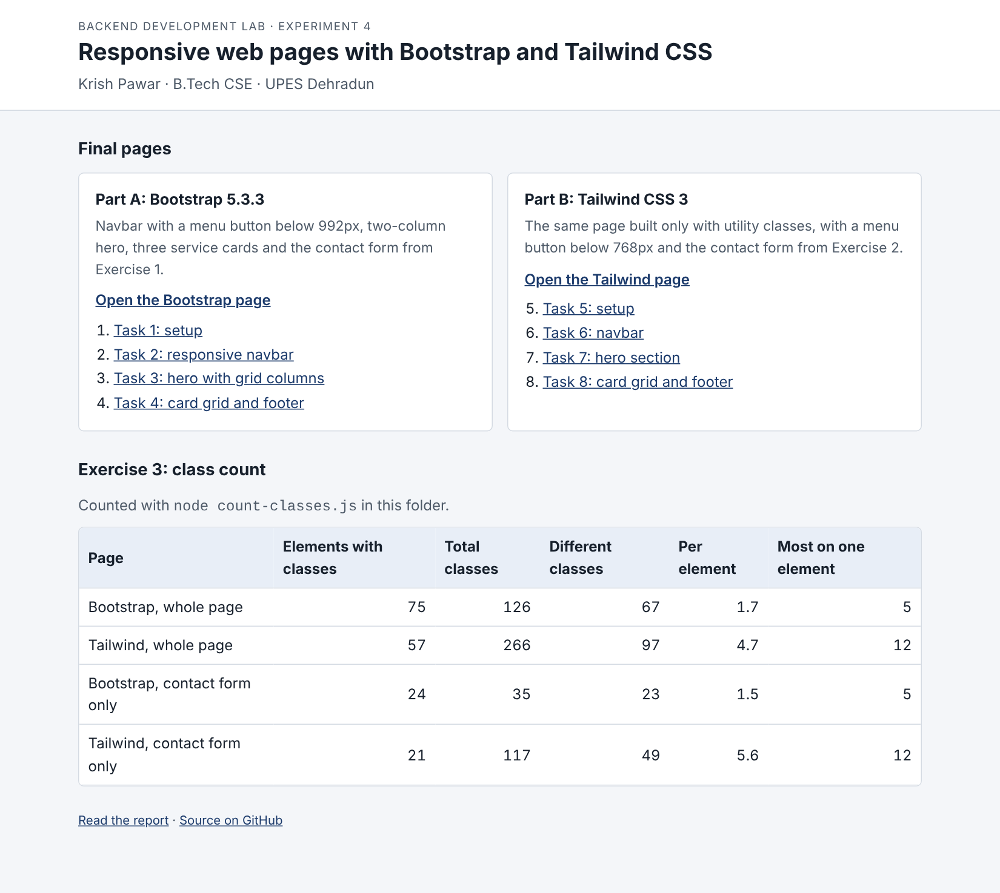

## 8. Problems in the lab sheet's code, and the fixes

### 8.1 Bootstrap hero buttons touched on a narrow phone

At 320px "Learn More" no longer fits next to "Get Started" and wraps. It then sits directly under the first button (both 48px tall, top at 355px and 403px: **0px gap**), and `ms-2` pushes it 8px to the right of the first one.

| Before (sheet) | After |
|---|---|
| 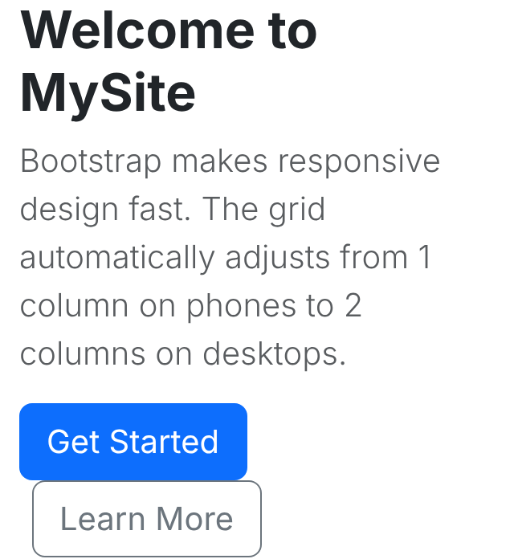 |  |

**Fix:** wrapped both buttons in `<div class="d-flex flex-wrap gap-2">` and removed `ms-2`. The gap is now the same horizontally and vertically, and on the final page both buttons fit in one row at 320px.

### 8.2 Tailwind navbar overflowed on small phones

The sheet's Tailwind navbar is `flex justify-between` with `gap-6` between the links and no rule for small screens. At 320px the page became **371px wide**: "Contact" was cut off and the page scrolled sideways. "MySite" also touched "Home". (The Bootstrap navbar does not have this problem because `navbar-expand-lg` collapses it into a menu button.)

| Before (sheet, 320px) | After (320px) |
|---|---|
|  | 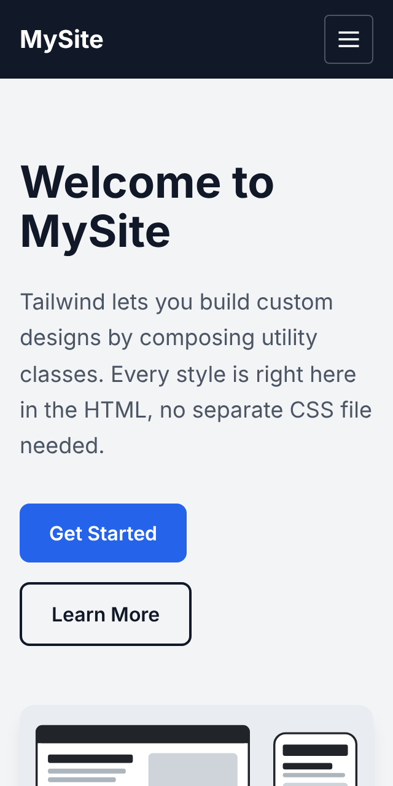 |

**Fix:** a menu button that shows only below 768px (`md:hidden`), a link list that is `hidden` on phones and `md:flex` from 768px, and six lines of JavaScript to toggle it and keep `aria-expanded` correct. This is the Tailwind way: the framework gives the classes, the behaviour has to be written.

### 8.3 Placeholder image

Every hero used `https://via.placeholder.com/500x300`. That service is reported as unreliable or gone ([OpenReplay](https://blog.openreplay.com/top-5-image-placeholder-services/) calls it "now-unreliable"), and when it does not answer the browser shows only the alt text "Hero Image", as in the "before" picture of 8.2. All pages now use `images/hero.svg`, a local file, with `width="500" height="300"` so the browser reserves the space before it loads.

### 8.4 Exercise 1 asks for `form-group`

`form-group` was a Bootstrap 4 class. It does not exist in Bootstrap 5: searching `bootstrap.min.css` 5.3.3 finds it **0 times**, so it would do nothing. Bootstrap 5 uses a spacing utility (`mb-3`) or the grid (`row g-3`) instead. The form uses `row g-3` with `col-md-6` and `col-12`.

### 8.5 Smaller changes

| Change | Reason |
|---|---|
| `aria-controls`, `aria-expanded`, `aria-label` added to Bootstrap's menu button | The button shows only an icon. Without a label a screen reader announces just "button". These are the attributes in Bootstrap's own navbar example |
| Links point to `#services` and `#contact` instead of `#` | So "Learn More" and the menu links actually go somewhere on the page |
| `flex-wrap` added to the Tailwind hero buttons | Same reason as 8.1 |
| Long dashes in the footer and hero text replaced by "·" and "," | Text style only |
| Favicon added to every page | Stops the `favicon.ico` 404 in the Console |

## 9. Observations (what I learned)

1. Bootstrap gives finished components. A working collapsible navbar took one class (`navbar-expand-lg`) and its JS bundle. In Tailwind the same menu needed my own button, classes and script.
2. Tailwind makes every style visible in the HTML. Nothing is hidden in a shared class, so changing one card cannot break another.
3. Both frameworks are mobile-first: classes without a prefix are for phones, prefixes add rules from a width upward. But their breakpoints differ (`lg` is 992px in Bootstrap, 1024px in Tailwind).
4. Testing at several widths finds bugs that a desktop and one phone size miss. Both sheet bugs here appeared only at 320px.
5. Bootstrap's form validation needs no custom CSS: add `needs-validation`, then `was-validated` on submit, and `invalid-feedback` messages appear. Tailwind can do the same with `peer` and `group` variants, but every class has to be written.
6. Size: full Bootstrap CSS is 227 KB (30 KB gzipped) whether a page uses 5 classes or 500. Tailwind generated 10.3 KB (2.7 KB gzipped) for exactly this page.
7. External services in tutorials can disappear. Assets the page depends on should be stored with the page.
8. Class names from older versions (`form-group`) still appear in many tutorials. Checking the framework's own CSS is a quick way to confirm a class exists.

## 10. Problems and Windows vs macOS differences

| # | Problem | Cause | Fix |
|---|---|---|---|
| 1 | Bootstrap buttons touching on phones | `ms-2` only adds a left margin | `d-flex flex-wrap gap-2` (8.1) |
| 2 | Tailwind navbar overflowing at 320px | No small-screen rule | Menu button (8.2) |
| 3 | Hero image not loading | External placeholder service | Local SVG (8.3) |
| 4 | `form-group` has no effect | Removed in Bootstrap 5 | `row g-3`, `mb-3` (8.4) |
| 5 | Pages show no styles at all when opened offline | Both frameworks load from a CDN | Needs an internet connection. For offline use, install them with npm and link the local files |
| 6 | Fonts look slightly different on each system | Both frameworks use the system font stack: San Francisco on macOS, Segoe UI on Windows | Expected. Layout and sizes stay the same |
| 7 | Running Exercise 3 | Needs Node.js | `node count-classes.js` works the same in macOS Terminal and Windows Command Prompt or PowerShell |

## 11. Viva questions

1. **What is Bootstrap's 12-column grid?** A row is split into 12 equal columns, and each column class says how many it takes: `col-md-6` is half the row from 768px up. Below the breakpoint the column takes the full width.
2. **How does Tailwind's spacing scale work?** One unit is 0.25rem (4px): `p-4` is 16px, `p-8` 32px. The same scale is used by margin, gap, width and height.
3. **What is mobile-first in these frameworks?** Classes without a prefix apply at every size, and prefixed classes (`md:`, `col-lg-`) add rules from that width upward.
4. **What does PurgeCSS do, and does Tailwind 3 need it?** PurgeCSS removes unused CSS by scanning the HTML. Tailwind 2 relied on it. Tailwind 3's just-in-time engine generates only the classes it finds, so the output is small from the start (10.3 KB here).
5. **When would you choose Bootstrap over Tailwind?** For a quick prototype or an admin panel, when ready components matter more than a unique design, or when the team knows Bootstrap.
6. **When would you choose Tailwind?** For a custom design, a marketing or product site, or when small CSS matters.
7. **What does `navbar-expand-lg` do?** The navbar shows its links in a row from 992px, and collapses them behind the menu button below that.
8. **Why does Bootstrap need a JavaScript file?** The collapse (menu button), dropdowns, modals and tooltips are behaviour, not styling.
9. **`h-100` on the Bootstrap cards?** Each card is 100% of its column's height, so all cards in a row are the same height.
10. **What is `g-4`?** Gutter (gap) between grid columns and rows, size 4 (1.5rem).
11. **What are `peer` and `group` in Tailwind?** `group` marks a parent and `group-*:` styles a child by the parent's state. `peer` marks an element and `peer-*:` styles a later sibling by that element's state (used for the error messages).
12. **Why is the Tailwind Play CDN not for production?** It builds the CSS in the browser on every page load. In production the CSS is built once with the CLI and served as a normal file.

## 12. Result

The same responsive page was built with Bootstrap 5.3.3 and Tailwind CSS 3, step by step and as two final pages, each with a working contact form. Both pages have no sideways scroll from 1440px down to 320px and working menu buttons on phones. Testing found two layout bugs in the sheet's code (touching buttons in Bootstrap, an overflowing navbar in Tailwind), a dead placeholder image and a removed Bootstrap class in an exercise, and all four were fixed. Exercise 3 measured 266 classes in the Tailwind page against 126 in the Bootstrap page.

## 13. Conclusion

Bootstrap is faster when its components fit: the navbar, grid, cards and form validation worked with very few classes. Tailwind needed more classes and some JavaScript for the menu, but gave full control over the design and produced far less CSS (2.7 KB against 30 KB gzipped). Neither framework removes the need to test at real screen widths, which is how both layout bugs were found.

## 14. References

1. Bootstrap 5.3 documentation: *Navbar*. <https://getbootstrap.com/docs/5.3/components/navbar/>
2. Bootstrap 5.3 documentation: *Grid system*. <https://getbootstrap.com/docs/5.3/layout/grid/>
3. Bootstrap 5.3 documentation: *Validation*. <https://getbootstrap.com/docs/5.3/forms/validation/>
4. Bootstrap 5 documentation: *Migrating to v5* (forms). <https://getbootstrap.com/docs/5.0/migration/#forms>
5. Tailwind CSS v3 documentation: *Responsive design*. <https://v3.tailwindcss.com/docs/responsive-design>
6. Tailwind CSS v3 documentation: *Handling hover, focus, and other states* (`group`, `peer`). <https://v3.tailwindcss.com/docs/hover-focus-and-other-states>
7. OpenReplay blog: *Top 5 image placeholder services*. <https://blog.openreplay.com/top-5-image-placeholder-services/>
