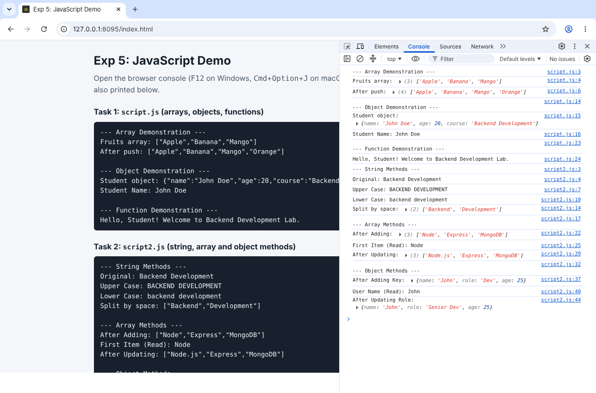
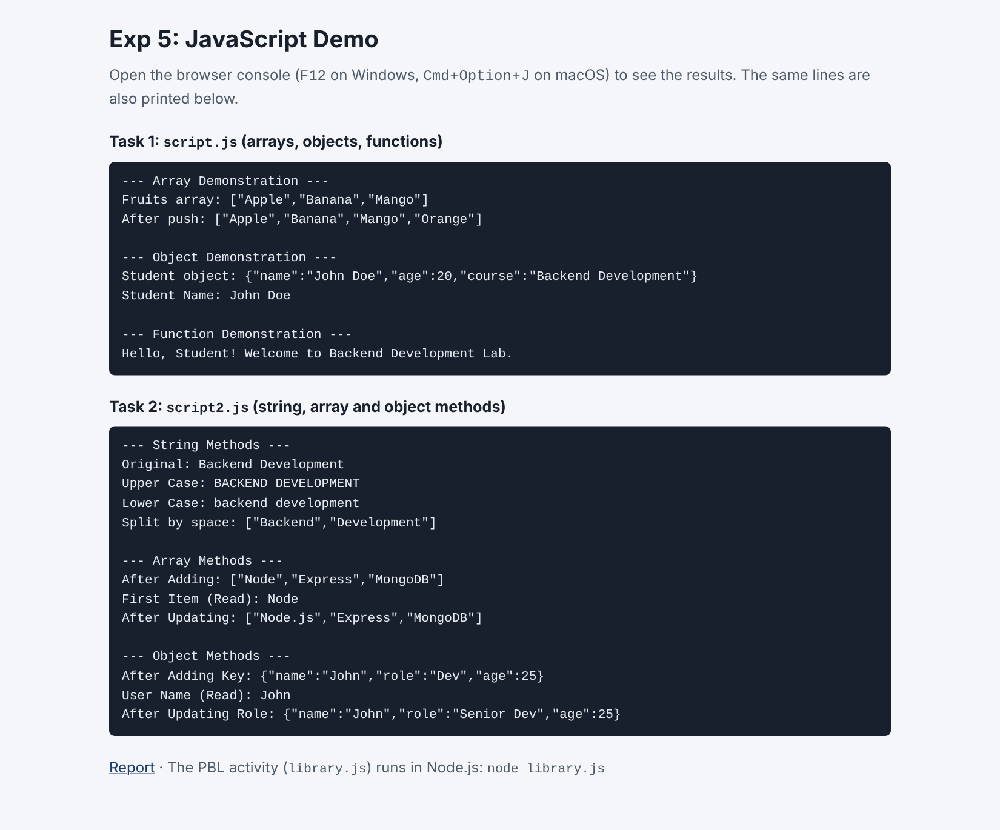
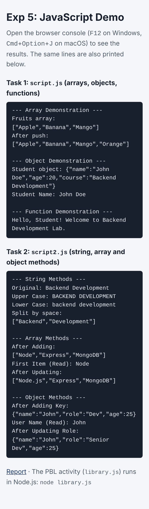
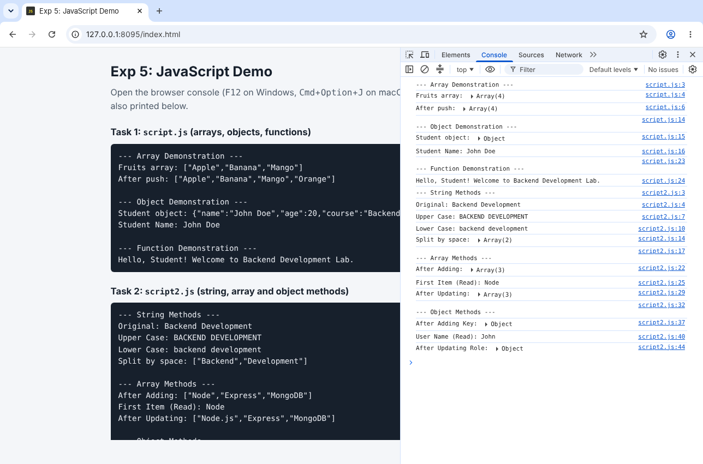

# Experiment 5: Programs to demonstrate JavaScript array, object and functions

**Course:** Backend Development Lab · Unit II  
**Course Outcome Mapped:** CO2 (Create and build web pages and applications)  
**Student:** Krish Pawar · B.Tech CSE · SAP ID 590017543 · UPES Dehradun  
**Date:** 21 November 2026

**Live page:** [Exp 5: JavaScript Demo](./index.html)  
**Source:** [`script.js`](https://github.com/Krish252616/backend-development/blob/main/LAB/EXP-5/script.js) · [`script2.js`](https://github.com/Krish252616/backend-development/blob/main/LAB/EXP-5/script2.js) · [`library.js`](https://github.com/Krish252616/backend-development/blob/main/LAB/EXP-5/library.js) · [`library.test.js`](https://github.com/Krish252616/backend-development/blob/main/LAB/EXP-5/library.test.js)

---

## 1. Aim

To write programs that use JavaScript arrays, objects and functions, run them in the browser and in Node.js, and use them together to manage a small library of books (PBL activity).

## 2. Objectives

1. Create and change arrays (`push`, read by index, update by index).
2. Create objects and add, read and update their properties.
3. Write functions that take arguments and return values.
4. Use string methods (`toUpperCase`, `toLowerCase`, `split`).
5. Run the same scripts in a browser (DevTools Console) and in Node.js.
6. Build `addBook` and `findBook` for an array of book objects and test them in Node.js.

## 3. Tools and environment

| Item | Detail |
|---|---|
| Runtime | Node.js 22 (`node script.js`, `node --test`) |
| Browser | Google Chrome, DevTools Console |
| Editor | Visual Studio Code |
| Testing | Node's built-in test runner (`node:test`) and `node:assert`, no packages to install |

## 4. Theory

### 4.1 Arrays

An array is an ordered list. Each item has an index starting at 0.

```javascript
const fruits = ['Apple', 'Banana', 'Mango'];
fruits.push('Orange');   // add at the end
fruits[0];               // read: 'Apple'
fruits[0] = 'Kiwi';      // update
```

`const` stops the **variable** from pointing to a different array, but the array itself can still change. That is why `fruits.push()` works on a `const` array.

| Method | What it does |
|---|---|
| `push(x)` | Adds `x` at the end, returns the new length |
| `arr[i]` | Reads the item at index `i` |
| `arr[i] = x` | Replaces the item at index `i` |
| `find(fn)` | Returns the first item for which `fn` returns `true`, or `undefined` |
| `length` | Number of items |

### 4.2 Objects

An object stores related data as **key: value** pairs.

```javascript
const user = { name: "John", role: "Dev" };
user.age = 25;            // add a key
user.name;                // read with dot notation
user["role"];             // read with bracket notation (useful when the key is in a variable)
user.role = "Senior Dev"; // update
```

### 4.3 Functions

A function is a named block of code that takes inputs (parameters) and can return a value.

```javascript
function greet(name) {
    return `Hello, ${name}! Welcome to Backend Development Lab.`;
}
```

The backticks make a **template literal**: `${name}` is replaced by the value of `name`.

### 4.4 String methods

| Method | Result for `"Backend Development"` |
|---|---|
| `toUpperCase()` | `"BACKEND DEVELOPMENT"` |
| `toLowerCase()` | `"backend development"` |
| `split(" ")` | `["Backend", "Development"]` (an array) |

Strings never change in place. These methods return a **new** string or array and leave `str` as it was.

## 5. Files

| File | Task | What it is |
|---|---|---|
| `script.js` | Task 1 | Arrays, objects and a function, exactly as in the sheet |
| `script2.js` | Task 2 | String, array and object methods, exactly as in the sheet |
| `index.html` | Task 3 | Loads both scripts in the browser. Their output goes to the Console |
| `page-output.js` | Task 3 (addition) | Shows the same output on the page, so it can be read on GitHub Pages without DevTools (section 9, problem 1) |
| `library.js` | PBL | The `library` array, `addBook(title, author)` and `findBook(title)`, plus a demo |
| `library.test.js` | PBL | Seven tests for `addBook` and `findBook` |

## 6. Procedure

1. Wrote `script.js` and `script2.js` from the sheet and ran both with Node.js (Task 4).
2. Wrote `index.html` to load them in Chrome and checked the Console (Task 3).
3. Wrote `library.js` for the PBL activity and ran its demo with Node.js.
4. Wrote `library.test.js` and ran it with `node --test`.

**How to run**

| Step | macOS (Terminal) | Windows (Command Prompt or PowerShell) |
|---|---|---|
| Check Node.js | `node -v` | `node -v` |
| Go to the folder | `cd LAB/EXP-5` | `cd LAB\EXP-5` |
| Task 4 | `node script.js` then `node script2.js` | Same |
| PBL demo | `node library.js` | Same |
| PBL tests | `node --test` | Same |
| Task 3 in the browser | Open `index.html`, then `Cmd + Option + J` for the Console | Open `index.html`, then `F12` or `Ctrl + Shift + J` |

## 7. Output

### 7.1 Task 4: `node script.js`

```text
$ node script.js
--- Array Demonstration ---
Fruits array: [ 'Apple', 'Banana', 'Mango' ]
After push: [ 'Apple', 'Banana', 'Mango', 'Orange' ]

--- Object Demonstration ---
Student object: { name: 'John Doe', age: 20, course: 'Backend Development' }
Student Name: John Doe

--- Function Demonstration ---
Hello, Student! Welcome to Backend Development Lab.
```

### 7.2 Task 4: `node script2.js`

```text
$ node script2.js
--- String Methods ---
Original: Backend Development
Upper Case: BACKEND DEVELOPMENT
Lower Case: backend development
Split by space: [ 'Backend', 'Development' ]

--- Array Methods ---
After Adding: [ 'Node', 'Express', 'MongoDB' ]
First Item (Read): Node
After Updating: [ 'Node.js', 'Express', 'MongoDB' ]

--- Object Methods ---
After Adding Key: { name: 'John', role: 'Dev', age: 25 }
User Name (Read): John
After Updating Role: { name: 'John', role: 'Senior Dev', age: 25 }
```

### 7.3 Task 3: in the browser

The DevTools Console, opened **before** the page loaded. Every line links to the file and line that printed it (`script.js:4`, `script2.js:22`), and arrays and objects can be expanded:



The page itself also shows both outputs:



On a 375px phone the page fits without sideways scrolling:



### 7.4 PBL activity: `node library.js`

```text
$ node library.js
--- Adding books ---
{ id: 1, title: 'Clean Code', author: 'Robert C. Martin' }
{
  id: 2,
  title: 'The Pragmatic Programmer',
  author: 'Andrew Hunt and David Thomas'
}
{ id: 3, title: "You Don't Know JS", author: 'Kyle Simpson' }

--- Library ---
┌─────────┬────┬────────────────────────────┬────────────────────────────────┐
│ (index) │ id │ title                      │ author                         │
├─────────┼────┼────────────────────────────┼────────────────────────────────┤
│ 0       │ 1  │ 'Clean Code'               │ 'Robert C. Martin'             │
│ 1       │ 2  │ 'The Pragmatic Programmer' │ 'Andrew Hunt and David Thomas' │
│ 2       │ 3  │ "You Don't Know JS"        │ 'Kyle Simpson'                 │
└─────────┴────┴────────────────────────────┴────────────────────────────────┘

--- Finding books ---
findBook("Clean Code"): { id: 1, title: 'Clean Code', author: 'Robert C. Martin' }
findBook("  you don't know js "): { id: 3, title: "You Don't Know JS", author: 'Kyle Simpson' }
findBook("Harry Potter"): null

--- Invalid input ---
addBook("", "No Title") -> Title is required
```

### 7.5 PBL activity: `node --test`

```text
$ node --test
✔ addBook adds a book object to the library array
✔ addBook gives each book its own id
✔ addBook trims spaces
✔ addBook rejects a missing title or author
✔ findBook finds a book by its exact title
✔ findBook ignores case and extra spaces
✔ findBook returns null when the title is not in the library
ℹ tests 7
ℹ suites 0
ℹ pass 7
ℹ fail 0
ℹ cancelled 0
ℹ skipped 0
ℹ todo 0
```

7 tests, 7 passed.

## 8. PBL activity: design

```javascript
const library = [];
let nextId = 1;

function addBook(title, author) {
    if (typeof title !== "string" || title.trim() === "") {
        throw new Error("Title is required");
    }
    if (typeof author !== "string" || author.trim() === "") {
        throw new Error("Author is required");
    }
    const book = { id: nextId++, title: title.trim(), author: author.trim() };
    library.push(book);
    return book;
}

function findBook(title) {
    const wanted = String(title).trim().toLowerCase();
    const book = library.find(b => b.title.toLowerCase() === wanted);
    return book || null;
}
```

| Choice | Reason |
|---|---|
| Each book is an object `{ id, title, author }` | Related data kept together, as the sheet asks |
| An `id` from a counter | Two different books can have the same title. The id tells them apart |
| `trim()` on input | `"  Clean Code "` should be the same book as `"Clean Code"` |
| Case-insensitive search | A user typing `clean code` expects to find `Clean Code` |
| `findBook` returns `null` when nothing is found | `Array.find` returns `undefined`. `null` says clearly "searched, not found", and the test checks it |
| `addBook` throws on an empty title or author | A book with no title could never be found. Throwing stops it from being added (test 4 checks `library.length` is still 0) |
| `module.exports` and `require.main === module` | The test file can import the functions without running the demo |

The sheet's "Expected Learning" mentions CRUD. This activity covers Create (`addBook`) and Read (`findBook`). Update and Delete would follow the same pattern: find the book, then change its properties or remove it with `library.splice(index, 1)`.

## 9. Problems faced and Windows vs macOS differences

| # | Problem | Cause | Fix |
|---|---|---|---|
| 1 | On GitHub Pages the output of Task 3 is only in the Console, so a visitor sees an almost empty page | The sheet's page only says "open the console" | Added `page-output.js`, which runs the same two scripts a second time with a stand-in `console` that writes into the page |
| 2 | My first version wrapped `console.log` to copy it onto the page. Then every Console line said `console-mirror.js:14` instead of `script.js:4` | The Console shows where `console.log` was **called** from, which was now my wrapper | Removed the wrapper. The lab scripts now run untouched and `page-output.js` uses its own stand-in console, so the Console links point to the real lines again (section 7.3) |
| 3 | In Chrome, "Fruits array:" showed **`Array(4)`**, although at that line the array had only 3 items | DevTools was opened **after** the page loaded. Chrome then reads the array when it is shown, not when it was logged, and by then `push('Orange')` had run | Open DevTools first, then reload. The line then shows `(3) ['Apple', 'Banana', 'Mango']`. Screenshots of both below |
| 4 | Opening `index.html` by double-clicking shows "Could not load script.js" on the page | `fetch()` is blocked for `file://` pages | Expected. The Console output still works. For the page output, open it with VS Code Live Server or on GitHub Pages |
| 5 | `'\n--- Object Demonstration ---'` looks different in Node and Chrome | Both print the `\n` as an empty line, but Chrome puts the empty line inside the same Console row | No change. The output is the same text |
| 6 | Objects print differently | Node prints `{ name: 'John Doe', ... }` in one line. Chrome shows `{name: 'John Doe', ...}` with an arrow to expand | Normal. Both show the same data |
| 7 | Console shortcut | `Cmd + Option + J` on macOS, `Ctrl + Shift + J` or `F12` on Windows | Written in the page and in section 6 |
| 8 | `node` not found on Windows after installing | The Node.js installer adds Node to PATH, but already open terminals do not see it | Close and open the terminal again. On macOS with Homebrew, `brew install node` adds it to PATH at once |

Problem 3. DevTools opened after the page loaded: the first log shows `Array(4)`:



DevTools open first, then reload: the same line shows the 3 items it really had:


## 10. Observations (what I learned)

1. `const` protects the variable, not the value. A `const` array or object can still be changed with `push` or `obj.key = value`.
2. Array methods like `push` change the array itself, while string methods like `toUpperCase` and `split` return new values and leave the original unchanged.
3. Objects and arrays are passed by reference: the Console in Chrome can show a later state of the same array (problem 3). To log a snapshot, log a copy: `console.log([...fruits])` or `JSON.stringify(fruits)`.
4. Dot notation (`user.name`) is for fixed keys, bracket notation (`user[key]`) for keys in a variable.
5. `Array.find` returns the first match or `undefined`. A function can turn that into a clearer `null`.
6. The same JavaScript runs in the browser and in Node.js. Only the environment differs: the browser has `document` and `window`, Node has `require`, `module.exports` and the file system.
7. Node has a test runner built in (`node --test`). Tests made it easy to check the edge cases: spaces, upper and lower case, empty input and a missing title.

## 11. Viva questions

1. **Difference between an array and an object?** An array is an ordered list accessed by index (`arr[0]`). An object is a set of named properties accessed by key (`obj.name`).
2. **Why can you `push` into a `const` array?** `const` only stops reassigning the variable. The array it points to can still change.
3. **What does `split(" ")` return?** An array of the parts between the spaces: `["Backend", "Development"]`.
4. **Dot vs bracket notation?** `obj.key` for a fixed key name. `obj[variable]` when the key is in a variable or has spaces or symbols.
5. **How do you add a property to an existing object?** Assign it: `user.age = 25`.
6. **What does `find` return if nothing matches?** `undefined`.
7. **Function declaration vs arrow function?** `function greet() {}` is hoisted (can be called before its line) and has its own `this`. `const greet = () => {}` is not hoisted and takes `this` from around it.
8. **What is a template literal?** A string in backticks where `${expression}` is replaced by its value.
9. **How do you run a JavaScript file without a browser?** `node file.js`.
10. **What is `module.exports`?** It decides what other files get when they `require` this file. `library.js` exports `library`, `addBook` and `findBook` for the tests.
11. **What does `require.main === module` check?** Whether the file was run directly (`node library.js`) or imported. The demo only runs when the file is run directly.
12. **Why did Chrome show `Array(4)` for an array that had 3 items when logged?** The Console keeps a reference, and when DevTools was not open at log time it reads the array later, after `push` had added the fourth item.

## 12. Result

`script.js` and `script2.js` ran without errors in Node.js and in Chrome, showing array, object, function and string operations. The PBL activity stores books as objects in an array, adds them with `addBook` and finds them with `findBook` (ignoring case and extra spaces, returning `null` when not found), and all 7 Node.js tests passed.

## 13. Conclusion

Arrays hold lists, objects hold named data, and functions wrap the steps that work on them. Together they were enough to build a small in-memory data store, the same pattern a backend uses before adding a database. Running the code in both Node.js and the browser showed that the language is the same, while the tools differ, and the browser Console showed why objects should be logged as copies when their state at that moment matters.

## 14. References

1. MDN Web Docs: *Array*. <https://developer.mozilla.org/en-US/docs/Web/JavaScript/Reference/Global_Objects/Array>
2. MDN Web Docs: *Working with objects*. <https://developer.mozilla.org/en-US/docs/Web/JavaScript/Guide/Working_with_objects>
3. MDN Web Docs: *Functions*. <https://developer.mozilla.org/en-US/docs/Web/JavaScript/Guide/Functions>
4. MDN Web Docs: *console.log()* (logging objects). <https://developer.mozilla.org/en-US/docs/Web/API/console/log_static>
5. Node.js documentation: *Test runner*. <https://nodejs.org/api/test.html>
