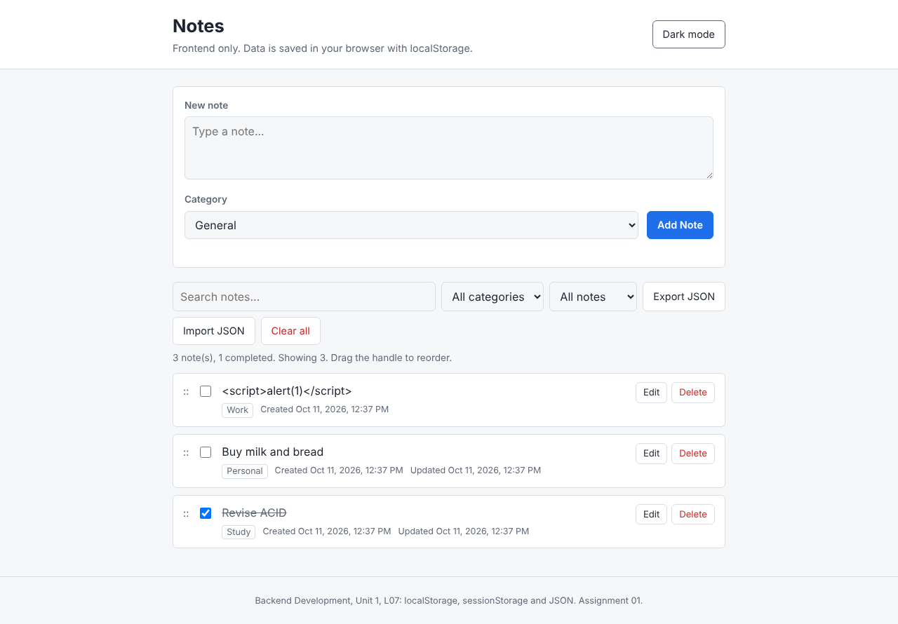
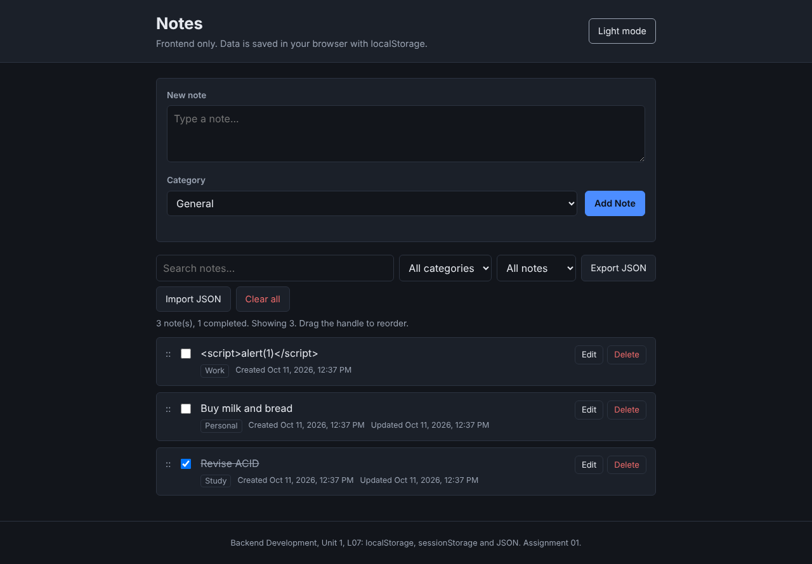
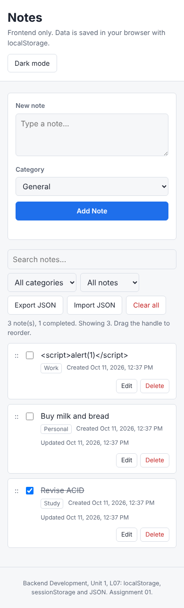

# Assignment 01: Notes App with localStorage

**Course:** Backend Development, Unit 1
**Lecture:** L07, LocalStorage, SessionStorage and JSON
**Task:** Section 12, Final Task: Build a Notes App
**Student:** Krish
**SAP ID:** 590017543

---

## 1. Objective

Build a working Notes / Todo app using **only frontend HTML, CSS and JavaScript**, where all data is saved in the browser with **localStorage**, so that notes stay after the page is refreshed or the browser is closed.

## 2. How to Run

1. Unzip the folder.
2. Open `index.html` in Chrome, Edge or Firefox (double-click is enough).
3. No installation, server or internet is needed.

Optional: to serve it like a real website, run `python -m http.server 8000` inside the folder and open `http://localhost:8000`.

## 3. Folder Structure

```
notes-app/
├── index.html        Page structure (form, toolbar, notes list)
├── style.css         Layout, light and dark theme, mobile layout
├── app.js            All logic: storage helpers, CRUD, render, stretch goals
├── report.md         This report
└── screenshots/
    ├── light.png
    ├── dark.png
    └── mobile.png
```

## 4. Requirements Checklist

### Must Have

| Requirement | Status | Where in code |
|---|---|---|
| Add a new note with text | Done | `addNote()` |
| Display all saved notes on page load | Done | `window.onload` calls `renderNotes()` |
| Delete individual notes | Done | `deleteNote()` |
| Edit existing notes | Done | Inline edit, `updateNote()` |
| Data persists after page refresh | Done | `saveNotes()` writes to localStorage |
| Each note has `id`, `text`, `createdAt`, `updatedAt` | Done | Note object in `addNote()` |

### Nice to Have (Stretch Goals)

| Stretch goal | Status | How |
|---|---|---|
| Mark notes complete / incomplete | Done | Checkbox, `toggleComplete()`, strike-through style |
| Search / filter notes | Done | Search box + category filter + status filter |
| Categories or tags | Done | General, Study, Work, Personal |
| Import / Export notes as JSON file | Done | `Blob` download for export, `file.text()` + `JSON.parse` for import, with validation |
| Dark / Light mode (saved preference) | Done | Saved in localStorage key `theme` |
| Drag to reorder notes | Done | HTML5 drag and drop, new order saved to localStorage |

All 6 must-have and all 6 stretch goals are complete.

## 5. Data Structure

Each note is stored as an object. All notes are kept together as one array under the key `"notes"`. This array works as the app's "database".

```javascript
{
    id: 1791702422381,                        // unique id from Date.now()
    text: "Revise ACID properties",
    category: "Study",
    completed: false,
    createdAt: "2026-10-11T07:07:02.381Z",    // ISO date string
    updatedAt: null                           // set when the note is edited
}
```

What is actually stored in localStorage:

| Key | Value |
|---|---|
| `notes` | `'[{"id":1791702422381,"text":"Revise ACID properties",...}]'` (a JSON string) |
| `theme` | `"light"` or `"dark"` |

## 6. Key Concepts Used (from L07)

### 6.1 localStorage stores only strings

localStorage can save only strings. If an object is saved directly, it becomes `"[object Object]"` and the data is lost. So the app always converts:

| Direction | Function | Used in |
|---|---|---|
| Object to string (saving) | `JSON.stringify()` | `saveNotes()` |
| String to object (reading) | `JSON.parse()` | `getNotes()` |

### 6.2 Helper functions (Step 2 of the task)

```javascript
function getNotes() {
    const raw = localStorage.getItem("notes");
    if (!raw) return [];                      // key missing: return empty list
    try {
        const data = JSON.parse(raw);
        return Array.isArray(data) ? data : [];
    } catch (e) {
        return [];                            // corrupt data: do not crash
    }
}

function saveNotes(notes) {
    localStorage.setItem("notes", JSON.stringify(notes));
}
```

Every CRUD function follows the same pattern: **read with `getNotes()`, change the array, write back with `saveNotes()`, then call `renderNotes()`.**

### 6.3 CRUD mapping

| Operation | Function | Array method used |
|---|---|---|
| Create | `addNote(text, category)` | `unshift()` (newest on top) |
| Read | `getNotes()` | `JSON.parse()` |
| Update | `updateNote(id, newText)`, `toggleComplete(id)` | `find()` |
| Delete | `deleteNote(id)` | `filter()` |

### 6.4 localStorage vs sessionStorage

The app uses **localStorage** because notes must stay after the tab or browser is closed. With sessionStorage, all notes would be lost as soon as the tab closes.

## 7. Common Mistakes Handled (Section 11 of the tutorial)

| Tutorial mistake | How this app avoids it |
|---|---|
| 1. Forgetting `JSON.stringify` | All saving goes through `saveNotes()`, which always stringifies |
| 2. Forgetting `JSON.parse` | All reading goes through `getNotes()`, which always parses |
| 3. Not handling null / missing keys | `getNotes()` returns `[]` if the key is missing, and uses `try...catch` if the data is corrupt |
| 4. Assuming data types survive | Ids are compared as numbers (`Number(card.dataset.id)`), because values read from the HTML are always strings |

## 8. Improvements Over the Starter Code

These were changes I made on purpose while building, beyond the tutorial's starter pattern:

1. **Safe rendering (prevents XSS).** The starter code builds the list with `innerHTML` and `${note.text}`. If a user types `` as a note, that code would run it. This app builds each note with `createElement()` and `textContent`, so anything typed is shown only as plain text. (Tested: a note containing `<script>alert(1)</script>` is displayed as text and never runs.)
2. **Empty notes blocked.** Empty or spaces-only notes are rejected with an error message, both when adding and when editing.
3. **Unique ids.** `Date.now()` can repeat if two notes are created in the same millisecond, so `createId()` increases the number until it is unused.
4. **No inline `onclick`.** One click listener on the list handles all Edit, Delete, Save, Cancel and checkbox actions (event delegation). This works even after the list is re-rendered.
5. **Safe import.** Imported files are checked: the file must be a JSON array, each note must have a valid `id`, `text` and `createdAt`, and notes whose id already exists are skipped. A bad file shows an error instead of breaking the app.
6. **Live sync between tabs.** The `storage` event updates other open tabs immediately when notes change in one tab.
7. **Reorder is disabled while searching or filtering**, so the saved order always matches the full list.
8. **Keyboard shortcuts:** Ctrl/Cmd + Enter adds a note or saves an edit, Escape cancels editing.

## 9. Testing

### 9.1 Tutorial testing checklist

| Test (from the tutorial) | Result |
|---|---|
| Add a note, refresh: still there? | Pass |
| Delete a note, refresh: still gone? | Pass |
| Edit a note, refresh: updated text preserved? | Pass |
| Open in new tab: same notes? (localStorage is shared) | Pass |
| DevTools > Application > Local Storage: `notes` key visible | Pass |
| Try adding empty text: should it be allowed? | Pass, it is blocked with a message |
| `console.table(JSON.parse(localStorage.getItem("notes")))` | Pass, shows a table of all notes |

### 9.2 Automated browser tests

I also tested the app in a real Chromium browser with an automated script (Playwright). **All 26 checks passed:**

| Area | Checks |
|---|---|
| Add | Empty state shown, empty and spaces-only notes rejected, 3 notes added, unique ids, all required fields present |
| Persistence | Notes, edits, completed status, deletion and order all survive a refresh |
| Edit | Edited text saved, "Updated" time shown |
| Search and filters | Text search, category filter, status filter |
| Tabs | New tab sees the same notes, another open tab updates live |
| Reorder | Dragged order saved and kept after refresh |
| Export / Import | Export file has all notes, import restores notes, invalid items and duplicates are skipped |
| Robustness | Corrupt data in localStorage does not crash the app |
| Security | HTML typed into a note is shown as text, not executed |
| Theme | Dark mode choice remembered after refresh |
| Mobile | No horizontal scrolling at 390px width |
| Errors | No JavaScript errors in the console |

**Bug found and fixed during testing:** when a note was dragged **downwards**, it was placed above the target note instead of below it. I fixed the drop logic so that moving down places the note after the target, and moving up places it before the target.

## 10. Screenshots

**Light mode**



**Dark mode**



**Mobile view (390px)**



## 11. Limitations (why a backend is still needed)

As explained in Section 13 of the tutorial, localStorage is useful but is **not a replacement for a database**:

| Limitation of this app | Backend solution |
|---|---|
| Notes are lost if the user clears browser data | Store notes in a database (PostgreSQL / MongoDB) |
| Notes are not shared between devices or browsers | Central server reachable from anywhere |
| No login, anyone using the browser can see the notes | Login with sessions or JWT tokens |
| Anyone can edit the data in DevTools | Server-side validation and permissions |
| Storage limit of about 5 to 10 MB | Database storage has no such small limit |

**Next step:** replace `getNotes()` and `saveNotes()` with `fetch()` calls to a REST API (for example `GET /api/notes`, `POST /api/notes`, `PUT /api/notes/:id`, `DELETE /api/notes/:id`) built with Express or FastAPI, and keep localStorage only as a cache for offline use.

## 12. Conclusion

The app meets all must-have requirements and all stretch goals of Task 12. It shows the full localStorage workflow from L07: saving objects with `JSON.stringify`, reading them back with `JSON.parse`, handling missing or corrupt data safely, and using localStorage (not sessionStorage) for data that must survive a browser restart.
