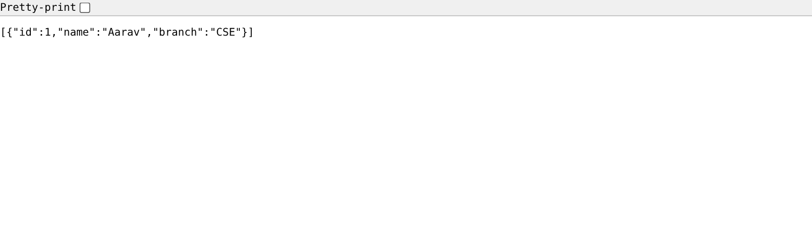
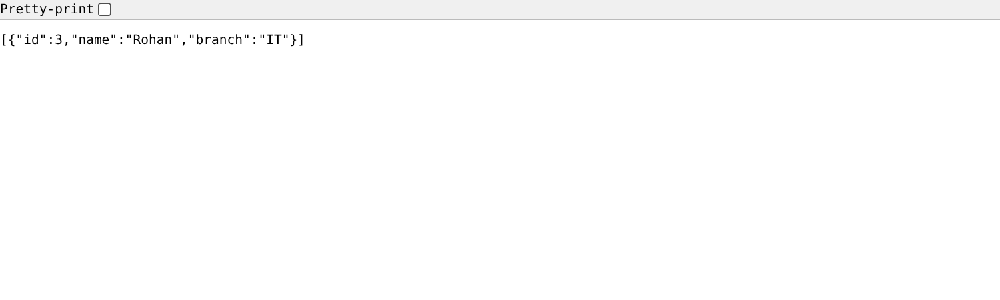
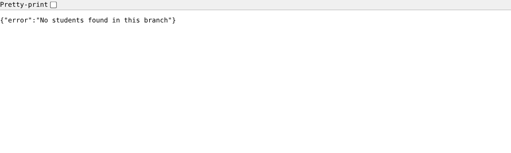
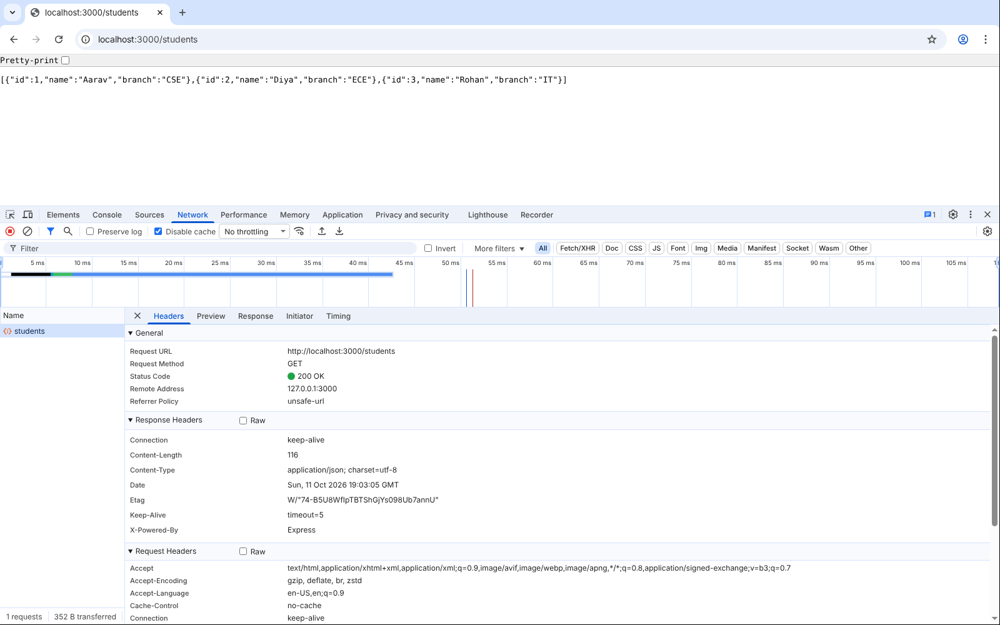
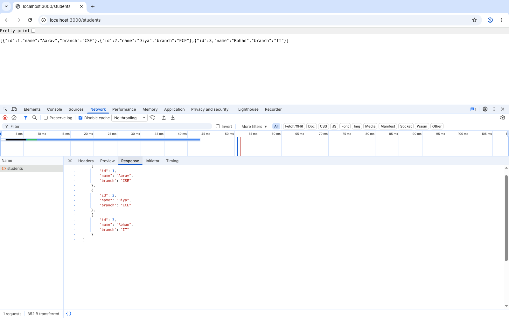

# Lecture 3: Express Demo, Tasks 1 to 5 and Lab Exercises

**Course:** Backend Development, Unit 1
**Lecture:** 3, Setting Up the Backend Environment
**Student:** Krish Pawar · B.Tech CSE · SAP ID 590017543 · UPES Dehradun

**Source:** [`task1` to `task5`, `lab3`](https://github.com/Krish252616/backend-development/tree/main/Theory/Lecture-03/express-demo) · **Shared views:** [`views/`](https://github.com/Krish252616/backend-development/tree/main/Theory/Lecture-03/express-demo/views)

---

## 1. Aim

To build a first backend server with Node.js and Express, and grow it step by step: from one plain-text route, to several routes, to a JSON API with route parameters, to HTML responses, and finally to pages rendered from EJS templates. The lab exercises add a branch filter route and inspect a request in browser DevTools.

## 2. What each task does

| Task | Routes | Response |
|---|---|---|
| 1 | `GET /` | Plain text: `Backend Server Running` |
| 2 | `GET /`, `GET /students`, `GET /students/1` | Plain text from three fixed routes |
| 3 | `GET /students`, `GET /students/:id` | JSON array, one student as JSON, or `404` with an error |
| 4 | `GET /`, `GET /students`, `GET /students/:id` | HTML built inside JavaScript strings |
| 5 | `GET /`, `GET /students` | HTML rendered from `views/home.ejs` and `views/students.ejs` |
| Lab 3 | Task 3 routes plus `GET /students/branch/:branch` | JSON list of every student in that branch, or `404` |

All five tasks listen on port 3000, so only one can run at a time.

## 3. How to run

```bash
cd Theory/Lecture-03/express-demo
npm install
npm run task3            # or task1, task2, task4, task5, lab3
```

Then open http://localhost:3000. Press `Ctrl + C` to stop the server before starting another task.

| Step | macOS (Terminal, zsh) | Windows |
|---|---|---|
| Check Node and npm | `node -v` and `npm -v` | Same commands in PowerShell or Command Prompt |
| Install packages | `npm install` | `npm install` |
| Run a task | `npm run task3` | `npm run task3` |
| Test with curl | `curl localhost:3000/students` | PowerShell: `curl.exe localhost:3000/students` (plain `curl` is a different PowerShell command) |
| Free a busy port 3000 | `lsof -ti :3000 \| xargs kill` | `netstat -ano \| findstr :3000`, then `taskkill /PID <number> /F` |

## 4. Code walkthrough

**Task 1: the smallest Express server**

```javascript
const express = require("express");
const app = express();

app.get("/", (req, res) => {
    res.send("Backend Server Running");
});

app.listen(3000, () => {
    console.log("Server started at http://localhost:3000");
});
```

`app.get()` connects a URL to a function. `req` holds what the client sent, `res` is used to reply. `app.listen(3000)` keeps the program running and waiting for requests.

**Task 3: route parameters and JSON**

```javascript
app.get("/students/:id", (req, res) => {
    const student = students.find(s => s.id === parseInt(req.params.id));
    if (student) {
        res.json(student);
    } else {
        res.status(404).json({ error: "Student not found" });
    }
});
```

`:id` matches any value in that part of the URL, and Express puts it in `req.params.id`. `res.json()` sends JSON and sets `Content-Type: application/json`.

**Task 4: HTML in a string**

```javascript
let html = "<h2>All Students</h2><ul>";
students.forEach(s => {
    html += `<li><strong>${s.name}</strong> (${s.branch})</li>`;
});
html += "</ul>";
res.send(html);
```

`res.send()` with an HTML string makes Express send `Content-Type: text/html`. It works, but the HTML is mixed into the JavaScript and quickly becomes hard to read.

**Task 5: EJS templates**

```javascript
app.set("view engine", "ejs");
app.set("views", path.join(__dirname, "..", "views"));

app.get("/students", (req, res) => {
    res.render("students", { students: students });
});
```

```html
<% students.forEach(student => { %>
    <li><strong><%= student.name %></strong> (<%= student.branch %>)</li>
<% }); %>
```

`res.render()` takes `views/students.ejs`, fills it with the data and sends the finished HTML. `<% %>` runs JavaScript, `<%= %>` prints a value.

## 5. Output

**Task 1:** `GET /`


**Task 2:** `GET /students/1`


**Task 3:** `GET /students` returns JSON


**Task 3:** `GET /students/5` returns 404


The same request with `curl -i` shows the status line and headers:

```text
$ curl -i localhost:3000/students/5
HTTP/1.1 404 Not Found
X-Powered-By: Express
Content-Type: application/json; charset=utf-8
Content-Length: 29

{"error":"Student not found"}
```

**Task 4:** `GET /students` as HTML


```text
$ curl -I localhost:3000/students
Content-Type: text/html; charset=utf-8
```

**Task 5:** home page and student list rendered with EJS


## 6. Lab exercises

| # | Exercise | Status |
|---|---|---|
| 1 | Install Node.js, npm, Python and pip | Done: Node and npm for these tasks, Python and pip for the [Flask demo](../flask-demo/report.md) |
| 2 | Complete the eight hands-on tasks | Done: Tasks 1 to 5 here, Tasks 6 and 7 in the [Flask demo](../flask-demo/report.md), Task 8 is Lab 5 below |
| 3 | Add `/students/branch/:branch` to Task 3 | Done: `lab3/server.js` |
| 4 | Add `POST /students` to the Flask Task 7 | Done: see the [Flask demo report](../flask-demo/report.md) |
| 5 | Capture the request and response cycle in DevTools | Done: screenshots below |

### Lab 3: students of one branch

```javascript
app.get("/students/branch/:branch", (req, res) => {
    const branch = req.params.branch.toUpperCase();
    const result = students.filter(s => s.branch.toUpperCase() === branch);
    if (result.length > 0) {
        res.json(result);
    } else {
        res.status(404).json({ error: "No students found in this branch" });
    }
});
```

- `filter()` is used, not `find()`, because one branch can have many students. `find()` would return only the first one.
- `toUpperCase()` on both sides makes `/branch/cse` and `/branch/CSE` give the same result.
- An unknown branch returns `404`, the same way Task 3 does for a missing id.
- `app.listen(3000, (error) => { if (error) throw error; ... })` shows a real error if port 3000 is busy, instead of a false "Server started" message (see Problems below).

Run it with `npm run lab3`.

**`GET /students/branch/CSE`**



**`GET /students/branch/it`** (lowercase still works)



**`GET /students/branch/MECH`** returns 404



### Lab 5: request and response cycle in Chrome DevTools

Steps: open DevTools (`Cmd + Option + I` on macOS, `F12` on Windows) > **Network** tab > tick **Disable cache** > open `http://localhost:3000/students` > click the `students` row.

**Headers tab:** request method `GET`, status `200 OK`, and the response headers sent by Express, including `Content-Type: application/json; charset=utf-8` and `X-Powered-By: Express`



**Response tab:** the JSON body the server returned



## 7. What I learned

1. An Express server is just routes plus `app.listen()`. Each route is a URL and a method connected to one function.
2. `res.send()` and `res.json()` set different `Content-Type` headers. The browser decides how to show the response from that header, not from the content itself.
3. Route parameters (`/students/:id`) let one route handle every id instead of writing `/students/1`, `/students/2` and so on.
4. Everything in `req.params` is a string. The id from the URL is `"1"`, not `1`, so `parseInt()` is needed before comparing with `===`.
5. A missing record should return `404`, not `200` with an error message, so clients can tell success from failure by the status code.
6. Building HTML inside JavaScript strings works for a few lines but gets messy fast. A template engine like EJS keeps the HTML in its own file.
7. `npm run task3` is shorter and safer than typing `node task3/server.js`, and it documents how to run each task inside `package.json`.
8. DevTools shows the full request and response: method, URL, status code, request headers, response headers and body. It is the quickest way to check what the server really sent.
9. `filter()` returns every match as an array, `find()` returns only the first match. The choice depends on whether one or many results are expected.

## 8. Problems I faced and how I fixed them

| Problem | Cause | Fix |
|---|---|---|
| The DevTools Network tab showed status `304 Not Modified` instead of `200 OK` after reloading | The browser had a cached copy and only asked the server whether it changed | Ticked **Disable cache** in the Network tab, then reloaded |
| Task 5 showed `Error: Failed to lookup view "home"` when I ran `node server.js` from inside the `task5` folder | Express looks for `views/` in the folder you start Node from. The shared `views/` folder is one level up, next to the task folders | Gave Express the full path: `app.set("views", path.join(__dirname, "..", "views"))`. Now Task 5 works from any folder |
| After starting a new task, the browser still showed the old task's page | The previous server was still running on port 3000 in another terminal. With Express 5, `app.listen()` passes the "port in use" error to its callback, so the new server printed "Server started" and then exited quietly | Stopped the old server with `Ctrl + C` before starting the next one, and in `lab3/server.js` I check the error in the `listen` callback so the problem is visible. If the terminal is already closed: macOS `lsof -ti :3000 \| xargs kill`, Windows `netstat -ano \| findstr :3000` then `taskkill /PID <number> /F` |
| `curl` gave strange output on Windows PowerShell | In PowerShell, `curl` is a shortcut for `Invoke-WebRequest`, which prints a different format | Used `curl.exe` instead, or ran the command in Command Prompt |
| The student list used an M dash between name and branch | Copied from the lecture code | Changed the output to `Aarav (CSE)` in Task 4 and in `students.ejs` |

## 9. Result

All five Express tasks run and return the expected text, JSON, HTML and EJS pages. Task 3 returns the correct `404` status for a missing student, and Task 5 renders its templates no matter which folder the server is started from. Lab 3 filters students by branch in any letter case, and the DevTools screenshots show the full request and response cycle for `GET /students`.
