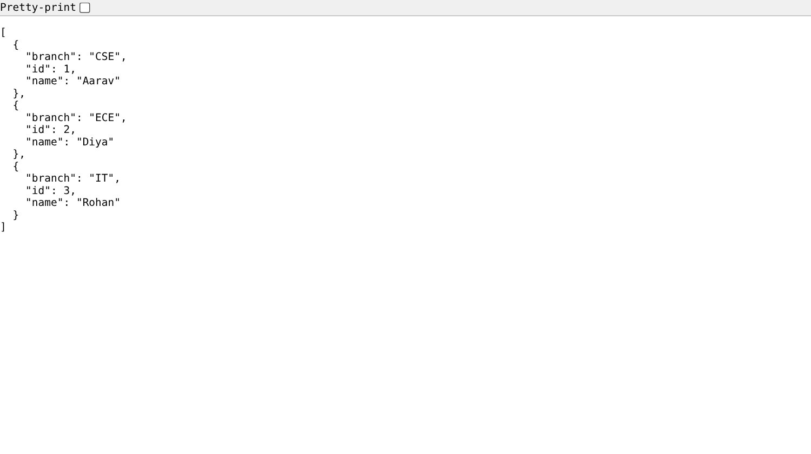
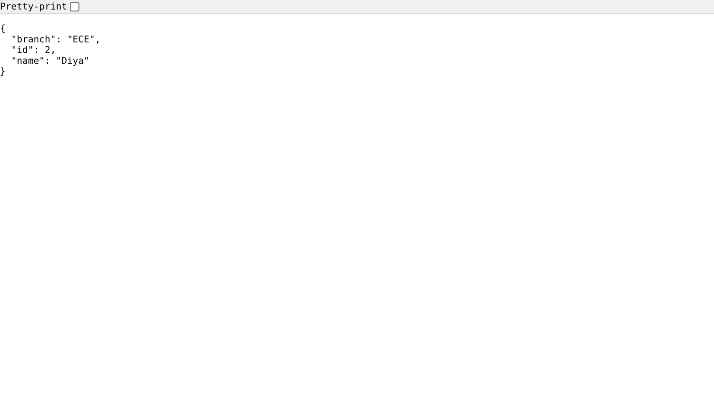
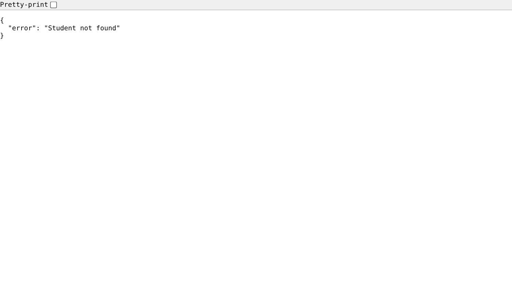
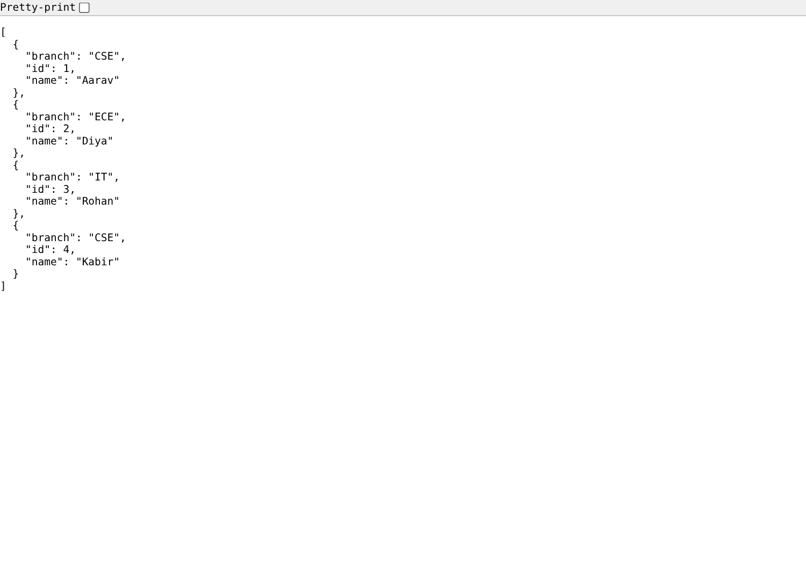

# Lecture 3: Flask Demo, Tasks 6 and 7 and Lab 4

**Course:** Backend Development, Unit 1
**Lecture:** 3, Setting Up the Backend Environment
**Student:** Krish Pawar · B.Tech CSE · SAP ID 590017543 · UPES Dehradun

**Source:** [`task6/app.py`](https://github.com/Krish252616/backend-development/blob/main/Theory/Lecture-03/flask-demo/task6/app.py) · [`task7/app.py`](https://github.com/Krish252616/backend-development/blob/main/Theory/Lecture-03/flask-demo/task7/app.py) · [`lab4/app.py`](https://github.com/Krish252616/backend-development/blob/main/Theory/Lecture-03/flask-demo/lab4/app.py)

---

## 1. Aim

To set up Python, `pip` and a virtual environment, run a first Flask server (Task 6), turn it into a JSON API for students (Task 7), and add a `POST /students` route that creates a new student (Lab Exercise 4).

## 2. What each part does

| Part | Routes | Response |
|---|---|---|
| Task 6 | `GET /` | Plain text: `Backend Server Running` |
| Task 7 | `GET /`, `GET /students`, `GET /students/<id>` | JSON list, one student as JSON, or `404` |
| Lab 4 | Task 7 routes plus `POST /students` | The new student with `201 Created`, or `400 Bad Request` if a field is missing |

All three use port 5000, so run one at a time.

## 3. How to run

```bash
cd Theory
python3 -m venv .venv
source .venv/bin/activate
pip install -r requirements.txt
cd Lecture-03/flask-demo/task7        # or task6, lab4
python app.py
```

Open http://127.0.0.1:5000. Press `Ctrl + C` to stop.

| Step | macOS (Terminal, zsh) | Windows |
|---|---|---|
| Check Python | `python3 --version` | `python --version` or `py --version` |
| Create the virtual environment | `python3 -m venv .venv` | `python -m venv .venv` |
| Activate it | `source .venv/bin/activate` | Command Prompt: `.venv\Scripts\activate` · PowerShell: `.venv\Scripts\Activate.ps1` |
| Install packages | `pip install -r requirements.txt` | Same |
| Run | `python app.py` (inside the venv, `python` points to Python 3) | `python app.py` |
| Send the Lab 4 POST | `curl -X POST http://127.0.0.1:5000/students -H "Content-Type: application/json" -d '{"name":"Kabir","branch":"CSE"}'` | PowerShell: `Invoke-RestMethod -Method Post -Uri http://127.0.0.1:5000/students -ContentType "application/json" -Body '{"name":"Kabir","branch":"CSE"}'` |
| Leave the venv | `deactivate` | `deactivate` |

When the virtual environment is active, the prompt starts with `(.venv)`.

## 4. Code walkthrough

**Task 6: the smallest Flask server**

```python
from flask import Flask

app = Flask(__name__)

@app.route("/")
def home():
    return "Backend Server Running"

if __name__ == "__main__":
    app.run(debug=True)
```

| Line | Meaning |
|---|---|
| `app = Flask(__name__)` | Creates the application. `__name__` tells Flask where the app's files are |
| `@app.route("/")` | Connects the URL `/` to the function below it (like `app.get("/")` in Express) |
| `return "..."` | Whatever the function returns becomes the response body |
| `if __name__ == "__main__":` | Starts the server only when the file is run directly, not when it is imported |
| `debug=True` | Restarts the server when the code changes and shows detailed error pages |

**Task 7: JSON and a route parameter**

```python
@app.route("/students/<int:student_id>")
def get_student(student_id):
    student = next((s for s in students if s["id"] == student_id), None)
    if student:
        return jsonify(student)
    else:
        return jsonify({"error": "Student not found"}), 404
```

- `<int:student_id>` takes the number from the URL and converts it to an `int`, so no `parseInt` is needed like in Express. `/students/abc` does not match the route at all and gets Flask's own 404 page.
- `jsonify()` turns a Python dict or list into a JSON response.
- Returning a tuple `(body, 404)` sets the status code.
- `next(..., None)` returns the first matching student, or `None` if there is none.

**Lab 4: POST /students**

```python
@app.route("/students", methods=["POST"])
def add_student():
    data = request.get_json(silent=True)
    if not data or not str(data.get("name", "")).strip() or not str(data.get("branch", "")).strip():
        return jsonify({"error": "name and branch are required"}), 400

    new_id = max((s["id"] for s in students), default=0) + 1
    new_student = {"id": new_id, "name": str(data["name"]).strip(), "branch": str(data["branch"]).strip()}
    students.append(new_student)
    return jsonify(new_student), 201
```

- `methods=["POST"]` is required, because a Flask route accepts only GET by default.
- `request.get_json(silent=True)` reads the JSON body. With `silent=True` it returns `None` for a missing or broken body instead of raising an error, so I can send my own clear `400` message.
- The client does not send an id. The server picks one more than the current largest id.
- `201 Created` is the correct status when something new is created.

## 5. Output

**Task 6:** `GET /`


**Task 7:** `GET /students`



**Task 7:** `GET /students/2`



**Task 7:** `GET /students/9` returns 404



**Lab 4:** the POST and its error cases, tested with curl

```text
$ curl -X POST 127.0.0.1:5000/students -H "Content-Type: application/json" -d '{"name": "Kabir", "branch": "CSE"}'
{
  "branch": "CSE",
  "id": 4,
  "name": "Kabir"
}
  [201]

$ curl -X POST 127.0.0.1:5000/students -H "Content-Type: application/json" -d '{"name": "Kabir"}'
{
  "error": "name and branch are required"
}
  [400]

$ curl -X POST 127.0.0.1:5000/students -d 'name=Kabir'
{
  "error": "name and branch are required"
}
  [400]
```

(The `[201]` and `[400]` lines are the status codes, printed with curl's `-w " [%{http_code}]"` option.)

**Lab 4:** `GET /students` after the POST shows the new student with `id: 4`



Terminal output when a Flask server starts:

```text
 * Serving Flask app 'app'
 * Debug mode: on
WARNING: This is a development server. Do not use it in a production deployment.
 * Running on http://127.0.0.1:5000
Press CTRL+C to quit
 * Restarting with stat
 * Debugger is active!
```

## 6. Lab exercises

| # | Exercise | Status |
|---|---|---|
| 1 | Install Python and pip, create a virtual environment | Done |
| 2 | Complete Tasks 6 and 7 | Done |
| 4 | Add `POST /students` to Task 7 | Done: `lab4/app.py` |

Lab Exercises 3 and 5 (the Express branch route and the DevTools screenshot) are in the [Express demo report](../express-demo/report.md).

## 7. What I learned

1. Flask and Express follow the same idea: a route decorator (Flask) or `app.get()` (Express) connects a URL to a function that returns the response.
2. Flask's default port is 5000, the Express apps in this course use 3000. Each port can be used by only one program at a time.
3. A virtual environment keeps each project's packages separate, so two projects can use different versions without breaking each other.
4. Flask converts route values for me with `<int:...>`, while in Express `req.params` is always a string.
5. A route answers only the methods listed in `methods=[...]`. Sending POST to a GET-only route gives `405 Method Not Allowed`.
6. `jsonify` sorts the keys alphabetically in this setup, so the output shows `branch`, `id`, `name` even though the code writes `id`, `name`, `branch`. The data is the same; JSON objects have no fixed key order.
7. The server, not the client, should decide the id. Otherwise two clients could send the same id.
8. `debug=True` is useful while learning, but must never be used on a real server, because the debugger can run code.

## 8. Problems and Windows vs macOS differences

| Problem | Cause | Fix |
|---|---|---|
| `python: command not found` on macOS | macOS ships Python 3 as `python3`. Plain `python` only exists inside an active virtual environment | Use `python3` to create the venv. After `source .venv/bin/activate`, `python` works |
| `Port 5000 is in use by another program` on macOS | Since macOS Monterey, the **AirPlay Receiver** service listens on port 5000 | Turn it off in System Settings > General > AirDrop & Handoff > AirPlay Receiver, or run Flask on another port: `app.run(debug=True, port=5001)` |
| PowerShell says running scripts is disabled when activating the venv | Windows blocks `.ps1` scripts by default | Run once: `Set-ExecutionPolicy -Scope CurrentUser RemoteSigned`, or activate from Command Prompt with `.venv\Scripts\activate` |
| `ModuleNotFoundError: No module named 'flask'` | Packages were installed outside the venv, or the venv was not active | Activate the venv first (prompt shows `(.venv)`), then `pip install -r requirements.txt` |
| A POST from a plain HTML form or `curl -d 'name=Kabir'` was rejected | The body was form data, not JSON, so `get_json()` returned `None` | Correct behaviour for this API. Send JSON with the header `Content-Type: application/json` |
| The POST could not be tested from the browser address bar | The address bar only sends GET | Used curl, Postman, or `Invoke-RestMethod` on Windows |
| The single-quote JSON in the curl command failed in Windows Command Prompt | Command Prompt does not treat single quotes as quotes | Used PowerShell's `Invoke-RestMethod`, or wrote the JSON with `\"` inside double quotes |

## 9. Result

Task 6 returns `Backend Server Running`, Task 7 serves the student list and single students as JSON with a proper `404`, and Lab 4 adds students through `POST /students` with `201 Created`, rejecting missing fields with `400 Bad Request`.
