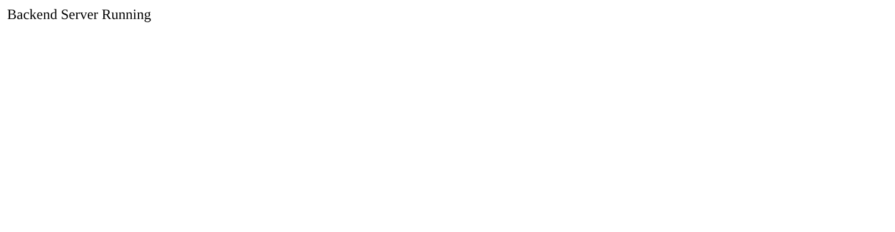

# Lecture 3: Flask Demo

**Course:** Backend Development, Unit 1
**Lecture:** 3, Setting Up the Backend Environment (Task 6)
**Student:** Krish Pawar · B.Tech CSE · SAP ID 590017543 · UPES Dehradun

**Source:** [`app.py`](https://github.com/Krish252616/backend-development/blob/main/Theory/Lecture-03/flask-demo/app.py)

---

## 1. Aim

To set up Python, `pip` and a virtual environment, and run a first backend server with Flask, the Python counterpart of the Express server from the same lecture.

## 2. What it does

| Method | Route | Response |
|---|---|---|
| GET | `/` | Plain text: `Backend Server Running` |

## 3. How to run

```bash
cd Theory
python3 -m venv .venv
source .venv/bin/activate
pip install -r requirements.txt
cd Lecture-03/flask-demo
python app.py
```

Open http://127.0.0.1:5000. Press `Ctrl + C` to stop.

| Step | macOS (Terminal, zsh) | Windows |
|---|---|---|
| Check Python | `python3 --version` | `python --version` or `py --version` |
| Create the virtual environment | `python3 -m venv .venv` | `python -m venv .venv` |
| Activate it | `source .venv/bin/activate` | Command Prompt: `.venv\Scripts\activate` · PowerShell: `.venv\Scripts\Activate.ps1` |
| Install packages | `pip install -r requirements.txt` | Same |
| Run | `python app.py` (inside the venv, `python` points to Python 3) | `python app.py` |
| Leave the venv | `deactivate` | `deactivate` |

When the virtual environment is active, the prompt starts with `(.venv)`.

## 4. Code walkthrough

```python
from flask import Flask

app = Flask(__name__)

@app.route("/")
def home():
    return "Backend Server Running"

if __name__ == "__main__":
    app.run(debug=True)
```

| Line | Meaning |
|---|---|
| `app = Flask(__name__)` | Creates the application. `__name__` tells Flask where the app's files are |
| `@app.route("/")` | Connects the URL `/` to the function below it (like `app.get("/")` in Express) |
| `return "..."` | Whatever the function returns becomes the response body |
| `if __name__ == "__main__":` | Starts the server only when the file is run directly, not when it is imported |
| `debug=True` | Restarts the server when the code changes and shows detailed error pages |

## 5. Output



Terminal output when the server starts:

```text
 * Serving Flask app 'app'
 * Debug mode: on
WARNING: This is a development server. Do not use it in a production deployment.
 * Running on http://127.0.0.1:5000
Press CTRL+C to quit
 * Restarting with stat
 * Debugger is active!
```

Response seen with `curl -i`:

```text
$ curl -i 127.0.0.1:5000/
HTTP/1.1 200 OK
Server: Werkzeug/3.1.8 Python/3.13.16
Content-Type: text/html; charset=utf-8
Content-Length: 22

Backend Server Running
```

## 6. What I learned

1. Flask and Express follow the same idea: a route decorator (Flask) or `app.get()` (Express) connects a URL to a function that returns the response.
2. Flask's default port is 5000, Express apps in this course use 3000. Each port can be used by only one program at a time.
3. A virtual environment keeps each project's packages separate, so two projects can use different versions without breaking each other.
4. `debug=True` is useful while learning because of auto reload and clear error pages, but it must never be used on a real server, because the debugger can run code.
5. When Flask returns a plain string, it still sends `Content-Type: text/html`, because Flask assumes the string is HTML.

## 7. Problems and Windows vs macOS differences

| Problem | Cause | Fix |
|---|---|---|
| `python: command not found` on macOS | macOS ships Python 3 as `python3`. Plain `python` only exists inside an active virtual environment | Use `python3` to create the venv. After `source .venv/bin/activate`, `python` works |
| `Port 5000 is in use by another program` on macOS | Since macOS Monterey, the **AirPlay Receiver** service listens on port 5000 | Turn it off in System Settings > General > AirDrop & Handoff > AirPlay Receiver, or run Flask on another port: `app.run(debug=True, port=5001)` |
| PowerShell says running scripts is disabled when activating the venv | Windows blocks `.ps1` scripts by default | Run once: `Set-ExecutionPolicy -Scope CurrentUser RemoteSigned`, or activate from Command Prompt with `.venv\Scripts\activate` |
| `ModuleNotFoundError: No module named 'flask'` | Packages were installed outside the venv, or the venv was not active when running `app.py` | Activate the venv first (prompt shows `(.venv)`), then `pip install -r requirements.txt` |
| The `Theory/requirements.txt` file was the only list of packages, so this folder could not be installed on its own | No `requirements.txt` inside the project | Added `flask-demo/requirements.txt` with `Flask==3.1.3` |

## 8. Result

The Flask server runs on port 5000 and returns `Backend Server Running` with status `200 OK`, the same result as Task 1 of the Express demo, written in Python.
