# Lecture 4: HTTP Requests, DevTools, curl, Postman and fetch

**Course:** Backend Development, Unit 1
**Lecture:** 4, HTTP Requests, DevTools, curl, Postman and fetch (CO1)
**Student:** Krish Pawar · B.Tech CSE · SAP ID 590017543 · UPES Dehradun

**Source:** [`server.js`](https://github.com/Krish252616/backend-development/blob/main/Theory/Lecture-04/http-tools/server.js) · [`public/app.js`](https://github.com/Krish252616/backend-development/blob/main/Theory/Lecture-04/http-tools/public/app.js) · [`public/index.html`](https://github.com/Krish252616/backend-development/blob/main/Theory/Lecture-04/http-tools/public/index.html) · [Postman collection](https://github.com/Krish252616/backend-development/blob/main/Theory/Lecture-04/http-tools/postman/Student-Management-API.postman_collection.json)

---

## 1. Aim

To look at what actually travels between a client and a server. The same students API is called with four different clients (Chrome DevTools, curl, Postman and JavaScript `fetch()`), and the request and response are inspected in each one.

## 2. What it does

| Part | What it is |
|---|---|
| `server.js` | The students API from Lecture 3 Task 3 (`GET /students`, `GET /students/:id`), plus `POST /students` so that Postman and `fetch()` can send a body |
| `public/` | A small page served by the same server at `http://localhost:3000/`. Each button calls the API with `fetch()` |
| `postman/` | The **Student Management API** collection. Import it into Postman, or run it from the terminal with Newman |
| Flask server | Task 5 and Exercise 3 use the Flask server from [Lecture 3, Task 7](../../Lecture-03/flask-demo/report.md) on port 5000. Nothing new was written for it |

Routes:

| Method | Path | Success | Error |
|---|---|---|---|
| GET | `/students` | 200, array of students | |
| GET | `/students/:id` | 200, one student | 404 `{"error":"Student not found"}` |
| POST | `/students` | 201, the new student with an id chosen by the server | 400 `{"error":"name and branch are required"}` |

The data is kept in an array in memory, so a student added with POST disappears when the server restarts.

## 3. How to run

```bash
cd Theory/Lecture-04/http-tools
npm install
npm start
```

Then open http://localhost:3000 for the `fetch()` page, or http://localhost:3000/students for the raw JSON.

For the Flask part (Task 5, Exercise 3), start the Lecture 3 Flask server in a second terminal:

```bash
cd Theory
source .venv/bin/activate
cd Lecture-03/flask-demo/task7
python app.py
```

**macOS vs Windows**

| Step | macOS (Terminal, zsh) | Windows |
|---|---|---|
| Open DevTools in Chrome | `Cmd + Option + I` | `F12` or `Ctrl + Shift + I` |
| Hard reload (skip cache) | `Cmd + Shift + R` | `Ctrl + Shift + R` |
| curl | `curl` is already installed | Use `curl.exe` in PowerShell. Plain `curl` in old Windows PowerShell 5.1 is an alias for `Invoke-WebRequest` and prints a different object. In Command Prompt, `curl` works as it is |
| PowerShell alternative to curl | | `Invoke-RestMethod http://localhost:3000/students` |
| POST with curl | `curl -X POST -H "Content-Type: application/json" -d '{"name":"Priya","branch":"CSE"}' http://localhost:3000/students` | Command Prompt does not treat `'` as a quote, so escape the inner quotes: `curl -X POST -H "Content-Type: application/json" -d "{\"name\":\"Priya\",\"branch\":\"CSE\"}" http://localhost:3000/students` |
| Activate the Flask venv | `source .venv/bin/activate` | `.venv\Scripts\activate` |
| Save a request in Postman | `Cmd + S` | `Ctrl + S` |
| Import the collection | Postman, **Import**, choose the `.json` file | Same |

If port 5000 is already taken on a Mac, turn off **AirPlay Receiver** in System Settings, General, AirDrop and Handoff. macOS uses port 5000 for it.

## 4. Code walkthrough

**server.js: serving the page and reading JSON bodies**

```javascript
app.use(express.json());                                   // read JSON request bodies
app.use(express.static(path.join(__dirname, "public")));  // serves public/index.html at /
```

`express.json()` fills `req.body` when the request has `Content-Type: application/json`. Without it, `req.body` is `undefined`. `express.static` serves the `fetch()` page from the same server, so the page and the API have the same origin and the browser does not block the calls (no CORS needed).

**server.js: POST /students**

```javascript
app.post("/students", (req, res) => {
    const name = String((req.body && req.body.name) || "").trim();
    const branch = String((req.body && req.body.branch) || "").trim();

    if (!name || !branch) {
        return res.status(400).json({ error: "name and branch are required" });
    }

    const id = students.reduce((max, s) => Math.max(max, s.id), 0) + 1;
    const student = { id, name, branch };
    students.push(student);
    res.status(201).json(student);
});
```

The server chooses the id, so even if the body sends `"id": 4` (as in the lecture's Postman example), it is ignored. A missing field returns **400 Bad Request** and a created student returns **201 Created**.

**public/app.js: GET with `.then()` and a status check**

```javascript
function getStudent(id) {
  fetch(`/students/${id}`)
    .then(async response => {
      const data = await response.json();
      if (!response.ok) {
        show(`GET /students/${id}`, response.status, data);
        throw new Error(`Student not found: ${response.status}`);
      }
      return { response, data };
    })
    .then(({ response, data }) => {
      console.log("Found:", data.name, "-", data.branch);
      show(`GET /students/${id}`, response.status, data);
    })
    .catch(error => console.error("Error:", error.message));
}
```

`fetch()` only rejects when the request cannot be sent at all (server down, no network). A 404 or 500 still counts as a reply, so `response.ok` (true for 200 to 299) has to be checked by hand.

**public/app.js: POST with async/await**

```javascript
const response = await fetch("/students", {
  method: "POST",
  headers: { "Content-Type": "application/json" },
  body: JSON.stringify({ name, branch })
});
const data = await response.json();
```

The body must be a string, so the object goes through `JSON.stringify`, and the `Content-Type` header tells Express to parse it as JSON.

**public/app.js: Exercise 4, filter CSE on the client**

```javascript
async function getCSEStudents() {
  const response = await fetch("/students");
  if (!response.ok) throw new Error(`HTTP ${response.status}`);
  const students = await response.json();
  const cseStudents = students.filter(s => s.branch === "CSE");
  console.log("CSE students:", cseStudents);
  renderList(cseStudents);
  return cseStudents;
}
```

The server sends every student and the browser keeps only the CSE ones. (In the real file this is wrapped in `try...catch` and also prints "N of M students are CSE".) The list on the page is built with `textContent`, not `innerHTML`, so a name is always shown as plain text.

## 5. Output

### Task 1 and Exercise 1: DevTools, GET /students

`GET /students` in the Network tab: method GET, status 200 OK, `Content-Type: application/json; charset=utf-8`, and the three students in the response.

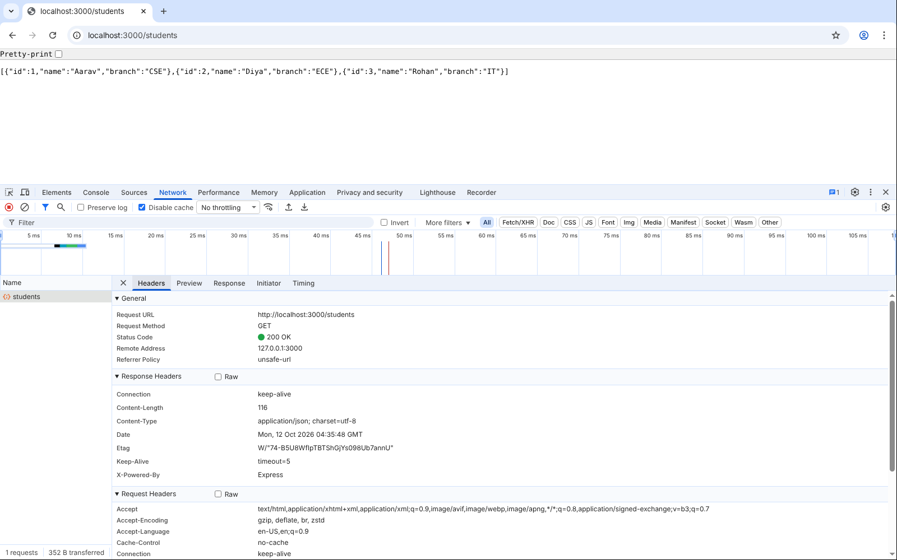

### Task 2 and Exercise 2: curl

```text
$ curl http://localhost:3000/students
[{"id":1,"name":"Aarav","branch":"CSE"},{"id":2,"name":"Diya","branch":"ECE"},{"id":3,"name":"Rohan","branch":"IT"}]

$ curl http://localhost:3000/students/3
{"id":3,"name":"Rohan","branch":"IT"}
```

Exercise 2: the reply for `/students/3` is Rohan, branch IT, which matches the data in `server.js`.

A student that does not exist, with `-i` to show the status line and headers:

```text
$ curl -i http://localhost:3000/students/99
HTTP/1.1 404 Not Found
X-Powered-By: Express
Content-Type: application/json; charset=utf-8
Content-Length: 29
ETag: W/"1d-/w9leX+CSVwScG3mclc8pAqpxGg"
Date: Mon, 12 Oct 2026 04:34:21 GMT
Connection: keep-alive
Keep-Alive: timeout=5

{"error":"Student not found"}
```

### Exercise 5: every response header from Express (`curl -v`)

Lines starting with `>` are what curl sent. Lines starting with `<` are what the server sent back.

```text
$ curl -v http://localhost:3000/students
*   Trying 127.0.0.1:3000...
* Connected to localhost (127.0.0.1) port 3000
> GET /students HTTP/1.1
> Host: localhost:3000
> User-Agent: curl/8.5.0
> Accept: */*
>
< HTTP/1.1 200 OK
< X-Powered-By: Express
< Content-Type: application/json; charset=utf-8
< Content-Length: 116
< ETag: W/"74-B5U8WfIpTBTShGjYs098Ub7annU"
< Date: Mon, 12 Oct 2026 04:34:21 GMT
< Connection: keep-alive
< Keep-Alive: timeout=5
<
[{"id":1,"name":"Aarav","branch":"CSE"},{"id":2,"name":"Diya","branch":"ECE"},{"id":3,"name":"Rohan","branch":"IT"}]
```

| Response header | Value | Meaning |
|---|---|---|
| `X-Powered-By` | `Express` | Names the framework. Can be turned off with `app.disable("x-powered-by")` |
| `Content-Type` | `application/json; charset=utf-8` | The body is JSON, set by `res.json()` |
| `Content-Length` | `116` | Size of the body in bytes |
| `ETag` | `W/"74-..."` | A fingerprint of the body. The browser sends it back as `If-None-Match`, and if nothing changed the server replies 304 Not Modified with no body |
| `Date` | the time of the reply | Added by Node's HTTP server |
| `Connection` | `keep-alive` | The TCP connection stays open for the next request |
| `Keep-Alive` | `timeout=5` | The server closes an idle connection after 5 seconds |

### Task 3 and Exercise 3: Postman

The collection [`Student-Management-API.postman_collection.json`](https://github.com/Krish252616/backend-development/blob/main/Theory/Lecture-04/http-tools/postman/Student-Management-API.postman_collection.json) has two folders:

| Folder | Requests |
|---|---|
| Express (port 3000) | Get All Students (with the `Accept: application/json` header from Task 3, Step 3), Get Student 2, Get Student 3, Get Missing Student, Create Student (POST), Create Student Without Branch |
| Flask (port 5000) | Get All Students (Flask), for Exercise 3 |

Each request has test scripts (status code, JSON, the right student). The whole collection was run with Newman, Postman's command line runner, with both servers on:

```text
$ npx newman run postman/Student-Management-API.postman_collection.json

Student Management API

❏ Express (port 3000)
↳ Get All Students
  GET http://localhost:3000/students [200 OK, 352B, 23ms]
  ✓  Status code is 200
  ✓  Response is JSON
  ✓  Returns at least 3 students

↳ Get Student 2
  GET http://localhost:3000/students/2 [200 OK, 272B, 4ms]
  ✓  Status code is 200
  ✓  Student 2 is Diya

↳ Get Student 3
  GET http://localhost:3000/students/3 [200 OK, 272B, 4ms]
  ✓  Status code is 200
  ✓  Student 3 is Rohan (IT)

↳ Get Missing Student
  GET http://localhost:3000/students/99 [404 Not Found, 271B, 4ms]
  ✓  Status code is 404
  ✓  Error message

↳ Create Student
  POST http://localhost:3000/students [201 Created, 278B, 11ms]
  ✓  Status code is 201
  ✓  Server assigned an id

↳ Create Student Without Branch
  POST http://localhost:3000/students [400 Bad Request, 284B, 5ms]
  ✓  Status code is 400

❏ Flask (port 5000)
↳ Get All Students (Flask)
  GET http://localhost:5000/students [200 OK, 357B, 4ms]
  ✓  Status code is 200
  ✓  Response is JSON
  ✓  Same 3 students as Express

┌─────────────────────────┬─────────────────┬─────────────────┐
│                         │        executed │          failed │
├─────────────────────────┼─────────────────┼─────────────────┤
│                requests │               7 │               0 │
├─────────────────────────┼─────────────────┼─────────────────┤
│              assertions │              15 │               0 │
└─────────────────────────┴─────────────────┴─────────────────┘
```

7 requests, 15 checks, 0 failed. Opening the same file with **Import** in Postman shows the same requests, ready to send with **Send**.

### Task 4: one request, three tools

`GET http://localhost:3000/students/2`

**DevTools**

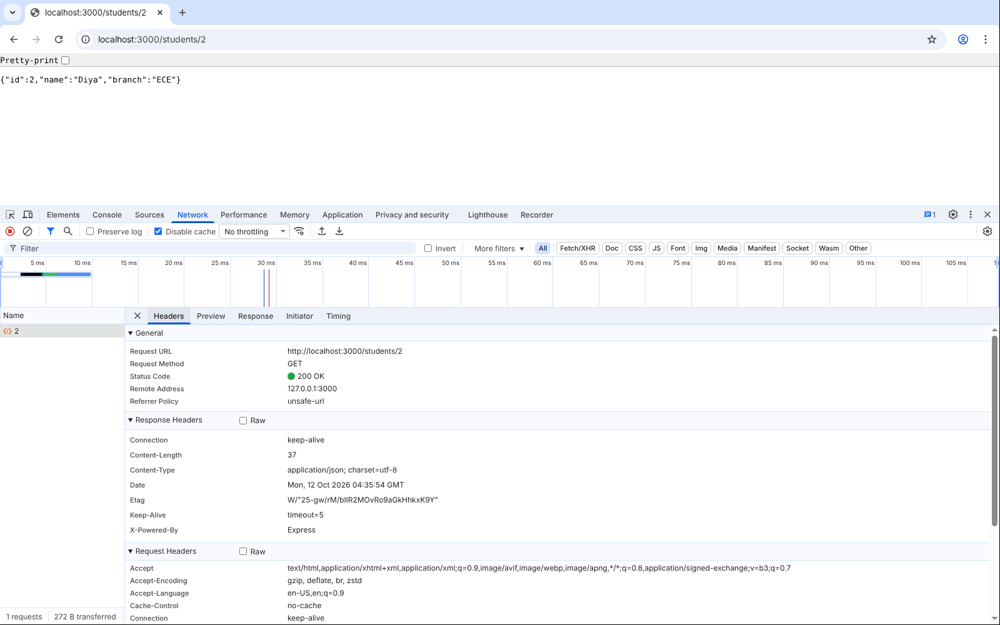

**curl**

```text
$ curl -i http://localhost:3000/students/2
HTTP/1.1 200 OK
X-Powered-By: Express
Content-Type: application/json; charset=utf-8
Content-Length: 37
ETag: W/"25-gw/rM/bIlR2MOvRo9aGkHhkxK9Y"
Date: Mon, 12 Oct 2026 04:34:21 GMT
Connection: keep-alive
Keep-Alive: timeout=5

{"id":2,"name":"Diya","branch":"ECE"}
```

**Postman (Newman)**

```text
↳ Get Student 2
  GET http://localhost:3000/students/2 [200 OK, 272B, 4ms]
  ✓  Status code is 200
  ✓  Student 2 is Diya
```

All three got **200 OK** and `{"id":2,"name":"Diya","branch":"ECE"}`, and the ETag in DevTools and curl is the same (`W/"25-gw/rM/..."`), so the body was byte for byte the same. Only the display differs. The request headers did differ: Chrome sent `Accept: text/html,...` and many more headers, curl sent only `Host`, `User-Agent` and `Accept: */*`. The server answered all of them the same way.

### Task 5: the Flask server, same request

```text
$ curl -v http://localhost:5000/students
> GET /students HTTP/1.1
> Host: localhost:5000
> User-Agent: curl/8.5.0
> Accept: */*
>
< HTTP/1.1 200 OK
< Server: Werkzeug/3.1.8 Python/3.13.16
< Date: Mon, 12 Oct 2026 04:34:21 GMT
< Content-Type: application/json
< Content-Length: 190
< Connection: close
<
[
  {
    "branch": "CSE",
    "id": 1,
    "name": "Aarav"
  },
  ...
]
```

| | Express (3000) | Flask (5000) |
|---|---|---|
| Status line | `HTTP/1.1 200 OK` | `HTTP/1.1 200 OK` |
| Names itself in | `X-Powered-By: Express` | `Server: Werkzeug/3.1.8 Python/3.13.16` |
| `Content-Type` | `application/json; charset=utf-8` | `application/json` |
| `ETag` | yes | no |
| Connection | `keep-alive`, `Keep-Alive: timeout=5` | `close` |
| Body | one line, keys in the order written | pretty printed, keys sorted A to Z |

Same request, same status, same data. Only the server's own headers and formatting differ. This is what the lecture means by "HTTP is a protocol": any client can talk to any server that follows it.

### fetch(): the browser page

GET all students:

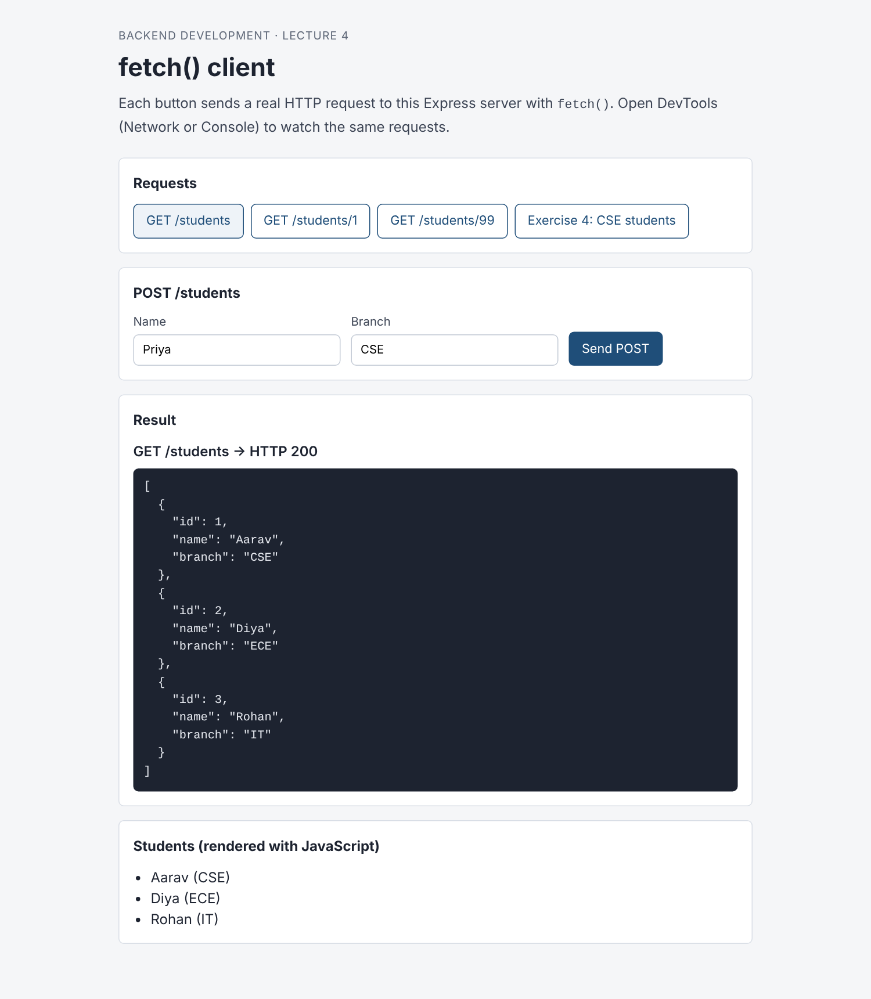

GET one student, and a missing one (the 404 body is shown and the error goes to the console):

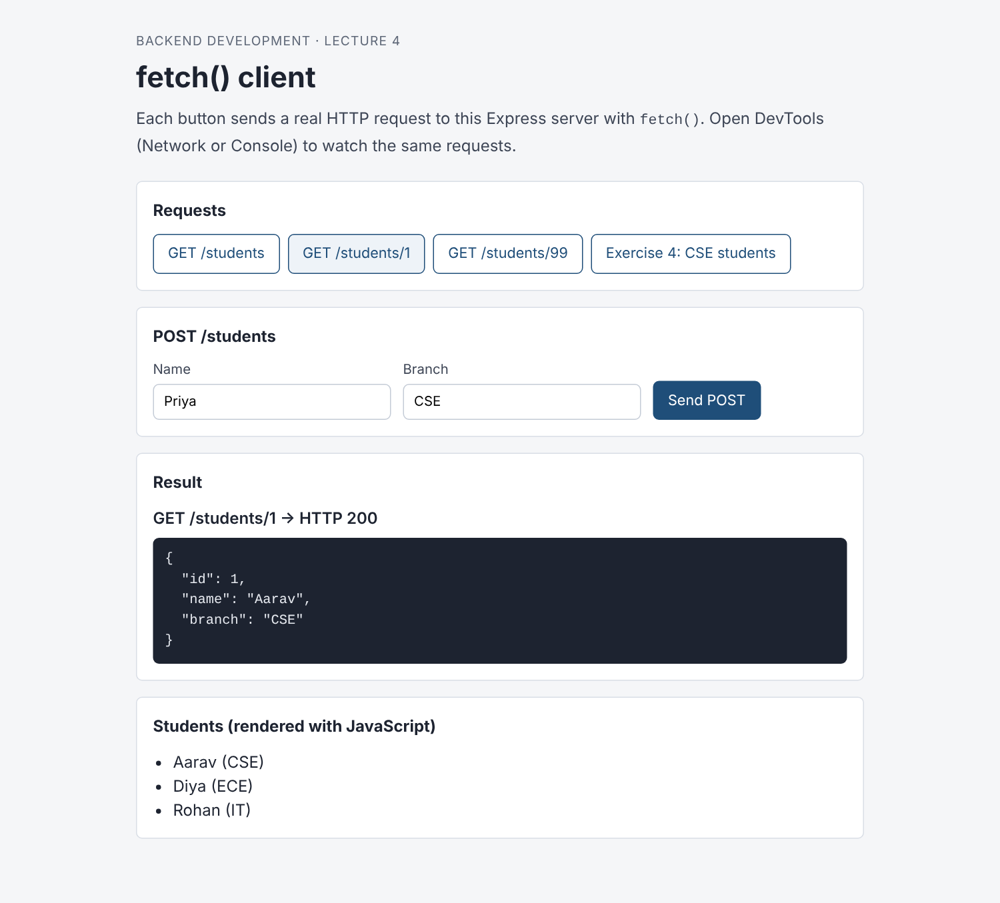

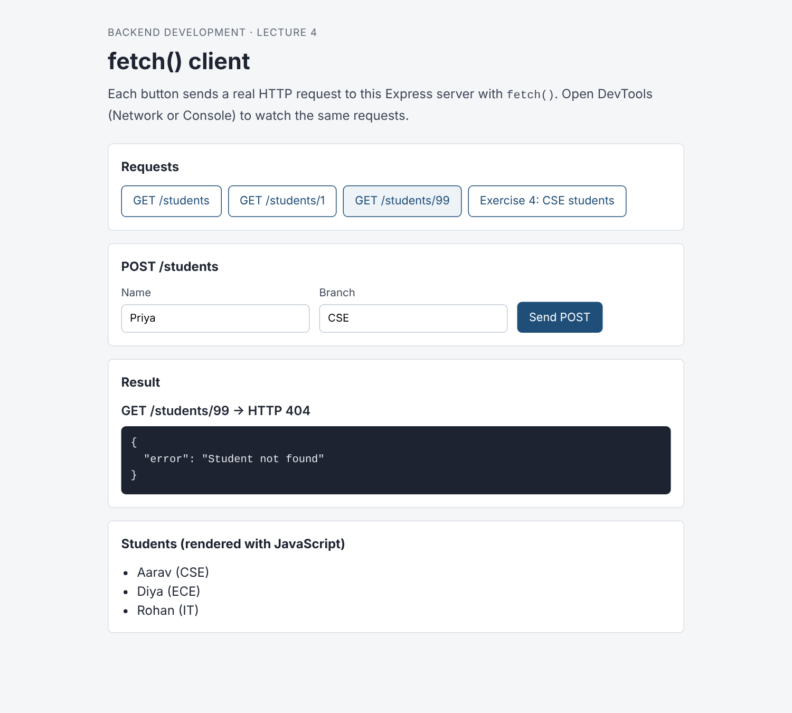

Exercise 4, CSE students filtered in the browser (1 of 3):

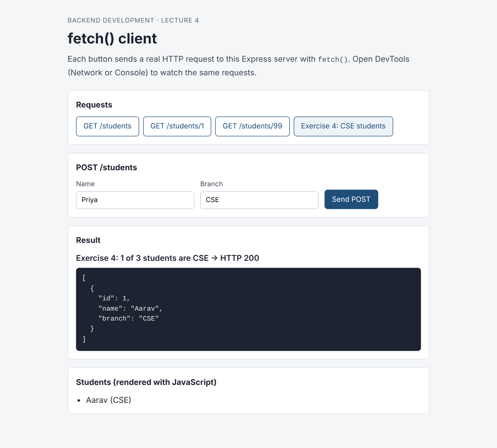

POST a new student, Priya (CSE). The server replies 201 with id 4:

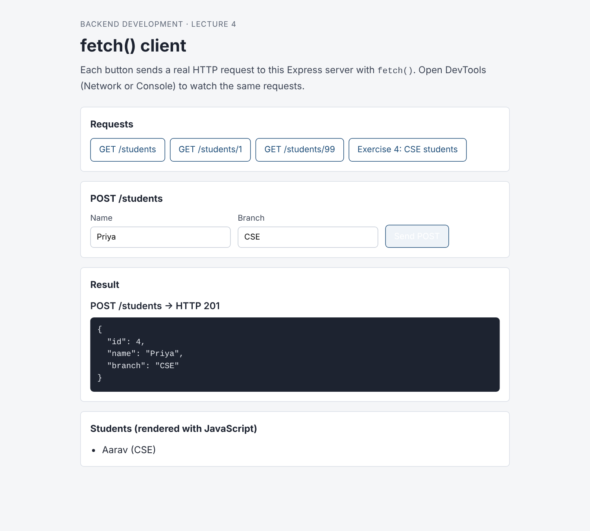

Exercise 4 again after the POST. Now 2 of 4 students are CSE, which shows the filter works on live data:

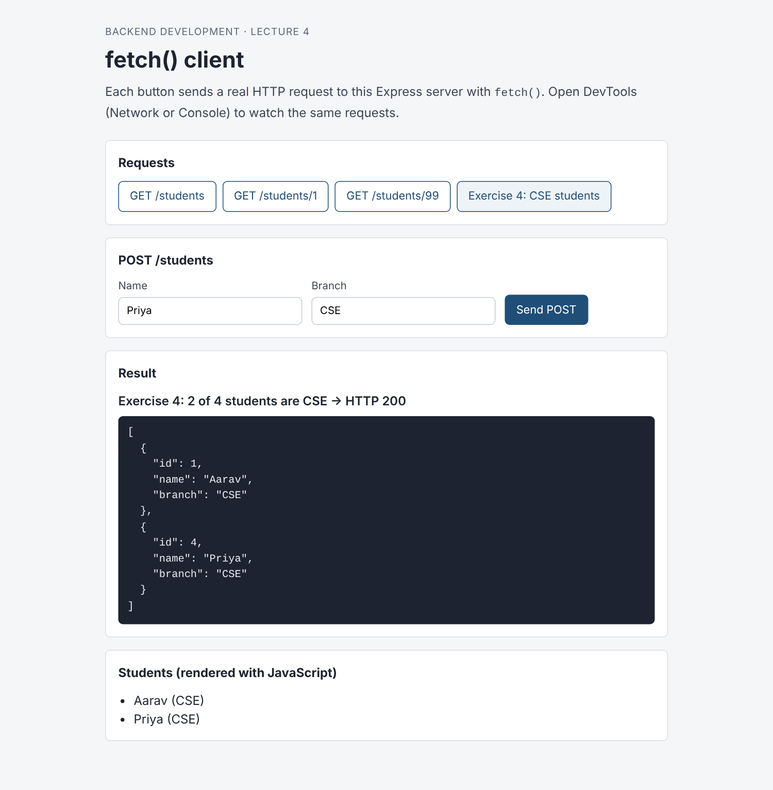

**The same calls in DevTools**

Network tab with the Fetch/XHR filter. The `99` row is red because it got a 404:

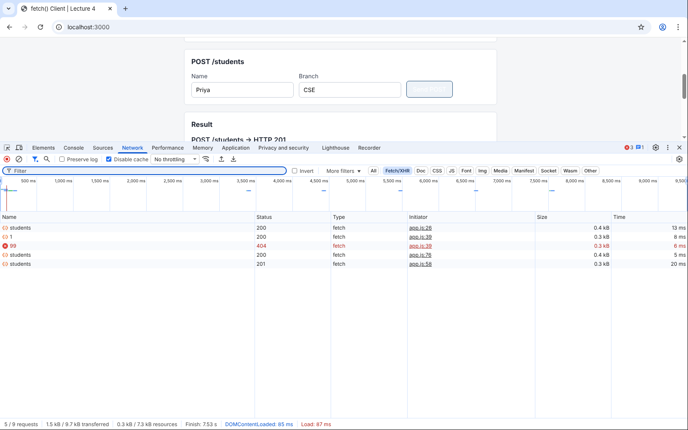

The POST request: method POST, 201 Created:

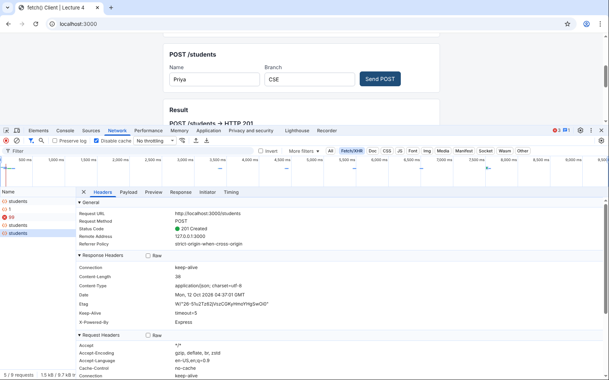

The Payload tab shows the body that `fetch()` sent, `{name: "Priya", branch: "CSE"}`:

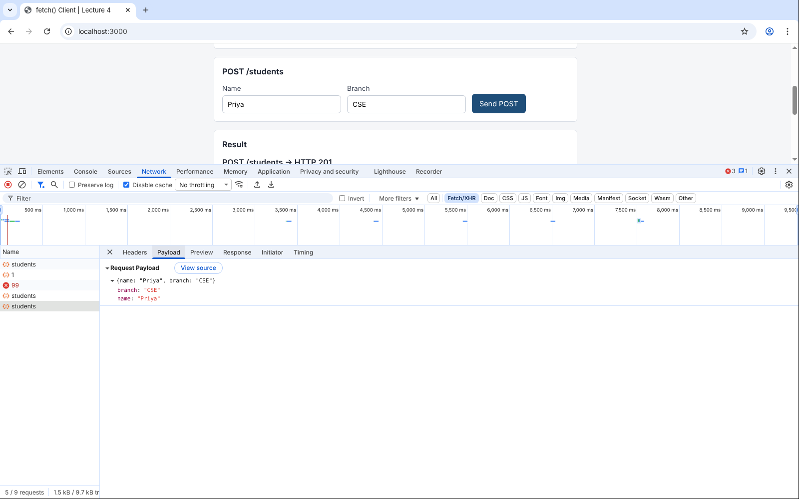

Console output from the `console.log` and `console.error` calls in `app.js`:

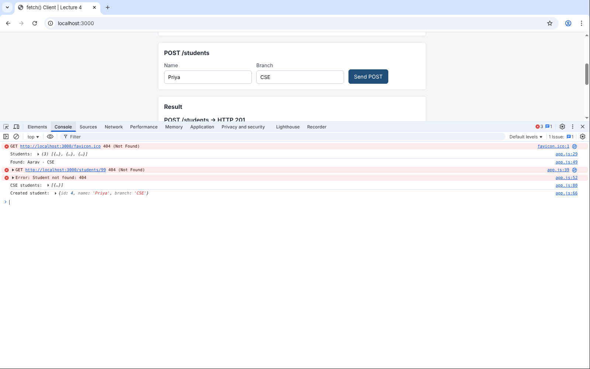

## 6. Lab exercises

| # | Exercise | Where it is done | Result |
|---|---|---|---|
| 1 | DevTools screenshot of `GET /students` | [Task 1 screenshot](#task-1-and-exercise-1-devtools-get-students) | 200 OK, `application/json`, 3 students |
| 2 | curl `GET /students/3` and check it | [curl output](#task-2-and-exercise-2-curl) | `{"id":3,"name":"Rohan","branch":"IT"}`, matches the data |
| 3 | Postman `GET http://localhost:5000/students` (Flask), saved to a new collection | Folder **Flask (port 5000)** in the [Postman collection](#task-3-and-exercise-3-postman) | 200 OK, same 3 students as Express |
| 4 | `fetch()` all students and keep only branch CSE on the client | `getCSEStudents()` in `public/app.js`, [screenshots](#fetch-the-browser-page) | 1 of 3 CSE, then 2 of 4 after the POST |
| 5 | `curl -v`: list every response header from Express | [Header table](#exercise-5-every-response-header-from-express-curl--v) | 7 headers: X-Powered-By, Content-Type, Content-Length, ETag, Date, Connection, Keep-Alive |

## 7. What I learned

1. An HTTP request is plain text: a request line (method, path, version), headers, a blank line, then an optional body. The response is the same shape with a status line. `curl -v` shows this most clearly.
2. DevTools, curl, Postman and `fetch()` all send the same kind of request. They differ only in how they show it: DevTools for quick checks while browsing, curl for scripts and servers with no browser, Postman for building, saving and testing APIs, and `fetch()` for real code in a web page.
3. `fetch()` does not throw on 404 or 500. Always check `response.ok` or `response.status`.
4. To send JSON with `fetch()` you need three things: `method: "POST"`, the `Content-Type: application/json` header, and `body: JSON.stringify(...)`. On the server, `express.json()` is needed to read it.
5. Status codes tell the client what happened without reading the body: 200 OK, 201 Created, 400 Bad Request, 404 Not Found, and 304 Not Modified when the cached copy is still good.
6. `ETag` and `304` are how the browser avoids downloading the same data again.
7. Two different servers (Express and Flask) can return the same data with different headers, and a client works with both.
8. Postman tests turn manual checks into automatic ones, and Newman runs them from the terminal.

## 8. Problems I faced and how I fixed them

| Problem | Cause | Fix |
|---|---|---|
| A `fetch()` page opened as a file (`file:///...`) or from another port would be blocked by **CORS** | The browser only lets a page call a server on the same origin (scheme, host and port) unless the server allows it | Served the page from the same Express server with `express.static`, so the page and the API are both `http://localhost:3000` |
| Without a status check, `GET /students/99` would be treated as a success | `fetch()` resolves normally on 404, so the code would print `undefined - undefined` for the name and branch of `{error: ...}` | Checked `response.ok` and threw an error when it was false, so the 404 goes to `.catch()` |
| POST from `fetch()` returned **400** `name and branch are required` even though the form was filled | Passing the object directly (`body: {name, branch}`) sends the text `[object Object]` as `text/plain`, and without the `Content-Type: application/json` header `express.json()` does not parse the body, so `req.body` is empty | `body: JSON.stringify({ name, branch })` plus `headers: { "Content-Type": "application/json" }` |
| DevTools showed **304 Not Modified** instead of 200, with an empty response | Chrome sent the saved ETag in `If-None-Match`, the data had not changed, so Express answered 304 | Ticked **Disable cache** in the Network tab (works only while DevTools is open), or used a hard reload |
| The Console showed a red `favicon.ico 404` | Chrome asks every site for `/favicon.ico` and this project has no icon | Not a bug in the app. It can be removed by adding `<link rel="icon" href="data:,">` to the page head |
| The lecture's Postman POST step gives an error | The Lecture 3 server had no POST route (the lecture says this is expected) | Added `POST /students` in this project, so the Postman and `fetch()` POST steps work |
| On Windows PowerShell 5.1, `curl -v` gave a strange error or a table instead of raw output | `curl` there is an alias for `Invoke-WebRequest`, which has different options | Use `curl.exe -v ...` (real curl ships with Windows 10 and 11), or use Command Prompt. On macOS, `curl` is the real curl |
| Port already in use | An old `node server.js` was still running. In Express 5 the error goes to the `listen` callback, so a callback that ignores it makes the server look started and then exit | The callback now does `if (error) throw error;`, so the real `EADDRINUSE` message is printed. Stop the old process (`Ctrl + C` in its terminal) and start again |
| Flask replies had `Connection: close` while Express had `keep-alive` | The Flask development server (Werkzeug) closes the connection after each reply. Not an error | Noted as a difference in the Task 5 table |

## 9. Result

The students API was inspected with Chrome DevTools, curl, Postman (run with Newman) and `fetch()`. All tools got the same status codes and data from the server, the Postman collection passed 7 requests and 15 checks with 0 failures, and all five lab exercises were completed with real output.
