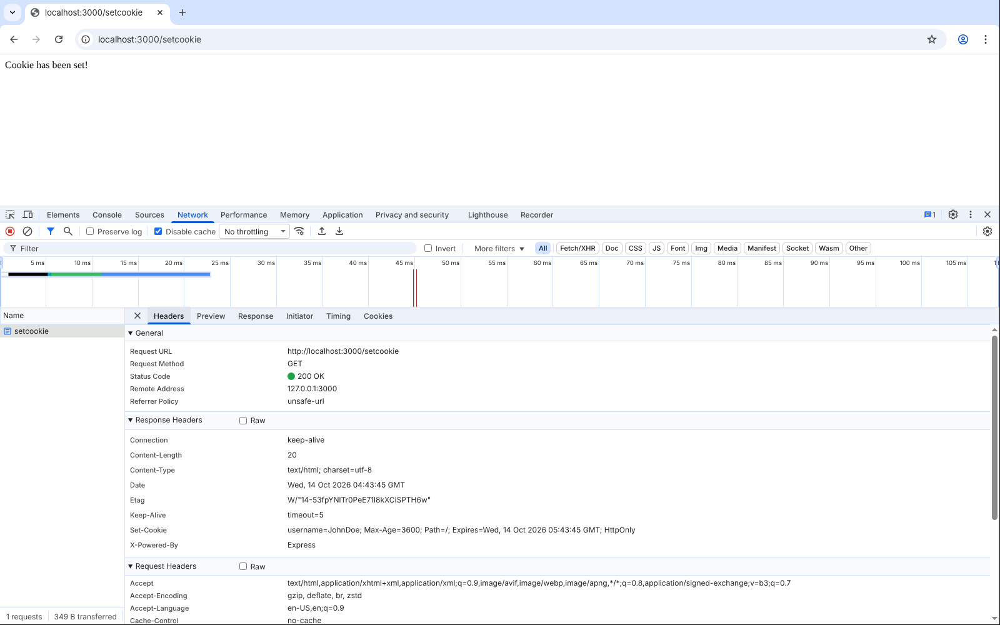
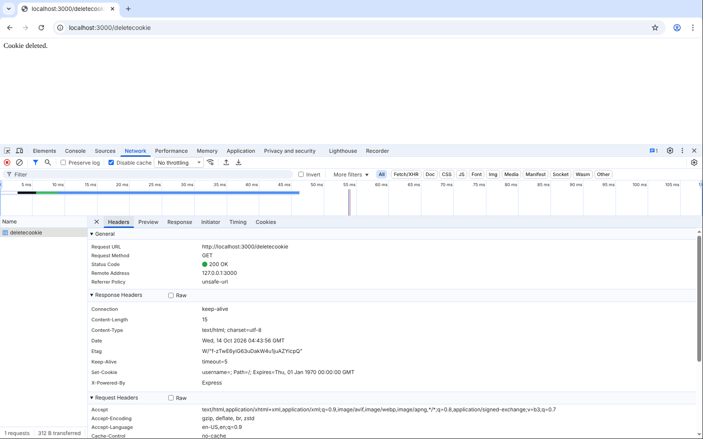
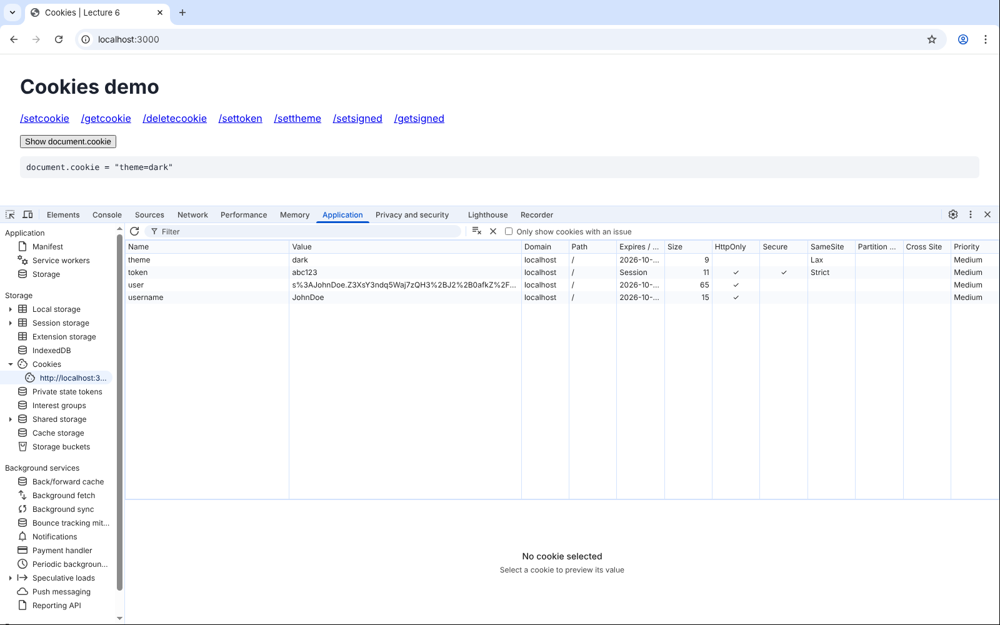
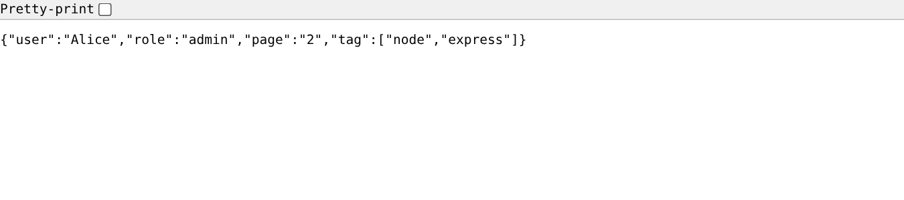
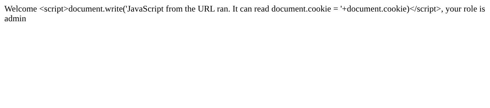

# Lecture 6: Cookies and Query Strings

**Course:** Backend Development, Unit 1
**Lecture:** 6, Managing Server-side Session, Cookie and State Management (CO1)
**Student:** Krish Pawar · B.Tech CSE · SAP ID 590017543 · UPES Dehradun

**Source:** [`cookies.js`](https://github.com/Krish252616/backend-development/blob/main/Theory/Lecture-06/cookies-querystrings/cookies.js) · [`querystring.js`](https://github.com/Krish252616/backend-development/blob/main/Theory/Lecture-06/cookies-querystrings/querystring.js)

The sessions part of this lecture is in a separate report: [Lecture 6: Sessions with express-session](../sessions/report.md).

---

## 1. Aim

HTTP does not remember anything between requests. Lecture 6 shows three ways to keep state: sessions, cookies and query strings. This project covers the last two:

1. Set, read and delete cookies with `cookie-parser`, and test the security attributes `httpOnly`, `secure`, `sameSite` and `maxAge`.
2. Read values from the URL with `req.query`.
3. Do the security check from the lecture's assessment ("security analysis demonstration"): find what an attacker can read or change, and fix it.

## 2. What it does

**`cookies.js`** (port 3000)

| Route | What it does |
|---|---|
| `/` | A small page with links to every route and a **Show document.cookie** button |
| `/setcookie` | Sets `username=JohnDoe` for 1 hour, `httpOnly` (lecture code) |
| `/getcookie` | Reads `username` and says `Welcome back, JohnDoe` (lecture code) |
| `/deletecookie` | Removes the cookie with `res.clearCookie` (lecture code) |
| `/settoken` | The lecture's security example: `token=abc123` with `httpOnly`, `secure`, `sameSite: 'strict'` |
| `/settheme` | `theme=dark` **without** `httpOnly`, to compare what JavaScript can read |
| `/setsigned`, `/getsigned` | A **signed** cookie, added after the tampering test in section 5 |

**`querystring.js`** (port 3000)

| Route | What it does |
|---|---|
| `/welcome?user=Alice&role=admin` | `Welcome Alice, your role is admin` (lecture example, with two fixes from section 5) |
| `/query?...` | Returns everything in `req.query` as JSON, to see how Express reads the URL |

## 3. How to run

```bash
cd Theory/Lecture-06/cookies-querystrings
npm install
npm run cookies      # then open http://localhost:3000
```

Stop it with `Ctrl + C`, then:

```bash
npm run query        # then open http://localhost:3000/welcome?user=Alice&role=admin
```

Both use port 3000, so run one at a time.

| Step | macOS (Terminal, zsh) | Windows |
|---|---|---|
| Install and run | `npm install`, then `npm run cookies` | Same |
| See cookies in Chrome | `Cmd + Option + I`, then **Application**, **Cookies**, `http://localhost:3000` | `F12`, then the same tabs |
| Save and send cookies with curl | `curl -c jar.txt -b jar.txt localhost:3000/getcookie` | Same in Command Prompt. In PowerShell use `curl.exe` |
| Send a made-up cookie | `curl -b "username=Hacker" localhost:3000/getcookie` | Same, with `curl.exe` in PowerShell |
| URL with `&` in curl | Put the URL in quotes: `curl "localhost:3000/welcome?user=Alice&role=admin"` | Same. Without quotes, Command Prompt and PowerShell treat `&` as a command separator, and zsh runs the command in the background |
| URL with `[ ]` in curl | `curl -g "localhost:3000/query?user[name]=Alice"` | Same. `-g` stops curl from treating `[ ]` as a pattern |
| Free port 3000 | `lsof -ti :3000 \| xargs kill` | `netstat -ano`, find `:3000`, then `taskkill /PID <number> /F` |

## 4. Code walkthrough

**Setting, reading and deleting a cookie**

```javascript
app.use(cookieParser('myCookieSecret'));

res.cookie('username', 'JohnDoe', { maxAge: 3600000, httpOnly: true, secure: false });  // set
const user = req.cookies.username;                                                    // read
res.clearCookie('username');                                                          // delete
```

| Part | Meaning |
|---|---|
| `cookieParser()` | Reads the `Cookie` header of each request and fills `req.cookies` |
| `res.cookie(name, value, options)` | Adds a `Set-Cookie` header to the response. The browser saves it |
| `maxAge: 3600000` | Lifetime in milliseconds (1 hour). Express sends it as `Max-Age=3600` (seconds) and `Expires=...` |
| `httpOnly: true` | Page JavaScript (`document.cookie`) cannot read it |
| `secure: true` | Only sent over HTTPS |
| `sameSite: 'strict'` | Not sent when another website links or posts to this site |
| `res.clearCookie(name)` | Sends the same cookie with an empty value and an expiry date in 1970, so the browser deletes it |

**Signed cookie**

```javascript
app.use(cookieParser('myCookieSecret'));          // the secret is needed for signing

res.cookie('user', 'JohnDoe', { maxAge: 3600000, httpOnly: true, signed: true });

const user = req.signedCookies.user;              // "JohnDoe", or false if it was changed
```

The cookie becomes `s:JohnDoe.<signature>`. The signature is made from the value and the secret. Only the server knows the secret, so a user who edits the value cannot make a matching signature.

**Query string, with the two fixes**

```javascript
function escapeHtml(value) {
  return String(value)
    .replace(/&/g, '&amp;')
    .replace(/</g, '&lt;')
    .replace(/>/g, '&gt;')
    .replace(/"/g, '&quot;')
    .replace(/'/g, '&#39;');
}

app.get('/welcome', (req, res) => {
  const user = req.query.user || 'Guest';
  const role = req.query.role || 'visitor';
  res.send(`Welcome ${escapeHtml(user)}, your role is ${escapeHtml(role)}`);
});
```

`req.query` holds every `name=value` pair after the `?`. The lecture version sent `req.query.user` straight into the HTML. Section 5 shows why that is a problem.

## 5. Output

### Cookies in the browser

`/setcookie` in the Network tab. The response has the header `Set-Cookie: username=JohnDoe; Max-Age=3600; Path=/; Expires=...; HttpOnly`:



`/getcookie`: the browser sent the cookies back on its own (request **Cookies** tab), and the page says `Welcome back, JohnDoe`:


`/deletecookie`: the server sends `username=` with `Expires=Thu, 01 Jan 1970`, so the browser removes it:



### Security attributes and `document.cookie`

All four cookies were set, then **Show document.cookie** was clicked. DevTools (Application, Cookies) shows the attributes:



| Cookie | HttpOnly | Secure | SameSite | Expires | Can page JavaScript read it? |
|---|---|---|---|---|---|
| `username` | yes | | | in 1 hour | No |
| `token` | yes | yes | Strict | Session | No |
| `user` (signed) | yes | | | in 1 hour | No |
| `theme` | | | Lax | in 1 hour | **Yes**, `document.cookie = "theme=dark"` |

`document.cookie` shows only `theme=dark`. The three `httpOnly` cookies are hidden from JavaScript, which is exactly what the lecture's table says `httpOnly` is for. `token` has no `maxAge`, so its expiry is **Session**: it is deleted when the browser is closed (the lecture's "session cookie" type). The others are persistent cookies.

### Cookies with curl

```text
$ curl localhost:3000/getcookie
No cookie found.

$ curl -i -c jar.txt localhost:3000/setcookie
HTTP/1.1 200 OK
Set-Cookie: username=JohnDoe; Max-Age=3600; Path=/; Expires=Wed, 14 Oct 2026 05:41:26 GMT; HttpOnly

Cookie has been set!

$ curl -b jar.txt localhost:3000/getcookie
Welcome back, JohnDoe

$ curl -i -b jar.txt -c jar.txt localhost:3000/deletecookie
HTTP/1.1 200 OK
Set-Cookie: username=; Path=/; Expires=Thu, 01 Jan 1970 00:00:00 GMT

Cookie deleted.

$ curl -b jar.txt localhost:3000/getcookie
No cookie found.

$ curl -i localhost:3000/settoken
HTTP/1.1 200 OK
Set-Cookie: token=abc123; Path=/; HttpOnly; Secure; SameSite=Strict
```

### Security check 1: a normal cookie can be changed by the user

The lecture says cookies are "visible to the user; can be modified". Tested by sending a made-up cookie:

```text
$ curl -b "username=Hacker" localhost:3000/getcookie
Welcome back, Hacker
```

The server trusted it. Anyone can type any value into DevTools or curl. So a plain cookie must never decide who a user is.

**Fix: a signed cookie**

```text
$ curl -i -c jar.txt localhost:3000/setsigned
Set-Cookie: user=s%3AJohnDoe.Z3XsY3ndq5Waj7zQH3%2BJ2%2B0afkZ%2FaP8brLWeElRuQqU; Max-Age=3600; Path=/; Expires=Wed, 14 Oct 2026 05:41:44 GMT; HttpOnly
Signed cookie has been set!

$ curl -b jar.txt localhost:3000/getsigned
Welcome back, JohnDoe (signature OK)

$ curl -i -b 'user=s%3AHacker.Z3XsY3ndq5Waj7zQH3%2BJ2%2B0afkZ%2FaP8brLWeElRuQqU' localhost:3000/getsigned
HTTP/1.1 400 Bad Request
Cookie was changed by the client. Signature does not match.

$ curl -b "user=Hacker" localhost:3000/getsigned
No signed cookie found.
```

`JohnDoe` was changed to `Hacker` but the old signature was kept, so `req.signedCookies.user` became `false` and the server refused it. A cookie with no signature at all is not counted as a signed cookie. The value is still readable (`JohnDoe` is visible inside the cookie), so signing stops changes, not reading. This is the same idea express-session uses for `connect.sid`.

### Query strings

`/welcome?user=Alice&role=admin`:


How Express reads different URLs:

```text
$ curl "localhost:3000/query?user=Alice&role=admin&page=2"
{"user":"Alice","role":"admin","page":"2"}

$ curl "localhost:3000/query?tag=node&tag=express"
{"tag":["node","express"]}

$ curl -g "localhost:3000/query?user[name]=Alice"
{"user[name]":"Alice"}

$ curl "localhost:3000/welcome?user=Priya%20Sharma&role=student"
Welcome Priya Sharma, your role is student
```

The same `/query` route in the browser:



1. Every value is a **string**: `page` is `"2"`, not the number 2.
2. A name used twice becomes an **array**.
3. Express 5 does not turn `user[name]` into a nested object. The key is the plain text `user[name]` (Express 4 gave `{"user":{"name":"Alice"}}`).
4. `%20` in the URL is a space, decoded automatically.

### Security check 2: problems in the lecture's `/welcome` code

The lecture code, run exactly as written:

```javascript
app.get('/welcome', (req, res) => {
  const user = req.query.user;
  const role = req.query.role;
  res.send(`Welcome ${user}, your role is ${role}`);
});
```

**Problem A: no query string**


```text
$ curl localhost:3000/welcome
Welcome undefined, your role is undefined
```

**Problem B: XSS (cross-site scripting).** The value from the URL goes into the HTML as it is, so HTML or a `<script>` in the URL becomes part of the page:

```text
$ curl -i "localhost:3000/welcome?user=%3Cscript%3Ealert(1)%3C/script%3E&role=admin"
HTTP/1.1 200 OK
Content-Type: text/html; charset=utf-8

Welcome <script>alert(1)</script>, your role is admin
```

Opened in Chrome with this URL (`%3C` is `<` and `%3E` is `>`):

```text
/welcome?user=<script>document.write('JavaScript from the URL ran. It can read document.cookie = '+document.cookie)</script>&role=admin
```


The script ran and read the `theme` cookie. The same test with `alert('XSS: ' + document.cookie)` opened a browser alert with the text `XSS: theme=dark`. An attacker could send such a link to a user and read every cookie that is not `httpOnly`. This is why `httpOnly` matters for login cookies.

**Fixes in `querystring.js`**

| Problem | Fix | Result |
|---|---|---|
| A: `undefined` | `req.query.user \|\| 'Guest'` | `Welcome Guest, your role is visitor` |
| B: XSS | `escapeHtml()` turns `<` into `&lt;` and so on before sending | The script is shown as text and does not run. No alert opened |




```text
$ curl "localhost:3000/welcome?user=%3Cscript%3Ealert(1)%3C/script%3E&role=admin"
Welcome &lt;script&gt;alert(1)&lt;/script&gt;, your role is admin
```

## 6. Sessions vs cookies vs query strings (what the tests showed)

| | Session ([sessions report](../sessions/report.md)) | Cookie | Query string |
|---|---|---|---|
| Where the data is | Server memory. The browser only holds the `connect.sid` ID | In the browser | In the URL |
| Can the user see it? | Only the ID | Yes, in DevTools | Yes, in the address bar |
| Can the user change it? | Changing the ID breaks its signature, the server ignores it | Yes (`username=Hacker` was accepted), unless signed | Yes, by editing the URL |
| Sent automatically? | Yes, as a cookie | Yes, on every request to the same site | No, only when it is in the link |
| Good for | Login state, cart | Preferences like `theme` | Search, filters, `?page=2` |

## 7. What I learned

1. A cookie is set by the server with the `Set-Cookie` response header, and the browser sends it back with the `Cookie` request header on every request to the same site. I did not write any code to send it back.
2. `httpOnly` is easy to test: `document.cookie` showed only the one cookie without it.
3. A plain cookie is user input. The server accepted `username=Hacker` from curl. Signed cookies (or sessions) are needed for anything that decides who the user is.
4. Signing stops changes but not reading. Secret data should not go into a cookie at all, even signed.
5. A cookie without `maxAge` or `expires` is a session cookie (deleted when the browser closes). With `maxAge`, it is a persistent cookie.
6. `res.clearCookie()` works by sending an expiry date in the past.
7. Every query string value is a string, repeated names become arrays, and missing ones are `undefined`. Always give a default.
8. Putting anything from the URL straight into HTML allows XSS. Values must be escaped first. Template engines like EJS (`<%= %>`) and Jinja2 do this automatically.

## 8. Problems I faced and how I fixed them

| Problem | Cause | Fix |
|---|---|---|
| `curl localhost:3000/getcookie` always said `No cookie found.` after `/setcookie` | curl does not save cookies unless told to | `-c jar.txt` to save and `-b jar.txt` to send |
| `/welcome` with no query showed `Welcome undefined, your role is undefined` | A missing query value is `undefined`, and the template string prints it | Default values with `\|\|` |
| A `<script>` in the URL ran in the browser (XSS) | The lecture code put `req.query.user` directly into the HTML | `escapeHtml()` before sending |
| The server accepted a cookie I typed myself (`username=Hacker`) | Plain cookies are not protected | Added a signed cookie with `cookieParser(secret)` and `signed: true` |
| `curl "localhost:3000/query?user[name]=Alice"` printed nothing | curl treats `[ ]` in a URL as a range pattern | Added `-g` (`--globoff`) |
| Expected `{"user":{"name":"Alice"}}` for `user[name]=Alice`, got `{"user[name]":"Alice"}` | Express 5 uses the simple query parser by default. Express 4 used the extended one | Expected for Express 5. `app.set('query parser', 'extended')` brings back the old behaviour |
| The `secure` token cookie was saved even though the site is `http://`, not HTTPS | Chrome treats `localhost` as a secure origin for development | Works only on `localhost`. On a real `http://` domain the browser would reject a `secure` cookie |
| On Windows, `curl localhost:3000/welcome?user=Alice&role=admin` ran only part of the URL | `&` splits commands in Command Prompt and PowerShell (on macOS zsh runs the part before `&` in the background) | Put the URL in double quotes on both systems |
| `npm run query` failed with `EADDRINUSE` | `npm run cookies` was still running on port 3000 | Stopped it with `Ctrl + C` first. The `listen` callback throws the error, so the real message is printed |

## 9. Result

Cookies were set, read and deleted, and DevTools confirmed every security attribute: `httpOnly` cookies were hidden from `document.cookie`, the token had `Secure` and `SameSite=Strict`, and `clearCookie` removed the cookie by expiring it. The security check found two real problems: plain cookies can be changed by the user (fixed with signed cookies, tampering now returns 400) and the lecture's `/welcome` route allowed XSS through the query string (fixed by escaping, the script no longer runs).
