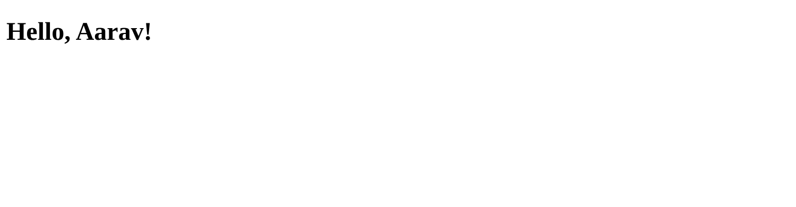

# Lecture 8: Server-Side Rendering with Python

**Course:** Backend Development, Unit 1
**Lecture:** 8, Server-Side Rendering and Templating Engines
**Student:** Krish Pawar · B.Tech CSE · SAP ID 590017543 · UPES Dehradun

**Source:** [`main.py`](https://github.com/Krish252616/backend-development/blob/main/Theory/Lecture-08/ssr-python/main.py) · [`templates/home.html`](https://github.com/Krish252616/backend-development/blob/main/Theory/Lecture-08/ssr-python/templates/home.html)

---

## 1. Aim

To render an HTML page on the server: FastAPI passes data to a Jinja2 template, Jinja2 fills it in, and the browser receives a finished page.

## 2. How it works

```text
Browser  --GET /-->  FastAPI route  -->  Jinja2: template + {"name": "Aarav"}  -->  finished HTML  --200 OK-->  Browser
```

## 3. How to run

```bash
cd Theory
source .venv/bin/activate
cd Lecture-08/ssr-python
uvicorn main:app --reload
```

Open http://127.0.0.1:8000. Running `python main.py` also works and uses the same port, 8000.

| Step | macOS (Terminal, zsh) | Windows |
|---|---|---|
| Activate the venv | `source .venv/bin/activate` | `.venv\Scripts\activate` |
| Go to the project | `cd Lecture-08/ssr-python` | `cd Lecture-08\ssr-python` |
| Run | `uvicorn main:app --reload` | Same |
| View the HTML the server sent | `Cmd + Option + U` in Chrome | `Ctrl + U` in Chrome |

## 4. Code walkthrough

**main.py**

```python
templates = Jinja2Templates(directory="templates")

@app.get("/", response_class=HTMLResponse)
def home(request: Request):
    return templates.TemplateResponse(request, "home.html", {"name": "Aarav"})
```

| Part | Meaning |
|---|---|
| `Jinja2Templates(directory="templates")` | Templates are read from the `templates` folder |
| `response_class=HTMLResponse` | Tells FastAPI and the docs that this route returns HTML, not JSON |
| `TemplateResponse(request, "home.html", {...})` | Renders `home.html` with the given data. `request` comes first |

**templates/home.html**

<pre><code>&lt;h1&gt;Hello, &#123;&#123; name &#125;&#125;!&lt;/h1&gt;
</code></pre>

Jinja2 replaces <code>&#123;&#123; name &#125;&#125;</code> with the value of `name` from the route, so the browser gets `<h1>Hello, Aarav!</h1>`.

## 5. Output



The HTML that reached the browser already contains the name. No JavaScript ran to put it there:

```text
$ curl -i 127.0.0.1:8000/
HTTP/1.1 200 OK
content-type: text/html; charset=utf-8

<!DOCTYPE html>
<html>
<head>
  <title>SSR Demo</title>
</head>
<body>
  <h1>Hello, Aarav!</h1>
</body>
</html>
```

## 6. What I learned

1. In server-side rendering the formula is **template + data = HTML**, and it happens on the server for every request.
2. The way to prove a page is server-rendered is **View Page Source**: the data is already inside the HTML. In a client-side page the same spot would be empty until JavaScript fills it.
3. Jinja2 uses <code>&#123;&#123; &#125;&#125;</code> to print a value, the same job as `<%= %>` in EJS.
4. Jinja2 escapes values by default, so if `name` contained `<script>`, it would be shown as text instead of running.
5. Library versions matter. Code from a tutorial can break when a newer version removes an old way of calling a function.

## 7. Problems I faced and how I fixed them

| Problem | Cause | Fix |
|---|---|---|
| The page returned **500 Internal Server Error**, and the terminal showed `TypeError: unhashable type: 'dict'` | The code used the old call `TemplateResponse("home.html", {"request": request, ...})`. The installed Starlette 1.6 no longer accepts that order | Changed it to the new order: `TemplateResponse(request, "home.html", {"name": "Aarav"})` |
| The page said "Hello, Aarav!" but changing the name in `main.py` did nothing | The template had `Aarav` typed directly into the HTML instead of the placeholder, so the server's data was never used | Replaced the hard-coded name with the Jinja2 placeholder for `name`. Now the page shows whatever the route sends |
| `pip install -r requirements.txt` installed nothing | `requirements.txt` was an empty file | Filled it with `fastapi`, `starlette`, `uvicorn` and `Jinja2` and their versions |
| `Error loading ASGI app. Could not import module "main".` | `uvicorn main:app` looks for `main.py` in the current folder, and I was still in `Theory/` | `cd Lecture-08/ssr-python` first (on Windows Command Prompt: `cd Lecture-08\ssr-python`). This also matters for `directory="templates"`, which is relative to the current folder |

## 8. Result

The route sends `name` to the template and the server returns a complete HTML page with `Hello, Aarav!` already inside it, which confirms server-side rendering.
