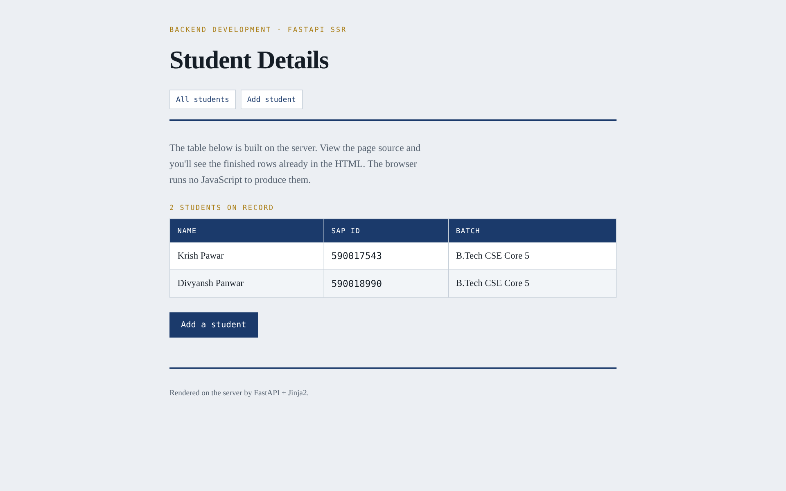
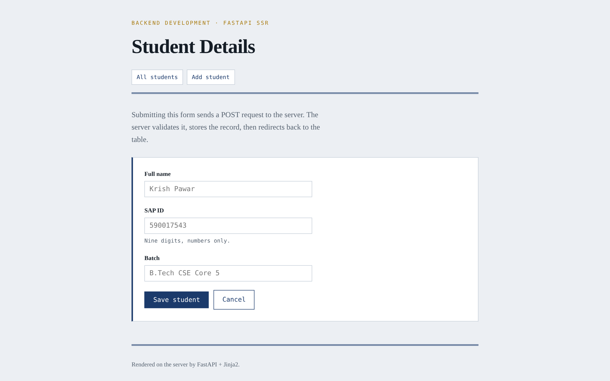
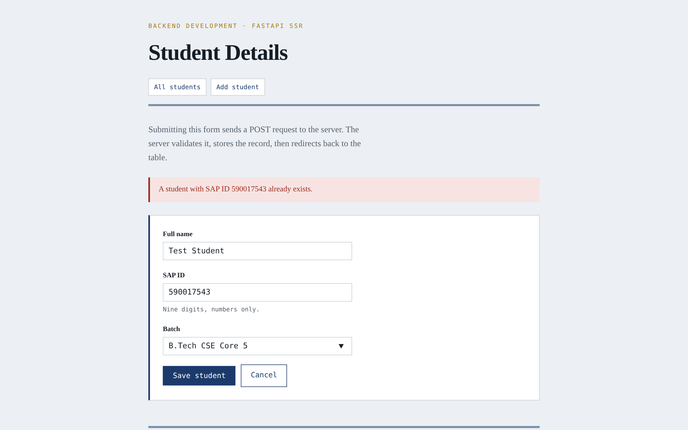
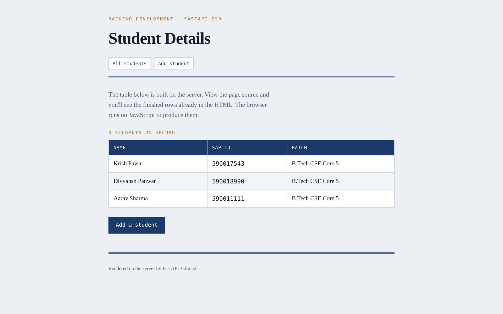

# Lecture 8: Student Details, FastAPI Server-Side Rendering

**Course:** Backend Development, Unit 1
**Lecture:** 8, Server-Side Rendering and Templating Engines
**Student:** Krish Pawar · B.Tech CSE · SAP ID 590017543 · Batch 5 · UPES Dehradun

**Source:** [`main.py`](https://github.com/Krish252616/backend-development/blob/main/Theory/Lecture-08/student-details/main.py) · [`templates/`](https://github.com/Krish252616/backend-development/tree/main/Theory/Lecture-08/student-details/templates) · [`static/style.css`](https://github.com/Krish252616/backend-development/blob/main/Theory/Lecture-08/student-details/static/style.css)

---

## 1. Aim

To build a small FastAPI app that keeps a list of students on the server and uses Jinja2 to turn it into finished HTML pages. A form lets you add students, and the server checks every field before saving.

## 2. Routes

| Method | Route | What it does |
|---|---|---|
| GET | `/` | Student table (same as `/students`) |
| GET | `/students` | Student table |
| GET | `/students/add` | Blank form |
| POST | `/students/add` | Validates the form, saves the student, then redirects to the table |

## 3. How to run

```bash
cd Theory
source .venv/bin/activate          # the venv from Theory/requirements.txt
cd Lecture-08/student-details
uvicorn main:app --reload
```

Open http://127.0.0.1:8000.

| Step | macOS (Terminal, zsh) | Windows |
|---|---|---|
| Create the venv (once) | `python3 -m venv .venv` | `python -m venv .venv` |
| Activate it | `source .venv/bin/activate` | `.venv\Scripts\activate` |
| Install packages | `pip install -r requirements.txt` | Same |
| Run | `uvicorn main:app --reload` | Same |
| View page source | `Cmd + Option + U` in Chrome | `Ctrl + U` in Chrome |

## 4. Structure

```
student-details/
├── main.py                 FastAPI app and routes
├── report.md               this report
├── requirements.txt
├── templates/
│   ├── base.html           shared layout (header, nav, footer)
│   ├── students.html       the table
│   └── add_student.html    the form
└── static/
    └── style.css
```

## 5. How the rendering works

1. `Jinja2Templates(directory="templates")` tells FastAPI where the templates are, and `app.mount("/static", StaticFiles(directory="static"))` serves the CSS.
2. A route returns `templates.TemplateResponse(request=request, name="students.html", context={"students": students})`.
3. Jinja2 fills the template with the data, and FastAPI sends the result as `text/html`.

**Template inheritance.** `base.html` holds the header, navigation and footer once. The other pages only fill in the content block:

<pre><code>&#123;% extends "base.html" %&#125;

&#123;% block content %&#125;
  ... page content ...
&#123;% endblock %&#125;
</code></pre>

**Loop with an empty case.** In Jinja2, the `else` part of a `for` loop runs when the list is empty:

<pre><code>&#123;% for student in students %&#125;
  &lt;tr&gt;
    &lt;td&gt;&#123;&#123; student.name &#125;&#125;&lt;/td&gt;
    &lt;td class="mono"&gt;&#123;&#123; student.sap_id &#125;&#125;&lt;/td&gt;
    &lt;td&gt;&#123;&#123; student.batch &#125;&#125;&lt;/td&gt;
  &lt;/tr&gt;
&#123;% else %&#125;
  &lt;tr&gt;&lt;td colspan="3"&gt;No student details available yet.&lt;/td&gt;&lt;/tr&gt;
&#123;% endfor %&#125;
</code></pre>

**Stylesheet link.** `request` must be passed to the template because Starlette (the toolkit FastAPI is built on) uses it to build links:

<pre><code>&lt;link rel="stylesheet" href="&#123;&#123; url_for('static', path='/style.css') &#125;&#125;"&gt;
</code></pre>

## 6. Validation

The form uses `required` and `pattern="[0-9]{9}"`, but browser checks can be skipped (for example with curl or Postman), so `main.py` checks every field again:

| Check | Error shown |
|---|---|
| Any field empty | All three fields are required. |
| SAP ID not exactly 9 digits | SAP ID must be exactly 9 digits. |
| SAP ID already in the list | A student with SAP ID ... already exists. |

On an error, the form is shown again with the message, and the values already typed are kept.

**Post, redirect, get.** After a successful save, the server answers `303 See Other` and sends the browser to `/students`:

```text
$ curl -i -X POST 127.0.0.1:8000/students/add -d name=Aarav+Sharma -d sap_id=590011111 -d batch=B.Tech
HTTP/1.1 303 See Other
location: /students
```

Because the last request is a GET, refreshing the page does not submit the form again.

## 7. Output

**1. Student table**



**2. Add student form**



**3. Server-side validation:** an SAP ID that is already in the list is rejected, and the typed values stay in the form



**4. After adding a student:** the server redirected back to the table, which now has one more row



**Proof that it is server-side rendering:** the rows are already inside the HTML the server sends.

```text
$ curl -s 127.0.0.1:8000/students
...
    <tbody>
      <tr>
        <td>Krish Pawar</td>
        <td class="mono">590017543</td>
...
```

## 8. What I learned

1. A template engine lets me write the page once and fill it with different data on every request.
2. Template inheritance (`extends` and `block`) removes repeated HTML: the header and footer live in one file.
3. Reading form data in FastAPI needs `Form(...)` and the `python-multipart` package. JSON bodies use Pydantic models instead.
4. Browser validation is only for convenience. The server must check everything again, because anyone can send a request without the browser.
5. Redirecting after a POST (status `303`) stops the "resubmit form?" problem when the user refreshes.
6. `url_for()` builds the correct link to static files, so the CSS still loads if the app is moved to another path.

## 9. Problems I faced and how I fixed them

| Problem | Cause | Fix |
|---|---|---|
| The app would not start: `RuntimeError: Form data requires "python-multipart" to be installed.` | FastAPI needs `python-multipart` to read form fields, and it was missing from `Theory/requirements.txt` | Added `python-multipart==0.0.32` to `Theory/requirements.txt` (this project's own `requirements.txt` already had it) |
| Typing a 5-digit SAP ID in the browser showed a browser message instead of my server message | The `pattern="[0-9]{9}"` attribute stops the form before it is sent | Correct behaviour. To test the server check, I submitted an SAP ID that is 9 digits but already exists, or sent the request with curl |
| Refreshing after adding a student asked to resubmit the form | The last request was a POST | Redirect with `303 See Other` to `/students`, so the last request is a GET |
| New students disappeared after restarting the server | The list is stored in memory | Expected in this demo. A database would keep the data |
| On macOS, `python` was not found when creating the venv | macOS uses `python3` | Used `python3 -m venv .venv`. Inside the venv, `python` works |

## 10. Result

The table and the form are rendered on the server with Jinja2, shared layout comes from `base.html`, every form field is validated on the server, and a successful save redirects back to the updated table.
